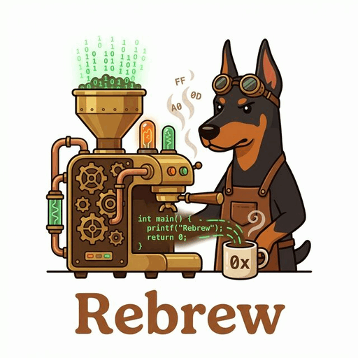

<p align="center">
  
</p>

# Rebrew

Rebrew is a decompilation workbench for binary-matching game reversing. Write
C, compile it with the target's compiler, and compare the output against the
original binary one function at a time.

The `rebrew` CLI handles function discovery, byte diffs, flag sweeps and genetic
search, library identification, and progress tracking. It also supports data
layout checks, Ghidra and BinSync, and symbol exports. See the
[documentation index](https://github.com/maci0/rebrew/blob/main/docs/README.md).

## Quick Start

Install [uv](https://docs.astral.sh/uv/getting-started/installation/) and use
Python 3.15+. For the standard local setup, use Linux x86_64 with Docker or
Podman. Installation builds the `python-flirt` dependency and requires Rust
(`cargo` and `rustc`). See [toolchain support](https://github.com/maci0/rebrew/blob/main/docs/TOOLCHAIN.md).

Download a wheel from [GitHub Releases](https://github.com/maci0/rebrew/releases)
and install it from the download directory:

```bash
uv tool install ./rebrew-*.whl
```

To install from the source repository instead:

```bash
uv tool install git+https://github.com/maci0/rebrew.git
```

From an empty project directory, onboard your binary and run the setup checks:

```bash
rebrew intake /path/to/game.exe
rebrew doctor
rebrew todo
```

A fresh setup may report a missing compiler image. Prepare the image and
rerun `doctor` before matching. Follow the
[first-binary walkthrough](https://github.com/maci0/rebrew/blob/main/docs/GETTING_STARTED.md)
or use the [manual setup guide](https://github.com/maci0/rebrew/blob/main/docs/ONBOARDING.md).

### Optional features

Symbolic proving uses the `prove` extra. If you already installed Rebrew, add
it from the same source. For a downloaded wheel, replace the path below
with the full path to that wheel:

```bash
uv tool install --reinstall "rebrew[prove] @ /path/to/rebrew-X.Y.Z-py3-none-any.whl"
```

For a Git installation:

```bash
uv tool install --reinstall 'rebrew[prove] @ git+https://github.com/maci0/rebrew.git'
```

Use `rebrew[binsync]` for BinSync, or `rebrew[prove,binsync]` for both. On Python
3.15, BinSync's JPype dependency builds from source and needs a JDK, Apache Ant,
and C build tools. See [BinSync setup](https://github.com/maci0/rebrew/blob/main/docs/BINSYNC_INTEGRATION.md).

## Development

Follow the [contributor bootstrap](https://github.com/maci0/rebrew/blob/main/CONTRIBUTING.md#bootstrap-clean-clone)
for the pinned sibling `resembl` checkout (`v5.4.0`) and host tools. Run `make help` for
contributor targets.

Rebrew distributes wheels and source archives through GitHub Releases. The
maintained `python-flirt` binding also publishes native wheels for qualified
CPython 3.15 hosts (Linux glibc, macOS ARM64, Windows AMD64). A fixed-platform
project managed by uv can pin a release wheel in `tool.uv.override-dependencies`
after verifying its hash. See the [binding release](https://github.com/maci0/lancelot/releases/tag/python-flirt-v0.10.2-relumea.1).

## License

MIT. Dependency grants and required notices are recorded alongside the
[license](https://github.com/maci0/rebrew/blob/main/LICENSE) in
[NOTICE](https://github.com/maci0/rebrew/blob/main/NOTICE).
