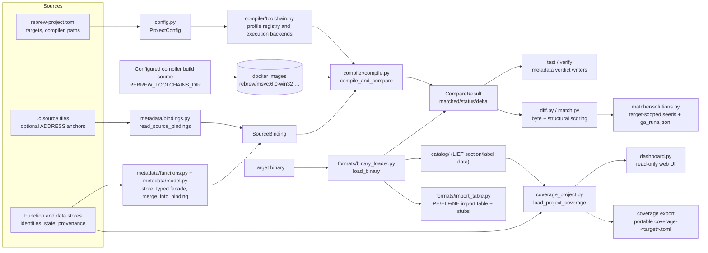

# Rebrew Architecture

Rebrew joins C source to native function identities, compiles with the
selected profile, and compares the result against the target binary. The
verifier records byte verdicts and the matcher uses comparison scores to
search for better candidates.

## Ecosystem

See [ecosystem integrations](ECOSYSTEM.md) for public interfaces and how
Rebrew uses Resembl. Open [architecture.drawio](architecture.drawio) in
diagrams.net for detailed compile, matching, configuration, and metadata flows.

## High-level data flow

## Module map

Paths below are under `src/rebrew/`.

| Area | Start here |
| --- | --- |
| CLI | `app/main.py` mounts the commands declared in `app/builtins.py`. `app/plugin.py` handles component activation. `cli.py` holds shared options, output, and exit codes. |
| Configuration and sources | `workspace/` resolves the project root and target. `config.py` builds `ProjectConfig`. `sources.py` discovers source files and resolves metadata paths. |
| Binary analysis | `formats/` parses binaries, objects, and archives. `discover.py` builds function inventories. `decompiler.py` selects a decompiler. |
| Metadata | `metadata/bindings.py` joins source addresses and stored identities. `metadata/functions.py` and `metadata/data.py` own domain fields and writes. `metadata/storage.py` selects TOML, SQLite, or PostgreSQL. `metadata/replication.py` coordinates replicas. |
| Compilation | `compiler/toolchain.py` resolves profiles and images. `compiler/compile.py` compiles, extracts, and compares. `compiler/cache.py` owns object cache keys. `compiler/recompile_client.py` handles the remote backend. |
| Matching and diagnosis | `matcher/` implements scoring, flag sweeps, mutations, and history. `coff_reloc.py` compares with relocation awareness. `near_analysis.py` and `stack_analysis.py` explain differences. `prove.py` runs symbolic checks. |
| Library identification | `flirt.py` matches signatures, `crt_match.py` matches against CRT source evidence, and `identify_library.py` records library identities. |
| Verification and coverage | `verify.py` coordinates batch checks. `catalog/` builds the function registry. `coverage_project.py` supplies live views to `dashboard.py`. `build_db.py` implements portable exports through `coverage_db.write_coverage`. |
| Synchronization | `binsync/` owns field exchange, reconciliation, and Git-backed state. `ghidra/` provides the `sync` CLI and live structural operations. |
| Extensions | `registry.py` discovers entry-point plugins. `skills.py` resolves packaged and overlaid skills. |

For subpackage boundaries, see each subpackage's `AGENTS.md`. For public entry
points and exception types, see the [Python API](PYTHON_API.md).

## Which similarity tool

The seven surfaces below answer different similarity questions. The last
row identifies libraries rather than scoring similarity. Check these
boundaries before adding another surface.

| Surface | Answers | Input and cost |
|---|---|---|
| `similar.py` | which functions in this target rank closest to this one | this target, mnemonic histogram, linear per candidate |
| `similar.py --submatch` (`instruction_clones.find_common_runs`) | where inside these two functions do they correspond | two functions, exact longest common runs, quadratic in the pair |
| `similar.py --cluster` (`instruction_clones.cluster_units`) | which functions are identical after normalization | this target, one hash per function, linear in total instructions |
| `binary_similarity.py` | how alike are two whole binaries (versions, DLL vs EXE) | two images, section and structural summary |
| `cfg_ged.py` | how alike are two control-flow graphs | per function pair, block-graph edit distance |
| `matcher/scoring.py` → `resembl.scoring` | which stored snippets resemble this query | a persisted cross-project corpus, approximate (MinHash + LSH) |
| `crt_match.py` / `flirt.py` / `identify_library.py` | is this function library code, and from which archive | signature and archive matching, not a similarity score |

The boundary that matters is the last two rows against `instruction_clones`: in-process,
exact, no persistence, one target (instruction_clones) versus a persisted corpus with
approximate near-neighbour search across projects (`resembl`). A request for
cross-project duplicate detection, a fragment query against a snippet library,
or near-duplicate clustering belongs on `resembl`, which rebrew already reuses
for the whole-function score; growing an index or a MinHash inside rebrew
would be a second answer to that question. See
[ECOSYSTEM.md](ECOSYSTEM.md#resembl-assembly-similarity-search).

## The compile → compare → STATUS/BLOCKER loop

1. `read_source_bindings()` joins source declarations and optional ADDRESS
   anchors to canonical metadata.
2. `compile_and_compare()` builds the selected source, extracts the function,
   and compares it with the original bytes. It returns a `CompareResult`.
3. `test` and `verify` persist accepted results through the verdict writers.
   Blocker commands use the ordinary metadata field writers.

See [compile backends](TOOLCHAIN.md#compile-backends) for execution and
[metadata ownership](METADATA.md#who-owns-which-fact) for the writer contract.

## Metadata routing and provenance

[`metadata/functions.py`](../src/rebrew/metadata/functions.py) owns `METADATA_FIELD_TYPES`,
`METADATA_FIELDS`, and `SYNC_FIELD_RULES`. The typed facade, data-field schemas,
linter, and integration projections reuse those definitions. Keep field shapes
and native sync permissions there rather than copying catalogs into callers.

[METADATA_FORMAT.md](METADATA_FORMAT.md) defines durable identity and field
rules; [METADATA.md](METADATA.md) owns canonical/derived/cache tiers and the
separate ordinary edit stamps, imported origins, and verification evidence.
[BINSYNC_INTEGRATION.md](BINSYNC_INTEGRATION.md) specifies field reconciliation,
manifest freshness, deletion handling, and the per-file atomicity boundary.

Status/todo reuse one accounting frame. Coverage documents and grids are derived
views; their cell/symbol counts do not replace the disjoint byte buckets in
[status accounting](CLI.md#rebrew-status).

## Composition guarantees

The [Cordis guide](CORDIS.md) owns component lifecycle and API contracts,
the [paper mapping and limits](CORDIS.md#paper-contracts-and-limits), and
component-author recipes. Its [tutorial](CORDIS_TUTORIAL.md) demonstrates
dependency-driven activation and provider replacement with executable checks.
Registry publication has its own [snapshot contract](DEVELOPMENT.md#registry-snapshots).

## Key architectural rules

Project commands resolve settings through the project config. Standalone
inspection can take an explicit artifact. Source discovery uses `iter_sources`
and batch metadata binding uses `iter_source_bindings`. Coverage views read
live inputs or explicitly selected snapshots. See [repository rules](../AGENTS.md)
for import direction, registry publication, and metadata writes.
