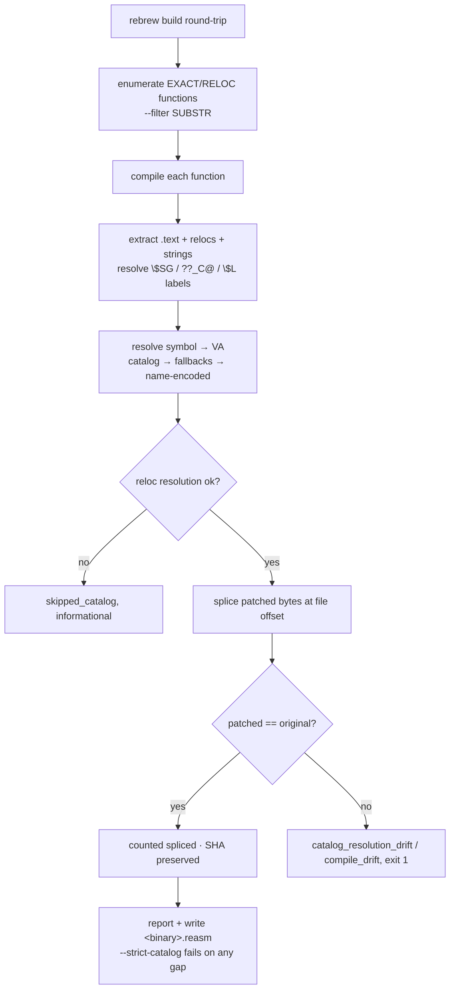

# CLI Reference

The CLI exposes 226 surfaces: 194 leaf commands and 32 groups, including the
root. They are registered under the unified `rebrew` entry point in `app/main.py`
(`CliComponent` rows in `app/builtins.py`).
Only `rebrew` is installed. Invoke tools as subcommands:
`rebrew status`, `rebrew test`, `rebrew binsync push`, and so on. The old
`rebrew-<command>` executables are removed; reinstall or upgrade Rebrew to
remove them from your environment. CMake uses
`rebrew build driver <cl|link|lib> -- <arguments>` and objdiff uses
`rebrew build objdiff-driver <target> <base-object>`. Compiler flags after `--` pass
through unchanged. Regenerate CMake toolchains and objdiff configurations
when upgrading from the separate executable hooks.
See [ADR 027](adr/027-build-hooks-under-umbrella.md).

Most tools support `--target / -t` to select a target from `rebrew-project.toml` and
read defaults (binary path, reversed_dir, compiler settings) from the project config.
A final `--target` lists configured targets without running the command.
The listing uses that command's output choice. `rebrew status --target` is
text. `rebrew status --json --target` and `rebrew -o json test --target` print
`{"targets","default_target"}` on stdout. `-o text` before the command wins
over `--json`. With no selection flag, the command uses the project default
target.
Commands that inspect standalone artifacts can accept an input path without
project selection; each command's help lists its accepted inputs and defaults.
`rebrew init` and `rebrew intake` use `--target/-t` to name the target being
created, rather than selecting an existing target.

Run any tool with `--help` or `-h` for inputs, defaults, examples, and write/preview
behavior. Help separates project selection, output, and shared logging options;
command-specific panels remain available for larger workflows.

`--version/-V`, `--verbose/-v` (repeatable) and `--quiet/-q` are shared options:
`rebrew.cli.add_global_options` injects them into every command,
so they parse after the subcommand name as well
as before it (`rebrew -vv diff` and `rebrew diff -vv` agree).  A tool that
declares one of these flags itself keeps its own meaning: `rebrew lint --quiet`
still means "errors only", not "logs at warning".  `REBREW_LOG_LEVEL` sets the
level when neither flag is given. `--json` is not one of these shared flags.
Each command that prints JSON declares `--json` itself. `rebrew --json <command>`
exits 2. `rebrew -o json <command>` and `rebrew <command> --json` select JSON.

New to rebrew?  Start with the [first-run walkthrough](ONBOARDING.md)
(`rebrew init` → `rebrew intake` → `rebrew doctor` in ~5 minutes).

## Typical Workflow

```
rebrew todo              See what needs work (prioritized by ROI)
rebrew skeleton 0x<VA>   Generate a .c skeleton from address
rebrew test src/<func>.c Compile, byte-compare, and auto-update STATUS
rebrew diff src/f.c      Show byte diff for near-misses
rebrew verify            Bulk-verify all reversed functions
```

## test vs verify vs match

| Command | Scope | Caching | Use when |
|---------|-------|---------|----------|
| `rebrew test <file>` | Single function | No | Iterating on one function |
| `rebrew test --all` | Batch (all files) | No | Verify's engine, always recompiles |
| `rebrew verify` | Batch (incremental) | Yes | CI / bulk status check (`--compare` regression baseline; `rebrew match batch` finds matches, `rebrew verify --no-cache` recompiles the selected functions, `--no-promote` measures without writing) |
| `rebrew match run <file>` | Single function | No | GA engine to find byte-perfect match |

## Selection flags

These flags name different axes.

| Flag | Selects |
|------|---------|
| `--all` | Every eligible item in the selected target. Omit the subject argument. `test --all` rejects `--cflags`, `--toolchain`, `--size`, `--va`, `--symbol`, and `--target-bin` (exit 2). `--dir`, `--module`, and `--jobs` require `--all`. |
| `--target NAME` | One configured target. |
| `--all-targets` | Every configured target. Each target keeps that command's own item selection. |
| `--source-targets` | Every target bound to one source file. Excludes `--target` and `--all-targets`. |
| `--no-cache` | On `verify` only: recompile the functions already selected. `verify` already covers every function. `test --all` always recompiles. |

`source rename --all-modules` renames every module's rows of one definition.

Byte-match ladder (best → worst): `EXACT` → `RELOC` → `NEAR_MATCHING` → `STUB`.
`PROVEN` is a side path: semantic equivalence via `rebrew prove` when bytes still
differ. It is not a byte match: the next test/verify records the byte result
over it.

Root help summarizes this workflow; command help documents each operation in detail.

## Exit Codes

Every `rebrew <cmd>` invocation uses the same exit contract, enforced by
`rebrew.cli.run_cli`:

| Code | Meaning |
|------|---------|
| 0 | Success (all functions matched / no errors) |
| 1 | Mismatch or test failure: fix your code |
| 2 | Build error, config error, or usage error (bad flag or argument) |
| 130 | Interrupted (Ctrl+C) |
| 141 | stdout closed early: `rebrew … \| head`, or the reader exited |

A tool's own `--help` may document a narrower set (a read-only tool never
returns 1); the table above is the ceiling, not a promise that every tool uses
every code.

Status messages, progress, warnings, and errors go to **stderr**; only
`--json` documents (and piped data like `rebrew cfg show`) go to **stdout**.
`rebrew <cmd> --json` writes one JSON document to stdout. `--json` is
per-command: placing it before the command name exits 2. A pipe stays text
unless `--json` or `-o json` is set. `-o` / `--output` before the subcommand
selects `auto`, `text`, or `json`; `auto` stays text, and a command's own
`-o` is still a destination path. In JSON mode the last stderr line of a
failure is `{"error":{"kind","message","hint"}}`. Exit 1 is a mismatch
outcome, not an error kind: the report stays on stdout.
A confirmation prompt rejects non-terminal stdin before reading it.
`cache clear`, `cfg target remove`, `cfg module remove`,
`coverage catalog --fix-sizes`, `source merge`, and `source split` need a
terminal or `--force`. A piped answer does not approve. The refusal exits 2.
In JSON mode the kind is `confirmation_required`, and those writes require
`--force` instead of prompting.
`rebrew schema` prints the clispec 0.3 document with no project and no network.
Continuous watch modes are terminal-only. `--watch --json` is rejected.
`sync watch` has no `--json` option. `rebrew -o json sync watch` exits 2
before export or the watch loop. For one structured result, use `sync push --json`.
For example,
`rebrew verify --json | jq` and `rebrew test src/f.c --json | python -c 'import json,sys; json.load(sys.stdin)'`
work without a `--quiet` flag.

The 141 code matters in pipelines: a reader that exits early
(`rebrew verify --json | head -20`) must not look like a verification failure
(1) to the calling shell. Python's default for a broken pipe at interpreter
exit is 120, and click's is 1; `run_cli` overrides both.

## Entry Points

The 34 root entries lead to the daily workflow and focused domain scopes.
Counts include each entry's landing page and all of its nested operations;
the root adds one surface to the 225 listed here. Each operation below has a
reference section with its current arguments, options, and defaults.

| Entry | Surfaces | Purpose |
| --- | ---: | --- |
| [`rebrew test`](#rebrew-test) | 1 | Compile-and-compare for reversed functions (auto-updates STATUS by default). |
| [`rebrew verify`](#rebrew-verify) | 1 | Rebrew verification pipeline: compile each .c and verify bytes match. |
| [`rebrew skeleton`](#rebrew-skeleton) | 1 | Generate .c skeleton files for uncovered functions in the target binary. |
| [`rebrew lint`](#rebrew-lint) | 1 | Check C source bindings, metadata, and project conventions. |
| [`rebrew decompile`](#rebrew-decompile) | 1 | Decompile a function, optionally applying known struct names. |
| [`rebrew diff`](#rebrew-diff) | 1 | Compile and diff a reversed function against the target binary. |
| [`rebrew init`](#rebrew-init) | 1 | Initialize a new rebrew project directory. |
| [`rebrew intake`](#rebrew-intake) | 1 | One-shot binary onboarding: init + detect + functions + document. |
| [`rebrew status`](#rebrew-status) | 1 | At-a-glance reversing progress overview. |
| [`rebrew todo`](#rebrew-todo) | 1 | Prioritized action list: what to work on next for highest ROI. |
| [`rebrew doctor`](#rebrew-doctor) | 1 | Diagnostic checks for rebrew project health. |
| [`rebrew schema`](#rebrew-schema) | 1 | Print the clispec 0.3 JSON document for this CLI. |
| [`rebrew prove`](#rebrew-prove) | 1 | Prove semantic equivalence of NEAR_MATCHING/SIZE_MISMATCH functions via symbolic execution. |
| [`rebrew recommend`](#rebrew-recommend) | 1 | Deterministic project advice: TU layout, hygiene, next steps. |
| [`rebrew sync`](#rebrew-sync) | 8 | Exchange metadata with Ghidra through BinSync and perform structural operations. |
| [`rebrew data`](#rebrew-data) | 17 | Inspect global data, edit metadata, and generate declarations and layout repairs. |
| [`rebrew metadata`](#rebrew-metadata) | 1 | Preview and apply a managed-metadata backend transfer. |
| [`rebrew blocker`](#rebrew-blocker) | 4 | Record, inspect, and clear function blockers in dedicated metadata. |
| [`rebrew orphans`](#rebrew-orphans) | 4 | List or prune metadata rows without a live source binding. |
| [`rebrew types`](#rebrew-types) | 7 | Manage type identities; check layouts; apply types to C signatures. |
| [`rebrew cfg`](#rebrew-cfg) | 18 | Read and edit rebrew-project.toml programmatically. |
| [`rebrew cache`](#rebrew-cache) | 3 | Manage the compile result cache (.rebrew/compile_cache/). |
| [`rebrew skills`](#rebrew-skills) | 3 | Discover and display agent skills bundled with rebrew. |
| [`rebrew library`](#rebrew-library) | 15 | Identify libraries, compare code, and manage source providers and compiler settings. |
| [`rebrew toolchain`](#rebrew-toolchain) | 11 | Manage compiler profiles and Docker images for shipped toolchains. |
| [`rebrew binsync`](#rebrew-binsync) | 9 | Synchronize Git-backed state or exchange raw BinSync artifacts. |
| [`rebrew source`](#rebrew-source) | 23 | Organize, import, and inspect C sources. |
| [`rebrew build`](#rebrew-build) | 24 | Generate build inputs and inspect linked artifacts. |
| [`rebrew diagnose`](#rebrew-diagnose) | 7 | Explain compiler configuration and locate byte mismatches. |
| [`rebrew binary`](#rebrew-binary) | 31 | Inspect binaries and extract functions or resources. |
| [`rebrew coverage`](#rebrew-coverage) | 6 | Inspect live coverage, manage portable exports/history, and serve reports. |
| [`rebrew match`](#rebrew-match) | 10 | Search source mutations, compiler flags, and toolchains for byte matches. |
| [`rebrew similarity`](#rebrew-similarity) | 3 | Compare function structure within or between binaries. |
| [`rebrew dev`](#rebrew-dev) | 2 | Inspect the Python repository for contributor maintenance. |
| [`rebrew export`](#rebrew-export) | 6 | Generate exchange artifacts or upload a decomp.me scratch. |

## Component Registration (Plugins)

Rebrew's component registries (every group in the table below) accept
registrations from outside the host source tree (see
`src/rebrew/registry.py`).  The packaged built-ins form the base registry;
discovered components merge on top.  Conflict and failure policy per group:

- `rebrew.toolchains`: a duplicate name or a registration that fails to
  load raises `RegistryError` (fields `group`, `name`, `origin`); a wrong
  compiler produces wrong bytes.
- `rebrew.commands` / `rebrew.multicommands`: a name already used by a
  built-in or another CLI plugin is ignored with a warning. Malformed
  declarations are skipped with a logged warning; import or export-shape
  failures mount an unavailable stub (exit 2).
- `rebrew.flag_sets`, `rebrew.library_presets`, `rebrew.msvc_versions`:
  tuning data; a later source extends or overrides by name.
- Every other group: a broken or duplicate registration is skipped with a
  logged warning, so one bad plugin cannot disable the host module.

| Component | Entry-point group | Registration shape |
|-----------|-------------------|--------------------|
| Toolchain | `rebrew.toolchains` | `module:attr`: a zero-arg callable returning `dict[str, ToolchainSpec]` |
| Decompiler backend | `rebrew.decompiler_backends` | `module:attr`: `fn(binary, va, root, **kwargs) -> str \| None`; selectable by name, and joins the `auto` backend probe order (`skeleton --decompiler auto`) when the callable carries `__rebrew_auto_probe__ = True` |
| CLI single command | `rebrew.commands` | `module` (uses `main`/`app` help, like built-ins) or `module:callable` |
| CLI multi-command group | `rebrew.multicommands` | `module` (uses `module.app`) or `module:app`; the app must be a `typer.Typer` |
| GA mutation | `rebrew.mutations` | `module:attr`: `(source, rng) -> str \| None`; `None` or an exception counts as a failed attempt (an exception is warned once per process) |
| Sweep flag set | `rebrew.flag_sets` | `module:attr`: zero-arg callable returning `dict[profile, (Flags, tiers)]`; tuning data: may override a packaged profile's axes |
| Library preset | `rebrew.library_presets` | `module:attr`: zero-arg callable returning `dict[name, {toolchain, cflags}]`; tuning data: may override a packaged preset |
| Detection alignment | `rebrew.toolchain_detectors` | `module:attr`: zero-arg callable returning `dict[family, list[profile]]`; lets a plugin toolchain align with a detected family (or open an un-matchable one) |
| Binary family detector | `rebrew.binary_detectors` | `module:attr`: `(path) -> ToolchainInfo \| None`; runs when the packaged backends (DIE/PDB/PE-meta/heuristics) leave the family unknown, so a novel compiler is detectable end-to-end (`detected_by` = `plugin-<name>`) |
| Binary loader | `rebrew.binary_loaders` | `module:attr`: `(path, fmt) -> BinaryInfo \| None`; runs when LIEF cannot parse the file, so a novel container format can be loaded |
| MSVC version table | `rebrew.msvc_versions` | `module:attr`: zero-arg callable returning `dict["build:<n>" \| "linker:<M>.<m>", list[profile]]`; a plugin MSVC-derivative declares which exact builds it byte-matches, joining the version-exact `suggested_profiles` (union per key) |
| Compile-cache backend | `rebrew.cache_backends` | `module:attr`: factory `(cache_dir, size_limit) -> CacheBackend` (get/put/volume/count/clear/close/stats; `stats()` must carry `entries`, `volume_mib`, `size_limit_mib`, the `session_*` counters are optional); selected via `[cache] backend` in `rebrew-project.toml`; the keying semantics are shared and not pluggable |
| Metadata backend | `rebrew.metadata_backends` | `module:attr`: zero-arg provider returning `dict[name, factory]`; each factory `(logical_path, project_root) -> MetadataStore` implements `metadata.storage.MetadataStore`. Selected project-wide through `[metadata].backend`; domain validation and verdict ownership are shared. |
| Function discoverer | `rebrew.discoverers` | `module:attr`: `(binary: Path) -> list[(va, size, name)]`; merged into `rebrew binary functions` by entry-point name; return `[]` when nothing is found (a raise, or anything but a list of `(int >= 0, int >= 0, str)` tuples, is skipped with a warning) |

CLI tools (packaged and third-party) mount through `rebrew.app.plugin`.
`main.compose()` provides the `cli` and `console` services, then
`activate()` registers every `CliComponent` on a `CoeffectScope`.
Composition runs at `rebrew.app.main` import, and the module keeps the
context and scope (`_COMPOSED`) for the process lifetime: nothing
unmounts before interpreter exit, and there is no hot-reload. See
[ADR 014](adr/014-component-composition.md).
The [Cordis guide](CORDIS.md) owns dependency, ownership, failure, and
teardown contracts; the [tutorial](CORDIS_TUTORIAL.md) runs them end to end.

A CLI plugin whose module cannot be imported degrades to a stub command that
reports the missing dependency (exit 2), the same fallback built-ins get
when an optional dependency is absent.

Project-local toolchains (not packaged) declare themselves as TOML files in
the directory named by `REBREW_TOOLCHAIN_OVERLAY_DIR`; each file is one or
more `name = { … }` tables of `ToolchainSpec` fields:

```toml
# mytoolchain.toml
[mytc]
image = "rebrew/custom:1.0-win32"
binary = "mycc"
flags_style = "posix"
obj_ext = ".o"
```

Unknown spec fields in an overlay file are a declaration error, and a name
that collides with a packaged toolchain raises `RegistryError`.  A spec may
declare `bits = 16` (or `32`/`64`): the arch-alignment check then treats a
16-bit toolchain as valid on x86_16 DOS/NE targets instead of flagging it as
a 32/64-bit compiler.

Community/user agent skills extend the packaged `agent-skills/` tree through
the `REBREW_SKILLS_DIR` environment variable: a directory of SKILL.md
directories merged over the packaged set (a user skill with the same name
wins; unset means packaged-only).  Drop skill directories into that dir by
hand (or check them out of version control): no install/remove commands;
copying a directory needs no CLI.  `rebrew skills list`
marks user skills (`origin` in JSON, a `(user)` suffix in the table), and
`rebrew init` renders both the packaged and the community skills into a
project's `.agents/skills/` (same override semantics).  A missing
`REBREW_SKILLS_DIR` path warns once instead of silently disabling community
skills.

## Command Reference

Tables below list command-specific parameters, accepted input types, defaults,
and meaning. The shared version, logging, and help flags are documented above
and remain available at every depth. A dash in Default means no explicit
value; the Meaning column explains configuration-derived defaults.

`--fix-sizes` uses evidence specific to each operation: `test` accepts a compiled
size only when all common bytes match, `verify` records binary-derived extents,
and `coverage catalog` writes canonical registry sizes with confirmation
(`--json` or a non-terminal stdin requires `--force`; a piped answer does not
approve). `--module` filters metadata modules in batch
`test`, `verify`, and `build order-sources`; it is unrelated to provenance.
`verify --skip-libraries` excludes library-attributed rows.

## Daily workflow

### `rebrew test`

`rebrew test [OPTIONS] [SOURCE]`

`rebrew test <file.c> [--va 0xHEX] [--symbol NAME] [--size N]` tests one
function. On a multi-function file, `--va` selects the metadata binding at that VA
(symbol and fallback size come from it); pass `--symbol` too to override the
symbol explicitly. With no `--va`/`--symbol`/`--size`, every bound
function in the file is tested.  A resolved size and any explicit `--cflags`
override are persisted to `rebrew-functions.toml` alongside STATUS, so
`rebrew diff` / `rebrew diagnose near` can resolve them later without re-supplying
them, and `rebrew verify` recompiles with the flags that produced the match.

When the source has a CMake per-file pin (a `flags.make` `Custom` comment with
`/REBREW_TOOLCHAIN:...` + `COMPILE_FLAGS`) and the metadata names no compiler
or flags, `test` compiles with the pin (the shipped link's flags) instead of
the project default.  `--cflags` on such a file is a loud error rather than a
silent metadata write that the build never honors.

`rebrew test --all` exits 2 when combined with `--cflags`, `--toolchain`, `--size`,
`--va`, `--symbol`, or `--target-bin`. Those flags select one function.
`--dir`, `--module`, and `--jobs` require `--all` and exit 2 without it.

| Argument or option | Type | Default | Meaning |
| --- | --- | --- | --- |
| `SOURCE` | str | — | Source file, symbol name, or VA (hex) (omit with --all) |
| `--va` | str | — | Target VA in hex (default: from metadata). Excludes --all |
| `--symbol` | str | — | Compiled symbol name (default: from metadata or source definition). Excludes --all |
| `--target-bin` | path | — | Raw function byte slice to compare against. Excludes --all |
| `--size` | int | — | Size in bytes. Excludes --all |
| `--cflags` | str | — | Compiler flags. Excludes --all |
| `--toolchain` | str | — | Compiler profile (e.g. msvc-5.0); overrides the project default. Excludes --all |
| `--all` | flag | `False` | Every reversed .c file in the selected target. Does not select other targets. |
| `--dir` | path | — | Restrict to this subdirectory of reversed_dir. Requires --all (exit 2 without it) |
| `--module` | str | — | Restrict to one module (e.g. GAME). Requires --all (exit 2 without it) |
| `--jobs` / `-j` | int | — | Parallel jobs (default: project.jobs, or 4). Requires --all (exit 2 without it) |
| `--no-promote` | flag | `False` | Measure without metadata writes. Otherwise records STATUS and explicit --cflags/--toolchain/--size overrides for future runs. Use this when trying candidate settings |
| `--force-status` | flag | `False` | Write the STATUS even where the promotion policy refuses it: unpark a SKIP function or replace a STUB with SIZE_MISMATCH (single-function only) |
| `--fix-sizes` | flag | `False` | Fix stale SIZE metadata when all common bytes match: writes the compiled size into metadata and reclassifies as EXACT/RELOC.  No-op when the mismatch is a real byte difference |
| `--linked` | flag | `False` | Compare linker-resolved bytes in a padded shell; requires a VA; excludes --all, --context, and --fix-sizes |
| `--watch` | flag | `False` | Watch the source file and re-test on every change (terminal only; no --json) |
| `--context` | path | — | C declarations to compile with the source (e.g. 'rebrew export context' output); the result records the context hash it was earned under |
| `--dry-run` | flag | `False` | Preview changes without writing |
| `--json` | flag | `False` | Output results as JSON |
| `--target` / `-t` | str | — | Target name from rebrew-project.toml (default: project default target); a final --target lists targets. |
| `--all-targets` | flag | `False` | Repeat this command for every configured target. Does not change which items each target selects. Excludes --target. |
| `--source-targets` | flag | `False` | Repeat this command for every target bound to the given source file. Unbound targets are skipped. Excludes --target and --all-targets. |

With `--source-targets`, SOURCE must be an existing path relative to the current
directory (or absolute). Target bindings are preflighted before compilation;
unbound targets have a `skipped` reason, invalid targets have an `error`, and
remaining targets still run. A wholly unbound scope exits 1. This excludes
`--target`, `--all-targets`, batch filters, watch/linked mode and target-pinned
VA/symbol/size/byte-slice overrides. Compiler flags/context still apply explicitly.

### `rebrew verify`

Multi-target projects retain independent verification results and `--compare`
baselines under `.rebrew/targets/<sha256-of-exact-target-name>/`. Untouched single-target
projects keep `.rebrew/verify_cache.toml` and `.rebrew/verify_baseline.toml`.
Before the first isolated write, an identity-matching legacy file can be read;
writers leave it intact. Once a target namespace exists, removing sibling
targets keeps that namespace selected. Existing target files are authoritative,
even when stale or corrupt. Compiler, binary and per-entry freshness guards
still apply. Switching targets does not
erase another target's receipts or skip its comparison baseline.

`--experimental-unshare` opts one invocation into the experimental rootless
MSVC/Wine backend. For a project default, set `[compiler] execution_backend =
"unshare"`; `"docker"` and `"podman"` select those frontends explicitly. See
[prerequisites and cleanup](TOOLCHAIN.md#experimental-unshare-backend).

`rebrew verify [OPTIONS] [FILE]`

```mermaid
graph TD
    Start[rebrew verify] --> Collect[collect bound sources<br/>--no-cache to recompile]
    Collect --> Compile[compile each .c with its CFLAGS<br/>parallel --jobs N]
    Compile --> Compare[byte-compare vs target<br/>reloc-aware · padding-tolerant]
    Compare --> Classify{result}
    Classify -->|EXACT / RELOC| Pass[pass · STATUS promoted]
    Classify -->|NEAR_MATCHING| NM[near-match · STATUS kept]
    Classify -->|MISMATCH / COMPILE_ERROR| Fail[fail · STATUS demoted]
    Pass --> Report[aggregate report<br/>--json · --output file (baseline: .rebrew/verify_baseline.toml)]
    NM --> Report
    Fail --> Report
    Report -->|--data| Data[byte-compare built<br/>.data/.rdata per symbol]
    Data --> Text{--text?}
    Text -->|yes| TA[check .text placement<br/>vs metadata; RELOC with identical<br/>raw-link bytes → EXACT]
    Text -->|no| Whole{--whole-binary?}
    TA --> Whole
    Whole -->|yes| WB[+ exports/imports/resources<br/>sections/header freshness]
    Whole -->|no| Gate{--compare<br/>regression vs last run?}
    WB --> Gate
    Gate -->|yes| CI[exit 1, CI gate]
    Gate -->|no| OK[exit 0]
```


The progress bar and `Verification: passed/total` headline count all checked
functions, including library-attributed source functions. When libraries are
included, the next line separates game and library results; only game functions
contribute to reversing progress. For example, 262 checks can mean 260 game
functions and 2 library functions. Library header entries and DATA/GLOBAL entries
are skipped and do not enter that total. JSON `summary.passed` and `summary.total`
use the same combined counts, with `library_passed` and `library_total` as subsets.

`LIBRARY` records origin. A project `.c` is built from source. A unique native
symbol in a configured external archive's link map is statically linked. A
declaration with neither stays unresolved, and the source wins when both exist.
To verify a vendored function identified in a header, bind its source and native symbol:

```sh
rebrew library bind-source 0x10001000 references/zlib/adler32.c --symbol _adler32
rebrew verify
```

The source identity lives in managed metadata. Bound sources outside the reversed
tree are included, and a missing bound source fails verification. `rebrew status`
and `rebrew todo` count the same rows as library code, so the address is not
uncovered work. A data row is the same kind of definition: `file`, name, and
kind live in `rebrew-data.toml`, and the `.c` does not need a data marker. The report's
`libraries` rows report those providers as `compiled`, `prebuilt`, and `unresolved`.
`summary.library_providers` counts that inventory independently of the verified
run scope. `prebuilt` is the static link: a configured external archive and a
unique native symbol in the raw link map. Prebuilt and unresolved declarations are not compile
passes; compiled-library verdicts are shown separately from game progress.

The `--json` report carries `dry_run`, `size_divergences`, and `missing_sizes`
(plus `sizes_fixed` when `--fix-sizes` ran); VAs fixed by `--fix-sizes` are
stripped from the same-run `size_divergences`/`missing_sizes` lists.
The summary carries `total` (bindings verified) and `inventory_count` (the
function catalog's registry entries); a gap between them is inventory
coarseness (the discoverer's partition is often coarser than the source bindings),
not missing functions, and reads as such in the human line.
`--skip-libraries` also adds `library_excluded` to the summary, `--prune-orphans` adds
`orphans_pruned`. `--data` adds a `data` block (`matched` count,
`mismatched`/`missing` lists with first-diff offsets); `--text` adds a `text`
block (same shape as `text-audit`: `functions`/`found`/`correct`/`misplaced`/
`missing` counts plus the `misplaced_list` rows, exit 1 on any misplaced
function, and a `linked` block: `image`, `image_hash`, `candidates` (RELOC rows),
`identical`, `promoted`, `kept_reloc` rows with the reason each stayed RELOC, and
`placement` (the link map path, or `objects`), and `raw_link_status_suppressed`
without the raw-link acknowledgement); `--whole-binary` adds
a `whole_binary` block (per-area verdicts for `file` (whole-file raw bytes, with
the first differing file offset), sections, exports, imports, `relocations` (PE
base fixups by RVA and type, with the block/directory/section byte layout),
`rsrc`, headers, plus `layout` freshness; `errors` lists binaries that failed
to load or parse, which counts as drift).
Per-function result rows carry `diff_lines` (structural diff count),
`similarity`, `reg_delta` (register-encoding-only diff count), and
`effective_match` (true when the entire delta is register allocation);
all consumed by the coverage documents `rebrew coverage export --output snapshots/` writes.

A function that fails to byte-match whose source is fenced behind
`#ifdef REBREW_ALLOW_NAKED` is reported with an explanatory note: the
comparison build compiles the `#else` fallback, so byte-identity requires a
`REBREW_ALLOW_NAKED` build (`rebrew build round-trip --allow-naked`; for reccmp,
build the recomp binary with `-DREBREW_ALLOW_NAKED=1`); the mismatch is the
build matrix, not the decompilation.

Status promotion is always-on: after verification, STATUS is promoted/demoted in
`rebrew-functions.toml` metadata. Every write tags `updated_by`
(test/verify/prove/match/lint/binsync-import/intake) with a UTC `updated_at`
timestamp. PROVEN is not protected: verify records the byte result over it
like over any other status.  Only parked SKIP is never overwritten, and a
STUB is not replaced by a placeholder SIZE_MISMATCH/MISSING_SIZE.  `passed`
counts byte-matched (EXACT/RELOC) functions only.

**Data placement.** `verify --data` uses the link map and checked COFF sections
from selected project objects or cached stock archives to locate private data.
An alias can inherit its bounded offset from a resolved backing object. A layout
span is checked as a complete section-relative interval, not a C allocation.
Each receipt states its `built_va` and `placement_method`. Only matching bytes
at that resolved address earn EXACT; displaced objects and unplaced names stay
separate. This supplies placement evidence, not source/storage ownership.

**Linked EXACT.** The object compare masks relocation slots, so a function with
a relocation is RELOC there. The raw link resolves them. `rebrew verify --text`
with an acknowledged raw link (`--raw-link`, or the configured `raw_link`)
promotes a RELOC function to EXACT when the built image places it at its
reference VA (the link map's function row, from `--link-map` or the `.map` beside
the image; without a map, the `text-audit` object walk) and its linked bytes `[va, va+size)` equal the reference bytes,
with no masking. A linked EXACT means the linked bytes are identical; it is a
byte match, not an inference. Functions whose source is newer than the built
image stay RELOC (rebuild first). `--dry-run` and `--no-promote` write nothing.

The promotion records the usual comparison inputs plus `linked_image` (path,
project-relative when inside the root) and `linked_image_hash` (SHA-256 of the
whole image) in the function's `verification` table. A later `rebrew verify` or
`rebrew test` whose object compare is RELOC keeps EXACT while that evidence still
holds: the same source, header, compiler, flags, defines, context and reference
inputs, and an image at `linked_image` that still hashes to `linked_image_hash`.
Any other object verdict (NEAR_MATCHING, STUB, ...) is recorded as usual, and a
changed input or a rebuilt image with different bytes records RELOC until the
next `verify --text --raw-link`. A cached verdict is served for such a function
only while the image hash still matches.

```sh
rebrew verify --text --raw-link --built build/<target>
```

Output prefixes for unambiguous parsing:

| Prefix | Meaning |
|--------|---------|
| `[COMPILE_ERROR]` | Source failed to compile |
| `[MISSING_FILE]` | Source file not found |
| `[MISSING_SIZE]` | No stored SIZE: backfill with `--fix-sizes` |
| `[FAIL]` / `[xx.x%]` | Compiled but bytes differ (percentage = match) |

| Argument or option | Type | Default | Meaning |
| --- | --- | --- | --- |
| `FILE` | path | — | Restrict to one source file (e.g. src/x/foo.c) for per-file CI gating |
| `--jobs` / `-j` | int | — | Parallel jobs (default: project.jobs, or 4) |
| `--summary` / `-s` | flag | `False` | Show summary table with STATUS breakdown and match percentages |
| `--compare` | flag | `False` | Compare against last saved report and detect regressions |
| `--no-cache` | flag | `False` | Recompile every selected function. The default reuses unchanged cached results. |
| `--fix-sizes` | flag | `False` | Correct stored SIZE from the binary-derived size: stale sizes (false SIZE_MISMATCH) and missing sizes (MISSING_SIZE stubs, which rebrew test refuses) are both backfilled into metadata |
| `--dir` | path | — | Restrict to this subdirectory of reversed_dir |
| `--module` | str | — | Restrict to one module (e.g. GAME) |
| `--no-promote` | flag | `False` | Measure only: write NOTHING to rebrew-functions.toml (report + cache still save) |
| `--watch` | flag | `False` | Re-verify all sources whenever any .c file changes (terminal only; no --json) |
| `--skip-libraries` | flag | `False` | Exclude library-origin functions from verification. Game code only: source-built and statically linked library rows are left out of the compile and the count |
| `--prune-orphans` | flag | `False` | Prune orphaned metadata rows (earned results are preserved) before verifying — same scan as `rebrew orphans prune` |
| `--data` | flag | `False` | Byte-compare built .data/.rdata against the reference, per metadata symbol |
| `--built` | path | — | Built image (default: build/<target>) |
| `--raw-link` | flag | `False` | Confirm --built is an unmodified raw link. Required for --data DRIFT writes and --text linked EXACT promotion unless --built matches configured raw_link. Postlink byte copies cannot establish these verdicts |
| `--link-map` | path | — | MSVC link map of --built for --data and --text placement (default: the built image's .map beside it). Data symbols the map puts at their reference VA become EXACT, others DISPLACED; --text promotes only functions the map places at their VA |
| `--text` | flag | `False` | Check .text function placement against metadata addresses (position-alignment gate). With an acknowledged raw link, a RELOC function placed at its VA whose linked bytes equal the reference becomes EXACT (linked EXACT) |
| `--whole-binary` | flag | `False` | Compare built binary against the reference: sections, exports, imports, resources, headers |
| `--context` | path | — | C declarations to compile with every source (e.g. 'rebrew export context' output); each result records the context hash it was earned under |
| `--output` / `-o` | path | — | Write the JSON report to a file (explicit export; the --compare baseline lives in .rebrew/ and needs no flag) |
| `--dry-run` | flag | `False` | Preview changes without writing |
| `--json` | flag | `False` | Output results as JSON |
| `--root` | path | — | Project root directory (default: auto-detected from rebrew-project.toml). |
| `--target` / `-t` | str | — | Target name from rebrew-project.toml (default: project default target); a final --target lists targets. |
| `--all-targets` | flag | `False` | Repeat this command for every configured target. Does not change which items each target selects. Excludes --target. |
| `--source-targets` | flag | `False` | Repeat this command for every target bound to the given source file. Unbound targets are skipped. Excludes --target and --all-targets. |
With `--source-targets`, FILE uses an explicit current-directory-relative or
absolute path, including with `--root`. Eligibility, skips and failure isolation
follow `test --source-targets`. This excludes target/all-target selection, watch,
batch filters, shared report output, orphan pruning and linked data/text/binary
checks; each selected target verifies its bound functions in that source.


### `rebrew skeleton`

`rebrew skeleton [OPTIONS] [VA]`

The generated stub signature follows the target's calling convention
(thiscall → `__fastcall`/naked `__declspec(naked)` with `ret N`, stdcall →
`__stdcall` with N args), inferred from the disassembly extent: the window is
`extent + 96` bytes, floored at 48 and capped at 256.  The flat 64-byte slice
this replaced truncated longer functions mid-code and reported a wrong
`int __cdecl f(void)` default.  When the resolved size is stale (the
disassembly extent runs past it; a truncated discovery entry),
skeleton warns with the real extent and suggests `rebrew binary asm show --size <extent>` /
`rebrew test --fix-sizes`; JSON output carries `size_warning`.
| `--batch N` | Generate N skeletons (smallest first). Excludes a function VA, --name, --output, and --append (exit 2) |
| `--min-size N` | Minimum function size (default 10) |
| `--max-size N` | Maximum function size (default 9999) |
| `--skip-fragments` | (batch) Exclude entries whose first bytes look like data/misaligned fragments (no common function-start prefix) |
| `--dry-run` | Preview skeletons without writing files or metadata |
| `--json` | Output results as JSON (for batch mode) |

Strict source/data proof callers can use `rebrew.coff_reloc.smart_reloc_compare(..., strict=True)`. This is an API mode, not a CLI flag. It rejects mapped address mismatches even when the actual address is absent from the catalog, and reports unbound, unsupported, out-of-extent and symbol-free claims in `invalid_relocs`. Compiler-local labels must be bound from their COFF owner; explicit IAT-region policy remains applicable. Ordinary test/verify source agreement keeps its existing tolerant contract.

| Argument or option | Type | Default | Meaning |
| --- | --- | --- | --- |
| `VA` | str | — | Function VA in hex (e.g. 0x10003da0). Excludes --batch |
| `--name` | str | — | Custom function name. Excludes --batch |
| `--batch` | int range (≥ 0) | — | Generate N skeletons (smallest first; 0 generates none). Excludes a function VA, --name, --output, and --append (exit 2) |
| `--skip-fragments` | flag | `False` | (batch) Exclude entries whose first bytes look like data/fragments (no common function-start prefix) — don't waste skeleton slots on non-code |
| `--min-size` | int | `10` | Minimum function size |
| `--max-size` | int | `9999` | Maximum function size |
| `--force` | flag | `False` | Overwrite existing files |
| `--append` | path | — | Append function to an existing .c file (multi-function file). Excludes --batch |
| `--decomp` | flag | `False` | Embed decompilation in skeleton |
| `--decomp-body` | flag | `False` | With --decomp: embed the complete validated C implementation |
| `--decompiler` | str | `auto` | Decompiler backend: auto, r2ghidra, r2dec, ghidra, kuna, m2c |
| `--xrefs` | flag | `False` | Fetch cross-references from Ghidra and embed in skeleton |
| `--endpoint` | str | `http://localhost:8080/mcp/message` | ReVa MCP endpoint URL |
| `--output` / `-o` | path | — | Output file path. Excludes --batch |
| `--dry-run` | flag | `False` | Preview changes without writing |
| `--json` | flag | `False` | Output results as JSON |
| `--target` / `-t` | str | — | Target name from rebrew-project.toml (default: project default target); a final --target lists targets. |

Complete decompiler bodies have no GA population size limit. The shared C gate
checks syntax, one definition, identity, declarations, directives, pragmas and
inline assembly. Rejections name the failing rule and preserve the output as a
comment. Function renaming uses identifiers, preserving comments and literals
and updating recursive calls. Extra GA seeds retain their 8K-character budget;
the original user translation unit is never truncated by that budget.

### `rebrew lint`

`rebrew lint [OPTIONS] [FILES…]`

Project-specific linting rules can be configured in `rebrew-project.toml` under `[project.lint]`:
- `naming_convention`: "snake_case", "camelCase", or "none" (default)
- `brace_style`: "same_line", "new_line", or "none" (default)
- `indent_style`: "spaces", "tabs", or "none" (default)
- `max_line_length`: integer (default: 200)

See [ANNOTATIONS.md](ANNOTATIONS.md) for the full linter code reference (10 E-codes, 28 W-codes; unassigned numbers in the ranges are reserved, not emitted).

`rebrew lint` is the source-corpus checker: checks optional ADDRESS anchors and dedicated metadata. It cross-references
every FUNCTION/STUB binding (a qualified `MODULE.0xVA` row) against
the current discovery inventory (**W028**): a VA that no longer has a function
there, or that now points *inside* another function's span, is a stale
binding after a binary update (LIBRARY/DATA/GLOBAL rows are excluded
so import stubs and data labels never false-positive).  A byte-matched
(EXACT/RELOC) binding is not flagged, nor is one whose inventory host starts
at an bound function that ends at or before it: discovery merged the
two, and the bindings tile the span.  **W029** flags
per-function `cflags` (and matching `cflags_presets`) that only repeat the
inherited ladder; `rebrew lint --fix` drops them.  **W037** compares each
data row of the active target with the definition of its `name` in its owning
`file` (an `extern` view for a `span` row) and reports a byte-size
disagreement with the `rebrew data set --size` / `--type` fix.  A tiled
allocation (a short leading definition plus separately defined interior names
and pads, each an `alias` row in the same file whose `backing` names the
allocation) is measured as the contiguous run of those definitions, and a hole
in it is reported by address; **W038** reports
named rows of one module whose extents overlap.  Environment/setup
health is `rebrew doctor`'s job, not lint's.

| Argument or option | Type | Default | Meaning |
| --- | --- | --- | --- |
| `--fix` | flag | `False` | Remove redundant compiler flags and backfill SECTION metadata (W016) |
| `--quiet` / `-q` | flag | `False` | Only show errors, suppress warnings |
| `--pedantic` | flag | `False` | Warn on functions that have not been renamed yet to a meaningful name |
| `FILES` | path… | — | Specific files to check (defaults to all *.c in project) |
| `--summary` | flag | `False` | Print status/origin breakdown |
| `--dry-run` | flag | `False` | Preview changes without writing |
| `--json` | flag | `False` | Output results as JSON |
| `--target` / `-t` | str | — | Target name from rebrew-project.toml (default: project default target); a final --target lists targets. |
| `--all-targets` | flag | `False` | Repeat this command for every configured target. Does not change which items each target selects. Excludes --target. |

### `rebrew decompile`

`rebrew decompile [OPTIONS] ADDRESS`

Decompile one function and print the pseudo-C (raw `print()`, pipeable to a
file).  Backend-pluggable, same backends as `recover-structs` (needs `kuna`
on PATH or the rizin/MCP backend).

`--named` applies the **known-struct naming pass** (`rebrew.name_decomp`):
decompiler output types struct pointers as primitives (`int a1` +
`*(int *)(a1 + 0x10)`), so the pass matches each anonymous pointer variable
against the project's declared structs (from the reversed sources and
`library_*.h` headers) and rewrites::

    unsigned int sub_1000d350(int a0,command_s *a1,char *a2)
    a1->field_10 = dat_10030b6c;      // was *(unsigned int *)(a1 + 0x10)
    v3->field_16 = v4;                // v3 = a1; alias inherits the match
    sub_1000b1c0(&a1->field_10);      // was sub_1000b1c0(a1 + 0x10)

Matching is conservative: the variable is typed only when at least one
accessed offset is an exact (non-padding) field of the smallest covering
struct, and every access falls within its span; misaligned reads into
`gap_*` padding are left as written.  This is the "feed the recovered
structs back in" loop: `recover-structs` recovers the layout as an
anonymous candidate, you name the type (e.g. `command_s`) in a header, and
`--named` picks it up.  `--json` returns `{va, backend, named, applied, code}`
where `applied` lists `{var, struct, offsets}`.

| Argument or option | Type | Default | Meaning |
| --- | --- | --- | --- |
| `ADDRESS` | str | required | Function VA (hex, e.g. 0x1000d350) |
| `--decompiler` | str | `kuna` | Decompiler backend: auto, r2ghidra, r2dec, ghidra, kuna, m2c |
| `--named` | flag | `False` | Apply known struct names to the output |
| `--json` | flag | `False` | Output results as JSON |
| `--target` / `-t` | str | — | Target name from rebrew-project.toml (default: project default target); a final --target lists targets. |

### `rebrew diff`

`rebrew diff [OPTIONS] SEED_C`

`--dry-run` requires `--fix-blocker`: it previews the BLOCKER metadata change.
Watch mode is terminal-only and rejects `--json` before project loading.

The seed argument accepts a `.c` path, a symbol name, or a hex VA: VAs and
symbols resolve to their source file (shared `resolve_source_arg` helper),
matching `rebrew prove` / `rebrew test`.


When the compiled candidate is shorter than the target, `--json` adds a
`missing_tail` summary (`count` / `first` / `last` target instruction):
the not-yet-decompiled tail, e.g.
`{"count": 6, "first": "call 0xcf26", "last": "ret"}`, and the terminal output
prints a matching hint.

With `--fix-blocker --json`, the payload also embeds a `blocker` outcome
dict (`written` / `cleared` / `text` / `delta` / `dry_run`) so script
consumers can learn whether the blocker landed (mirrors `near-diag`'s
`blocker_written` contract).

| Argument or option | Type | Default | Meaning |
| --- | --- | --- | --- |
| `SEED_C` | str | required | Source file, symbol name, or VA (hex) |
| `--mismatches-only` / `-m` | flag | `False` | Show only structural diff (**) lines |
| `--register-aware` / `-r` | flag | `False` | Normalize register encodings and mark differences as RR |
| `--fix-blocker` | flag | `False` | Record BLOCKER metadata from the diff; required with --dry-run |
| `--format` / `-f` | terminal / csv | `terminal` | Output format: terminal, csv (mutually exclusive with --json) |
| `--ignore-lint` | flag | `False` | Continue even if source binding lint errors exist |
| `--watch` | flag | `False` | Watch the seed source and re-diff on every change (terminal only; no --json) |
| `--dry-run` | flag | `False` | Preview changes without writing |
| `--json` | flag | `False` | Output results as JSON |
| `--target` / `-t` | str | — | Target name from rebrew-project.toml (default: project default target); a final --target lists targets. |

### `rebrew init`

`rebrew init [OPTIONS]`

- `--link-tools-from PATH`: symlink `toolchain/<family>/<version>-<arch>` from a master toolchain
  directory (e.g. a checkout holding vendored trees; the vendored trees
  themselves assemble via `rebrew toolchain vendor` into the
  recompile-toolchains checkout).  Optional: compiler
  command/includes/libs that are missing under the project's `toolchain/`
  resolve against that master automatically, so a fresh project compiles
  out of the box without the symlink.
- `--write-completions`: write bash/zsh/fish completion scripts into `completions/`

| Argument or option | Type | Default | Meaning |
| --- | --- | --- | --- |
| `--binary` / `-b` | str | `program.exe` | Name of the executable binary file (an 'original/' prefix is accepted and stripped) |
| `--toolchain` | str | `msvc-6.0` | Compiler profile to use |
| `--guess-compiler` | flag | `False` | Auto-select the compiler profile from the target binary (diec → PDB → PE metadata → heuristics; prefers the 16-bit profile for DOS/NE binaries).  Requires the binary to be in place |
| `--install-wibo` | flag | `False` | Download optional tools/wibo for host-only plugin toolchains |
| `--write-completions` | flag | `False` | Write bash/zsh/fish completion scripts into completions/ |
| `--link-tools-from` | path | — | Master toolchain directory to symlink tools/<profile> from (e.g. /opt/toolchains). Skips profiles with no host tree to link (GCC, MinGW, and Clang run inside their Docker images) |
| `--refresh-agents` | flag | `False` | Rewrite the generated scaffold (AGENTS.md, PRINCIPLES.md, .agents/skills/) from rebrew-project.toml and exit; `--dry-run` previews drift without writing or pruning |
| `--check` | flag | `False` | Report generated-scaffold drift (AGENTS.md, PRINCIPLES.md, .agents/skills/) against the packaged sources instead of writing; exit 1 when any file differs |
| `--wizard` / `--no-wizard` | flag | `True` | Run the interactive onboarding wizard (TTY only, off under --json).  Only parameters not passed on the CLI are prompted |
| `--dry-run` | flag | `False` | Preview changes without writing |
| `--json` | flag | `False` | Output results as JSON |
| `--target` / `-t` | str | `main` | Target name for the initial binary |

### `rebrew intake`

`rebrew intake [OPTIONS] BINARY`

One-shot binary onboarding: FLIRT scan, function catalog, triage; the
automated version of the `rebrew-intake` skill's steps.  It writes no coverage
document; `rebrew coverage export --output snapshots/` does, afterwards.


Intake fails (exit 2) when no discoverer yields **any** function: a missing
rizin or an analysis timeout must not be reported as a successful empty
onboarding (the project scaffold is still created; fix rizin or register
another plugin and re-run).

| Argument or option | Type | Default | Meaning |
| --- | --- | --- | --- |
| `BINARY` | path | required | Path to the target binary (copied into original/) |
| `--toolchain` | str | — | Compiler profile (default: auto-detected) |
| `--dry-run` | flag | `False` | Preview changes without writing |
| `--json` | flag | `False` | Output results as JSON |
| `--target` / `-t` | str | — | Target name (default: binary stem) |

### `rebrew status`

`rebrew status [OPTIONS]`

Progress without compilation. `status` and the `coverage` frame in `todo` JSON
share the same accounting. The terminal shows three independent measures when
their inputs are available:

| Measure | JSON | Denominator |
|---|---|---|
| Whole-file agreement | `file.similarity_pct` | Longer of reference and built image; bytes compared at the same file offsets |
| Accounted executable bytes | `byte_coverage_pct` | File-backed `.text`; matched functions, library attributions, and alignment fill count |
| Stored data verification | `data.byte_pct` | File-backed `.data` + `.rdata`; only VERIFIED bytes without conflicting verdicts count |

Do not add these percentages or treat stored verdicts as a fresh build check.
Whole-file agreement uses configured `raw_link` or `build/<target>`; a missing
configured image is reported rather than silently substituted. Without a
configured `raw_link`, a missing `build/<target>` omits the file score; other
targets' images are never substituted. `.bss` has no
file-backed bytes and appears as symbol counts/virtual-layout work.

The overlap warning concerns stored byte verdicts, independently of the C type
checks in `rebrew data list --conflicts`. A VERIFIED object can sit inside a larger
DRIFT layout span. Status conservatively counts those overlapping bytes as
unverified, without alleging a type disagreement. The symbol table still counts
each record's verdict; the byte table counts each initialized address once.

Function `coverage_pct` counts source presence; `matched_pct` counts EXACT/RELOC.
Functions marked `LIBRARY` or assigned to a configured external module are excluded
from those reversing denominators and shown as `library_identified`; their bytes
still contribute to accounted `.text`. Vendored library code tracked as `FUNCTION`
remains in the function counts; exclusion depends on attribution, not code origin.
For confirmed vendored library functions, set that row's `kind` to
`LIBRARY` through the metadata writer. Sourced
library functions remain compilable; status and todo exclude them from the function
denominators and include them in the separate `Library functions` count. Update the stored `kind` through `rebrew.metadata.functions`, not by hand.
The terminal leads with the linked-file percentage, then the code account
(`byte_coverage_pct` of virtual `.text`). Those are different measures, so the
file line is labeled `Linked file` and the code line is labeled `Code account`.
When the on-disk `.text` section is larger than the virtual size, the file
block says so. Game function counts list the total, the EXACT/RELOC
byte-matched count, the sourced count when it differs, and the no-source
count. Library rows stay out of that total; their bytes stay in the code
account. A `LIBRARY` row whose `file` names a source outside the reversed
tree, such as vendored zlib, is included the same way. The status table under a known `.text` size lists counts and bytes
and does not add a per-status percentage. Without per-status bytes the table
falls back to `Count %`. Sourced functions without a status in either metadata
or the verification cache default to `STUB`.
The data byte percentage covers initialized `.data`
and `.rdata`. The symbol table beside it is a count, including `.bss`, and
does not print a second percentage while the byte percentage is shown.
`decompiled_pct` excludes matched `source = "naked"` assembly reconstructions.
When any of those are byte-matched, the terminal prints `N/M functions decompiled`.
`Verify cache` prints `N/M byte-matched` across cached game-function verdicts,
including older verdicts preserved by scoped runs. Its timestamp is the cache's
last modification time, not a per-function verification time.
PROVEN is semantic evidence and earns no byte-match credit.

Executable accounting reconciles as:

```text
matched_bytes + unmatched_bytes + padding_bytes + unattributed_bytes = total_text_bytes
accounted_text_bytes = matched_bytes + padding_bytes
```

`matched_bytes` includes library attributions. `status_bytes` partitions function
extents by effective status plus LIBRARY, NO_SOURCE, and UNVERIFIED_TAIL.
UNVERIFIED_TAIL contains discovered native bytes beyond the compared source body;
these bytes count as unmatched, with overlapping source definitions counted once.
`unattributed_ranges` lists the remaining non-padding gaps as VA/size objects.
Sourced functions use
the annotated SIZE that verification compares; library rows use the larger of
the annotated and discovered extents so discovery stopping at an early return
does not leave another branch's bytes unattributed. Spans stop at the next actual
function start and at section bounds;
switch arms inside a function do not split it. Padding recognizes CC/90/00 runs
at gap edges, not zero bytes inside unknown code. When `.text` is unavailable,
the terminal falls back to the matched-function ratio.
The shared status/todo loader rejects anonymous, unannotated x86 inventory spans
of only NOP/INT3 bytes shorter than 16 bytes ending at the next aligned start.
These bytes count as padding, not pending functions; named or exported functions
and source bindings are preserved.

Data JSON includes symbol counts (`verified`, `drift`, `unchecked`, `total`,
`sections`) and disjoint `bytes` buckets (`drift`, `unchecked`, `verified`,
`untracked`) adding to `total_bytes`. Overlaps count once, with drift taking
precedence over unchecked, then verified. `conflicting_verified_bytes` reports
VERIFIED spans excluded by another verdict. Unknown complete extents cannot
claim guessed bytes. The active target and its library modules are included;
other targets in the shared data store are excluded.

`file.matched_bytes + file.unmatched_bytes = file.total_bytes`. `file.sections`
attributes the same-offset comparison to reference sections and headers/other;
extra or missing built bytes remain unmatched. File agreement also measures
layout/header differences that function matching does not.

Reported statuses use the effective verify-cache overlay; see
[Effective Status](ANNOTATIONS.md#effective-status-verify-cache-vs-metadata). JSON `verify_cache` includes
`overrides`, `missing_size`, and `effective_matches` (register-only residue).
`last_verify.library_passed` / `library_total` keep library checks visible outside
reversing progress. `last_verify.stale` flags source/function metadata newer than
the cached run; full input/evidence freshness is covered by integration health.
Unavailable byte measurements are omitted or null; they are not measured zeroes.

| Argument or option | Type | Default | Meaning |
| --- | --- | --- | --- |
| `--json` | flag | `False` | Output results as JSON |
| `--target` / `-t` | str | — | Target name from rebrew-project.toml (default: project default target); a final --target lists targets. |
| `--all-targets` | flag | `False` | Repeat this command for every configured target. Does not change which items each target selects. Excludes --target. |

### `rebrew todo`

`rebrew todo [OPTIONS]`

`improve-match` items whose blocker was written by `rebrew diagnose near --fix-blocker`
carry a `mutations` array in `--json` (the GA operators to try next) and a
`[try: ...]` hint in the terminal description.

`extract-error` also reports managed C identities whose source file or definition
is missing. Restore or repair the named source before testing; these items retain
the stored name and blocker, never suggest a new skeleton, and do not count as
source coverage. A cached match cannot establish a currently absent definition.

Two categories answer "what is left until the build is identical straight out
of the toolchain", so a project at 100% byte-matched still reports its
remaining gap instead of "no action items":

- `exact-only`: a `RELOC` function: identical only after relocation masking,
  so the compiler/linker output on its own is not identical. Closing it means
  `EXACT`; the command is the no-masking oracle, `rebrew test <VA> --linked`.
  When the whole raw link is already byte-identical, `rebrew verify --text
  --raw-link` records those functions as linked EXACT in one run.
- `postlink-mangled`: a function whose bytes in `build/<target>` differ from
  the pre-postlink `raw_link` image, i.e. a `rebrew build postlink` fixer supplied
  them. Only detected when the target configures `raw_link`.

Both score 0, below every actionable item, so they never displace unfinished
work; the coverage header counts them instead (`RELOC: N · E identical
straight from the toolchain`).

`Match %` is rounded down to one decimal, so a near miss never reads 100%.

The bar above the list is the code account when virtual `.text` is known:
matched functions, identified libraries, and alignment padding, the same
percentage `rebrew status` prints. The line under it is a count,
`N/M functions byte-matched`. The title says `of .text` or `of functions`,
and it lists every status that has a count. EXACT, RELOC, PROVEN,
NEAR_MATCHING, and STUB stay visible at zero. `--json` keeps
`coverage.pct_matched` as the function ratio. `coverage.byte_coverage_pct`
is the code account, or null when `.text` was not measured.
`coverage.statuses` counts every covered function once. `documented` is how
many of the STUB rows are marked non-targets.

`start-data` is the unchecked data lane after import slots, BSS, and
zero-fill tails are skipped. It is not the status data table, which counts
every named symbol. An unknown data spelling is unchecked in both.

| Argument or option | Type | Default | Meaning |
| --- | --- | --- | --- |
| `--limit` / `-n` | int | `20` | Number of items to show (0 = none) |
| `--category` / `-c` | str | — | Filter by category (fix-delta, start-function, compile-error, ...) |
| `--stats` / `-s` | flag | `False` | Show coverage stats header |
| `--json` | flag | `False` | Output results as JSON |
| `--target` / `-t` | str | — | Target name from rebrew-project.toml (default: project default target); a final --target lists targets. |
| `--all-targets` | flag | `False` | Repeat this command for every configured target. Does not change which items each target selects. Excludes --target. |

### `rebrew doctor`

`rebrew doctor [OPTIONS]`

Exits 0 when every check passes, 2 when any check fails. A failing check is
a missing prerequisite, an unreadable config, or an unusable toolchain, so it
never returns the 1 that a byte mismatch produces.

Checks: project toml, target binary, arch/format, toolchain alignment
(diec → PDB → PE metadata → heuristics), CRT linkage, optimization level, compiler +
CL.EXE reachability, runner, include/lib paths, function list, source dirs,
FLIRT signatures, Ghidra sync, optional tools (angr/claripy), metadata
files, and shared-source setup (multi-target projects warn when
`src/shared` is missing or disabled; skipped on single-target projects).
`rebrew doctor` is environment health only; source-corpus checks
(source bindings, VA-vs-function-list consistency) live in
`rebrew lint`.  16-bit-only checks (e.g. Delphi 1.0) only appear on
x86_16 targets.
The **Runner** check treats wine as the compatible default. When wibo is
also present it notes that fact on a passing check: it does **not**
recommend switching (`runner = "tools/wibo"`), because wibo fails on some
tools. For image-backed profiles the host runner config is obsolete;
`rebrew toolchain install-wibo` downloads only and leaves `compiler.runner` untouched.

| Argument or option | Type | Default | Meaning |
| --- | --- | --- | --- |
| `--json` | flag | `False` | Output results as JSON |
| `--target` / `-t` | str | — | Target name from rebrew-project.toml (default: project default target); a final --target lists targets. |

### `rebrew schema`

`rebrew schema [COMMAND...]`

Print the clispec 0.3 JSON document for this CLI. The document is JSON on
stdout and does not read a project, a credential, or the network. A command
path keeps that command and any command under it.

`global_args` are `--output`/`-o` (`auto`, `text`, or `json`; default `auto`),
`--verbose`/`-v`, `--quiet`/`-q`, and `--version`/`-V`. `--json` is not in
that list. It is an argument of each command that declares it.
`rebrew --json <command>` exits 2. `rebrew -o json <command>` and
`rebrew <command> --json` select JSON. `rebrew -o text <command> --json` stays
text.

Effects follow the full command path, not the last word. `lint`, `diff`,
`binary extract show`, and `binary asm show` are `non_idempotent`. The same
last word on another command stays `read_only` (`binsync diff`, `skills show`,
`blocker show`, `binary extract list`).

A negative boolean spelling is the `negative` field of the positive parameter,
not its own argument: `--no-wizard` (`init`), `--no-copy` (`cfg target add`),
`--no-annotate` (`binary asm show`), `--no-compare-obj` (`match run`), and
`--no-seed-solved` (`match batch`).

`lint --quiet`/`-q` remains the lint report flag (errors only). It is not the
shared log `--quiet`.

| Argument or option | Type | Default | Meaning |
| --- | --- | --- | --- |
| `COMMAND` | str | — | Command path to include. Matching commands and their children are kept. |

### `rebrew prove`

`rebrew prove [OPTIONS] [SOURCE]`

`--watch-va` always reads hexadecimal addresses, including bare digits; `0x` is
optional. Watch mode is terminal-only and cannot be combined with `--json`.

Prove semantic equivalence of a NEAR_MATCHING function via angr symbolic execution + Z3 constraint solving. Requires the optional `angr` dependency (`make setup` installs the `prove` extra). The source argument accepts a `.c` path, a symbol name, or a hex VA (resolved via the shared `resolve_source_arg` helper, like `rebrew diff`).


On success, updates `STATUS` from `NEAR_MATCHING`/`SIZE_MISMATCH` → `PROVEN`. On failure (timeout, path explosion, or Z3 finds a distinguishing input), status remains unchanged. Failure messages include a concrete counterexample (register/memory values from the Z3 model). `SIZE_MISMATCH` is accepted so functions whose compiled size differs structurally can still be proven semantically equivalent: the proof is what makes them PROVEN.

**64-bit returns**: Functions that return `long long`, `__int64`, `int64_t`, or `uint64_t` use the EDX:EAX register pair for their return value. `rebrew prove` auto-detects this from the C function signature and enables EDX comparison automatically: no flag needed. Pass `--check-edx` explicitly to force EDX checking even when the heuristic does not trigger.

**Memory side effects**: By default only return registers (EAX, optionally EDX) are compared. Functions that write to globals or output-pointer arguments can therefore pass even when their memory effects differ. Pass `--watch-va` (repeatable) or set `prove_constraints.watched_vas = [0x...]` in the function metadata to also compare the first 4 bytes at each watched address between the original and compiled executions; an address mapped on only one side counts as a difference. Keep the watched set small (<10) to avoid Z3 blowup.

`--start-offset` and `--end-offset` slice one function. A non-zero offset
combined with `--all` exits 2. A zero offset is the full function and is
accepted with `--all`. `--ceiling` and `--max-delta` require `--all` and
exclude each other. Either flag without `--all`, or both flags together,
exits 2. These rejections happen before symbolic execution.

| Argument or option | Type | Default | Meaning |
| --- | --- | --- | --- |
| `SOURCE` | str | — | Source file, symbol name, or VA (hex) (omit with --all) |
| `--all` | flag | `False` | Every eligible NEAR_MATCHING or SIZE_MISMATCH function in the selected target. Does not select other targets. |
| `--ceiling` | flag | `False` | With --all, restrict to GA_CEILING functions. Requires --all. Excludes --max-delta (exit 2) |
| `--max-delta` | int | — | With --all, cap recorded blocker_delta in bytes. Requires --all. Excludes --ceiling (exit 2) |
| `--timeout` | int | `60` | Seconds before giving up |
| `--loop-bound` | int | `10` | Max loop iterations for angr |
| `--start-offset` | int | `0` | Start byte offset within one function (0-based). Excludes --all when non-zero (exit 2) |
| `--end-offset` | int | `0` | End byte offset within one function (0 means the full function). Excludes --all when non-zero (exit 2) |
| `--check-edx` | flag | `False` | Also compare EDX register (forced on when return type is 64-bit) |
| `--watch-va` | str (repeatable) | — | Also compare 4 bytes of memory at this VA (hex, repeatable; adds to prove_constraints.watched_vas) |
| `--stub-thunks` | flag | `False` | Stub every absolute thunk address the compiled blob references via DIR32 (including thunks LIEF did not list as imports), seeding both sides' IAT slots so indirect thunk calls terminate instead of dead-ending the CFG at address 0 |
| `--watch` | flag | `False` | Watch the source file and re-prove on every change (terminal only; no --json) |
| `--dry-run` | flag | `False` | Preview changes without writing |
| `--json` | flag | `False` | Output results as JSON |
| `--target` / `-t` | str | — | Target name from rebrew-project.toml (default: project default target); a final --target lists targets. |

### `rebrew recommend`

`rebrew recommend [OPTIONS]`

Deterministic project advice across lanes (read-only by default):

| Lane | Kinds | Source |
|------|-------|--------|
| TU layout | `merge`, `split`, `move`, `flag-split`, `fix-sizes`, `cluster-fill` | `cu-map` clusters vs source files; merges carry the exact `rebrew source merge ... --consolidate` command, CFLAGS-divergent merges flagged to reconcile first; `flag-split` fires when one file mixes per-function flag sets; `fix-sizes` points at unsized functions; `cluster-fill` skeletons unreversed VAs inside a reversed cluster via `--append` |
| Hygiene | `link-order`, `orphans`, `matched-orphans`, `lint-fixable`, `lint-errors`, `duplicate-globals`, `stale-addresses`, `shared-twins`, `foreign-sources`, `data-drift`, `start-data`, `build-check`, `stale-cache` | CMake VA-order drift, prunable metadata orphans (matched held back), matched orphans needing repaired source bindings, `lint --fix` repairs (W029/W016), E-code errors per file, W021 global collisions, W028 stale bound addresses, identical per-target twins for `rebrew source merge --shared`, files excluded from this target's build, DRIFT/unchecked data symbols, stale build/ flags, sources newer than verify cache |
| Next | `stub-sort`, `verify-failures`, `missing-externs`, `default-names`, `backfill-blockers`, `next-action`, `merge-sweep` | Unannotated inventory functions, COMPILE/EXTRACT/MISSING_SIZE cache failures, undefined extern callees, decompiler default names, bare STUBs, highest-ROI `todo` item pointer, `rebrew match partitions --dry-run` when partitions unproven |

`--apply` executes only safe mechanical lanes (`lint --fix`,
`rebrew build link-order --apply`, `orphans --prune`, `rebrew source merge --shared` twins); TU
merge/split/move stay advisory. A child is recorded only when it exits 0
with no exception. Failures are reported (`failed` under `--json`) and the
command exits with the highest child status. A missing status, or an
exception on a zero status, counts as 2. The shared-twins lane runs
`source merge --shared --force`, so the merge does not read stdin.

| Argument or option | Type | Default | Meaning |
| --- | --- | --- | --- |
| `--category` / `-c` | tu / hygiene / next | — | Filter lanes: tu, hygiene, next |
| `--min-confidence` | float | `0.0` | Skip TU clusters below this confidence |
| `--apply` | flag | `False` | Auto-fix safe lanes (lint, link-order, orphans, twins). Records children that exit 0. Exits with the highest child status. Twins merge passes --force |
| `--dry-run` | flag | `False` | Preview changes without writing |
| `--json` | flag | `False` | Output results as JSON |
| `--target` / `-t` | str | — | Target name from rebrew-project.toml (default: project default target); a final --target lists targets. |

### `rebrew metadata`

Select and transfer the four managed metadata stores. TOML is the default;
SQLite is experimental and project-wide. `rebrew-project.toml` stays in TOML.

```bash
rebrew metadata migrate sqlite --dry-run --json
rebrew metadata migrate sqlite --expected-digest <input_digest-from-preview>
rebrew metadata migrate toml --dry-run
rebrew metadata migrate toml
```

`rebrew metadata migrate BACKEND` validates and copies the active stores,
verifies the destination, and then updates `[metadata].backend`. The source is
retained. Destination-only documents listed by the preview are removed so old
settings cannot reappear after switching back. `--expected-digest` rejects
changes to either side since preview. Previews create no files. Existing domain
commands and their STATUS/provenance rules work with either backend. See
[metadata storage](METADATA.md#storage-api-and-backend-selection).

## Source

### `rebrew source`

`rebrew source [OPTIONS] COMMAND [ARGS]…`

Organize C sources, update identities through dedicated metadata writers, import related sources, and inspect source structure. Most transformations write by default and support `--dry-run`; `import-splat` previews by default and writes with `--apply`.


Use `rebrew source <operation> --help` for exact arguments and examples.


| Operation | Purpose |
| --- | --- |
| `rebrew source units` | Inventory native source-path strings and bounded direct references. |
| `rebrew source findings` | Find prior documented findings mentioning a native address or address range. |
| `rebrew source clear-cflags` | Clear a saved per-function CFLAGS override through the locked writer (`--dry-run`, `--json`, `--va`, `--target`); use `diagnose config` to inspect effective flags. |
| `rebrew source register` | Register address-only source bindings, or a support file purpose, in metadata. |
| `rebrew source rename` | Rename a function, global, type or struct member and update every reference. |
| `rebrew source fix` | Make raw decompiler output compilable (DecBench-style fixup). |
| `rebrew source inline-strings` | Inline string-literal globals (s_<hint>_<ADDR>) from the reference binary. |
| `rebrew source document-unmatched` | Document unmatched functions as STUB skeletons + blockers. |
| `rebrew source graph` | Generate function dependency graph from reversed .c files. |
| `rebrew source security` | Scan C sources for unsafe API use (unbounded copies, format strings, command execution). |
| `rebrew source split` | Split multi-function C files into single-function files. |
| `rebrew source merge` | Merge single-function C files into one multi-function file. |
| `rebrew source import-related` | Import matched functions from another target (same code, different VAs). |
| `rebrew source import-splat` | Seed a Rebrew project from splat YAML: names, layout, and metadata. |
| `rebrew source rehome` | Point function and data rows at the source file that now defines them. |
| `rebrew source symbolize` | Rewrite raw (T *) 0xVA casts to the data symbols the reference relocates. |
| `rebrew source document-assembly` | Record target-scoped original assembly evidence for a named C definition. |
| `rebrew source binding` | Review and apply target-scoped source retirement or rebinding. |
| `rebrew source organize` | Review all-target TU organization and compare complete PE raw artifacts. |

### `rebrew source units`

`rebrew source units [OPTIONS]`

Inventory native source-path strings and bounded direct references.

| Argument or option | Type | Default | Meaning |
| --- | --- | --- | --- |
| `--json` | flag | `False` | Output results as JSON |
| `--target` / `-t` | str | — | Target name from rebrew-project.toml (default: project default target); a final --target lists targets. |

### `rebrew source findings`

`rebrew source findings [OPTIONS] ADDRESSES…`

Findings search project documentation, without target-specific filtering.
Use `--root` to select another project.

Find prior documented findings mentioning a native address or address range.

| Argument or option | Type | Default | Meaning |
| --- | --- | --- | --- |
| `ADDRESSES` | str… | required | Native address, or the endpoints of a range |
| `--window` | int range (≥ 0) | `0` | Widen the address span by this many bytes |
| `--context` | int range (≥ 0) | `0` | Include this many surrounding document lines |
| `--doc` | path (repeatable) | — | Document to search (repeatable; default: docs/**/*.md) |
| `--json` | flag | `False` | Output results as JSON |
| `--root` | path | — | Project root directory (default: auto-detected from rebrew-project.toml). |

### `rebrew source consolidate`

`rebrew source consolidate [OPTIONS]`

Preview the migration from format-2 `rebrew-functions.toml` and optional
`rebrew-source.toml` with `--dry-run --json`. Review the reported counts and
`input_digest`, then apply with `--expected-digest DIGEST`. The selected target
chooses the metadata root; shared roots need migrating once. The operation
preserves function rows, verdicts, assembly hashes and support purposes in
format-3 functions, then removes the retired source store. Data remains format 2.
Stale digests and conflicting existing source sections refuse without writes;
ordinary readers never fall back to the retired store.

| Option | Meaning |
| --- | --- |
| `--dry-run` | Preview changes without writing |
| `--expected-digest` | Reviewed preview input digest; required to apply |
| `--json` | Output results as JSON |
| `--target` / `-t` | Select the configured target's metadata root |

### `rebrew source register`

`rebrew source register [OPTIONS] [SOURCE]`

Register optional `ADDRESS: MODULE 0xVA` comments immediately above the next C
function definition, variable or constant in canonical metadata (functions format 3; data format 2). Stacked targets
bind one declaration. Without SOURCE, scan configured sources and headers.
Validate the full selection before writing; preserve existing fields and verdicts.
With one SOURCE, `--support REASON` records a target-scoped file purpose in
`rebrew-functions.toml` under `[source.files]`. Old source blocks and older store formats are rejected.
See [source addresses](ANNOTATIONS.md).

| Argument or option | Type | Default | Meaning |
| --- | --- | --- | --- |
| `SOURCE` | path | — | Source to register (default: configured sources and headers) |
| `--support` | str | — | Record a reason for a support file without a native address |
| `--dry-run` | flag | `False` | Preview changes without writing |
| `--json` | flag | `False` | Output results as JSON |
| `--target` / `-t` | str | — | Target name from rebrew-project.toml (default: project default target); a final --target lists targets. |

### `rebrew source rename`

`rebrew source rename [OPTIONS] TARGET_IDENT NEW_NAME`

Renames a function, a global (`--data`), a type (`--type`) or a struct/union
member (`--field`) across every source and header, and the metadata rows bound
to it. The whole rename is planned first; nothing is written when any part is
refused.


Choosing the symbol:

- With `<new>` set to `MODULE.0xVA`, bind an unbound placeholder's declarations
  and references to that existing function's C name. This explicitly asserts
  that those references identify the selected function. Its definition, identity
  and verification stay unchanged. The destination must have one external source
  definition or a managed `LIBRARY` identity naming a library inventory header. A library
  binding creates no replacement body and does not establish its build provider.
  Definitions or identities for the placeholder, and conflicting variables,
  types, statics or macros in affected files, refuse before any write.
  `--file` and `--all-modules` do not apply.
- `<old>` for a function is a name, symbol, file, VA (active target) or
  `MODULE.0xVA` (any module). For `--data` it is a name, VA or `MODULE.0xVA`.
  A name with rows in several modules prefers the active target's row.
- A name the active target has no row for is renamed at source level: its
  definition (one per project, or every one with `--all-modules`), every
  declaration and use, and the rows of other modules bound to it. This covers
  a function compiled into a target but discarded there.
- `MODULE.0xVA` of a managed `LIBRARY` row without a C definition renames
  that identity through the metadata owner. Inventory headers carry no inline
  state or placeholder definitions. Native symbol decoration is preserved, and
  only rows of the selected module count as collisions.

Modules and shared sources:

- One `.c` definition is one symbol. Every row, in any module, whose `file`
  is that source and whose name is the old name is bound to it and follows the
  rename. A row-level rename that would carry rows of other modules refuses and
  lists them until `--all-modules` acknowledges them; no row is left naming a
  symbol that no longer exists.
- Definitions of the same name in other files (per-target twins such as
  `GOLDTL.<name>.c`) keep their name and their references; the output notes
  the rows left alone. `--all-modules` renames every definition.
- A reference is attributed by the modules whose rows bind its file. A header,
  a row-less file, or a file built into targets that link different
  definitions cannot be attributed while another definition exists, and the
  rename refuses with the file list.
- A `static` definition renames only within its own file.
- Function and global renames also update exact native symbols in each affected
  target's `layout/<target>/**/*.rsp` linker response files: `/INCLUDE`,
  `/ALTERNATENAME` and `/EXPORT` internal bindings. Exported public names,
  decoration, qualifiers and unrelated paths remain unchanged. Preview output
  lists these as `linker` edits, and a write failure restores them with the C
  sources. Explicit placeholder binding can repair a remaining linker reference
  even when no C reference remains. Response files outside the project refuse
  before any write.

Syntax rules:

- Only whole identifiers are rewritten, classified by tree-sitter after
  calling conventions, `__declspec` and inline assembly are blanked for the
  parse (assembly operands that name a global are still renamed). String and
  character literals are never rewritten; comments only with `--comments`.
- A function or global rename leaves struct members, goto labels, struct tags
  and a macro's own name alone; macro bodies are renamed outside literals and
  member accesses.
- A type rename rewrites tags and typedef names, casts, `sizeof` and macro
  bodies; it also rewrites the `type` of data rows and of function `locals`
  that name the type. A typedef name also declared as a variable or function
  is refused.
- A member rename resolves each access (`p->m`, `a[i].m`, casts, member
  chains, function returns, designated initializers, `offsetof`, and
  `name.m` in a macro body) to its struct. When no other struct has a member
  of that name, every access is renamed. Otherwise an access whose type cannot
  be resolved refuses the rename and is listed by `file:line`.
- The new name must be a C89 identifier that is not a keyword. A rename onto a
  name already used as an identifier, macro, type, member of the same struct,
  or by any function or data row is refused.

Writes and output:

- Sources are written first; if one write or the file move fails, every
  source already written is restored and no row changes. Rows then change
  through the locked writers (`updated_by = "rename"`). A data row whose
  `name` or `type` changes loses its stored verdict; re-run
  `rebrew verify --data`.
- `--dry-run` prints every edit as `file:line:column role`, every row change
  and the file move. `--json` returns `files[].edits[]`, `rows[]` (`store`,
  `module`, `va`, `old`, `new`), `move`, `notes`, `files_updated` and
  `dry_run`; a function rename also returns `module`, `va` and `new_symbol`.
- BinSync struct artifacts are projected from the sources, so the next
  `rebrew sync push` exports a renamed member or `struct.<new>`; a state dir
  keeps its `struct.<old>` artifact until it is removed there.
- `rebrew data set --name` changes only the row; use `--data` here to rename
  the source symbol with it.

| Argument or option | Type | Default | Meaning |
| --- | --- | --- | --- |
| `TARGET_IDENT` | str | required | Old name: function name, symbol, file, VA or MODULE.0xVA; a global with --data; a type with --type; STRUCT.MEMBER with --field |
| `NEW_NAME` | str | required | New name, or MODULE.0xVA to bind function references |
| `--file` | str | — | New filename |
| `--data` | flag | `False` | Rename a global (data row, definition, declarations, uses); excludes --type and --field |
| `--type` | flag | `False` | Rename a struct/union/enum tag or typedef name; excludes --data and --field |
| `--field` | flag | `False` | Rename a struct/union member given as STRUCT.MEMBER; excludes --data and --type |
| `--all-modules` | flag | `False` | Rename every module's rows of this definition, and every other definition of the name |
| `--shared-definition` | flag | `False` | Rename every function row bound to one definition; requires MODULE.0xVA; excludes --all-modules, --data, --type, and --field |
| `--reference-owner` | str, repeatable | — | Reviewed owner of all references in project-relative `FILE=MODULE.0xVA`; requires `--shared-definition` |
| `--expected-digest` | str | — | Digest from a reviewed reference-binding or reference-ownership preview; required when applying explicit owners |
| `--comments` | flag | `False` | Also rewrite whole-word occurrences inside comments |
| `--dry-run` | flag | `False` | Preview changes without writing |
| `--json` | flag | `False` | Output results as JSON |
| `--target` / `-t` | str | — | Target name from rebrew-project.toml (default: project default target); a final --target lists targets. |

Function reference binding (`PLACEHOLDER MODULE.0xVA`) previews an `input_digest`
and `input_hashes` with `--dry-run --json`. Repeat with `--expected-digest DIGEST`
to guard the reviewed references, destination source, source/header inventory,
managed stores, configuration, target binaries and linker edits. Changed inputs
refuse before writes. Binding changes references only; the destination definition,
identity and verdict remain unchanged. Apply without a digest remains supported.

When independent definitions coexist in the same target, module membership cannot
attribute shared declarations or callers. Use `--reference-owner` only after
reviewing every occurrence in that file across its targets. The selected identity
must name an existing definition of the old symbol; its related-target rows define
the owner. References assigned to a different definition are retained. References
assigned to the renamed definition follow it. Unassigned ambiguous files still
refuse the operation. A file containing references to both definitions needs a
finer ownership repair; one file-level owner cannot describe it.

Preview with `--dry-run --json`, review `reference_owners`, edited files and rows,
then repeat with `--expected-digest DIGEST`. The digest covers the operation,
decisions, source/header inventory and bytes, metadata/configuration, target
binaries and linker edits. Changed or newly discovered inputs refuse before
writes. The existing source rollback and locked metadata writers remain in use.
Ownership is an explicit reviewed source claim; it does not prove native callees
or earn STATUS. Reverify all affected definitions and callers in every target.
The decisions cover C sources and headers. If independent definitions still
share a native linker symbol, ambiguous response-file references refuse the
rename; a C reference owner does not establish export or linker ownership.

### `rebrew source fix`

`rebrew source fix [OPTIONS] SOURCE_FILE`

Make raw decompiler output (Ghidra, r2ghidra, r2dec, Kuna, angr) compilable
so rebrew can byte-match it: the DecBench fairness pass:

- **sanitize**: decompiler pseudo-types (`undefined4` → `int`,
  `undefined1` → `char`, `byte` → `unsigned char`, `qword` → `unsigned long long`),
  qualified symbols (`GLIBC_2.2.5::stderr` → `stderr`), junk
  specifiers, leading `*` casts. String, character and macro text is left
  byte-for-byte alone, so a literal that happens to spell a pseudo-type
  survives.
- **inject**: adds what compiler errors ask for, missing typedefs for undeclared type
  names and prototypes for implicitly-declared functions, never redefining
  what the source declared.

Writes `<file>.fixed.c` by default (`--output` to override, `--dry-run` to
print instead).  Also used internally by `rebrew match run --seed-kuna`.

`--compile-check` compiles the fixed source with the project's default
flags before writing: on failure the decisive first compiler error is
banner-commented into the output and the exit code is 2; never silently
shipping a fix that does not compile.

| Argument or option | Type | Default | Meaning |
| --- | --- | --- | --- |
| `SOURCE_FILE` | path | required | Path to the pseudo-C file to fix |
| `--compile-check` | flag | `False` | Compile the fixed source; on failure, banner the error into the output and exit nonzero |
| `--dry-run` | flag | `False` | Preview changes without writing |
| `--output` / `-o` | path | — | Write the fixed source to this path (default: <file>.fixed.c) |
| `--json` | flag | `False` | Output results as JSON |
| `--target` / `-t` | str | — | Target name from rebrew-project.toml (default: project default target); a final --target lists targets. |

### `rebrew source inline-strings`

`rebrew source inline-strings [OPTIONS]`

Materialize `s_<hint>_<0xADDR>` string-literal globals from the reference
binary: rewrites C-level uses to inline literals (never inside comments or
`__asm` blocks), and by default turns the remaining
asm-referenced `extern char s_x[];` into real `char s_x[N] = "...";`
definitions in the owning TU (most-referencing file), so the string gets
content AND lands in the owning translation unit's `.data` slot.

`--named` reads no binary. For each file-scope `[static] [const] char
<prefix>name[] = "...";` in a selected file, it replaces every use in that
file with the initializer, copied byte-for-byte so escapes and concatenated
literals survive, and removes the definition and every `extern char
<prefix>name[];` in the file. MSVC6 emits a TU's string literals as `??_C@`
COMDATs after the TU's plain `.data`, so a literal pool spelled as named arrays
regains its original placement once inlined. A name is skipped, with its reason
in the output (`files[].skipped` under `--json`), when any other scanned `.c`
or a `.h` under the source directories mentions it outside comments and
literals, when a use sits in `__asm` or other unparsed code or a macro body,
when the file redeclares it in any other form, when it is defined twice, or
when it has no use. Arrays with an explicit size are left alone. Data rows
for an inlined name in that file get `storage_kind = "literal"`
(`updated_by = "inline-strings"`); their `link_symbol` and verdict stay, so
re-run `rebrew verify --data` and record the literal's `??_C@` symbol with
`rebrew data set --link-symbol 0xVA=SYMBOL` from the link map.

| Argument or option | Type | Default | Meaning |
| --- | --- | --- | --- |
| `--files` | path (repeatable) | — | Restrict to these files |
| `--source-dir` | path | — | Directory of reversed sources (default: config reversed_dir) |
| `--binary` | path | — | Reference binary (default: config target_binary) |
| `--token-prefix` | str | `s_` | Placeholder token prefix (s_<hint>_<ADDR>) |
| `--inline-only` | flag | `False` | Replace string uses without materializing new global definitions |
| `--named` | flag | `False` | Inline each file's own char <prefix>x[] = "..." definitions instead (no binary) |
| `--dry-run` | flag | `False` | Preview changes without writing |
| `--json` | flag | `False` | Output results as JSON |
| `--target` / `-t` | str | — | Target name from rebrew-project.toml (default: project default target); a final --target lists targets. |

### `rebrew source document-unmatched`

`rebrew source document-unmatched [OPTIONS]`

Standalone version of intake's document-unmatched step: writes a STUB
`.c` skeleton + BLOCKER/STATUS=STUB metadata for every function in the
function list that isn't already documented. Skips VAs that already have
a `fcn_<va>.c` file or a bound FUNCTION/STUB metadata row (including renamed files).
Idempotent: re-running after documenting reports zero unmatched. Use it
after re-discovery to document newly-added functions without re-running
the whole intake.

| Argument or option | Type | Default | Meaning |
| --- | --- | --- | --- |
| `--backfill-blockers` | flag | `False` | Write a BLOCKER for every existing STUB function that lacks one (the lint W005 class — stubs documented before document-unmatched existed), and record available SIZE metadata so the stub stays testable |
| `--dry-run` | flag | `False` | Preview changes without writing |
| `--json` | flag | `False` | Output results as JSON |
| `--target` / `-t` | str | — | Target name from rebrew-project.toml (default: project default target); a final --target lists targets. |

### `rebrew source graph`

`rebrew source graph [OPTIONS]`


| Argument or option | Type | Default | Meaning |
| --- | --- | --- | --- |
| `--format` / `-f` | mermaid / dot / summary | `mermaid` | Output format: mermaid, dot, summary |
| `--focus` | str | — | Focus on a specific function and its neighbors |
| `--depth` | int | `1` | Neighborhood depth for --focus |
| `--cu-map` | flag | `False` | Show compilation unit boundary map; excludes --output |
| `--include-dispatch` | flag | `False` | Augment the call graph with dispatch-table edges detected in the binary. Adds a virtual dispatch_0x<VA> node per table connected to all its function-pointer targets. Edges appear as dashed lines in mermaid/dot |
| `--min-table-len` | int | `3` | Minimum entries to qualify as a dispatch table (--include-dispatch) |
| `--max-pointer-stride` | int | `4` | Maximum byte stride between pointer slots when scanning tables (--include-dispatch) |
| `--from-binary` | flag | `False` | Build call edges from the target binary's xrefs instead of the reversed C sources (16-bit NE support included — the source graph is empty for stub-only projects) |
| `--output` / `-o` | path | — | Output file (default: stdout); excludes --cu-map |
| `--json` | flag | `False` | Output results as JSON |
| `--target` / `-t` | str | — | Target name from rebrew-project.toml (default: project default target); a final --target lists targets. |

### `rebrew source security`

`rebrew source security [OPTIONS] [DIRECTORY]`

Scan a C source tree for unsafe API use.  `DIR` may be any C source tree
(no project needed); it defaults to the project's reversed source directory.
Every call expression is resolved on the tree-sitter AST: the callee
identifier and argument nodes are read from the parse tree, never from a
regex over the raw text.

| Rule | Matches | CWE | Severity | Confidence |
|------|---------|-----|----------|------------|
| `unbounded-copy` | `strcpy`, `strcat`, `sprintf`, `vsprintf`, `gets`, `lstrcpyA/W`, `lstrcatA/W`, `wcscpy`, `wcscat` | CWE-120 | high | high |
| `format-string` | `printf`, `fprintf`, `sprintf`, `snprintf`, `vprintf`, `vfprintf`, `vsnprintf` with a non-literal format argument | CWE-134 | medium | medium |
| `command-exec` | `system`, `popen`, `WinExec`, `ShellExecuteA/W`, `CreateProcessA/W` | CWE-78 | medium | medium |
| `unchecked-memcpy` | `memcpy`, `memmove`, `RtlCopyMemory`, `CopyMemory` with a non-literal size argument | CWE-787 | low | low |
| `insecure-random` | `rand`, `srand`, `random`, `srandom` used as a value source | CWE-338 | low | low |
| `stack-alloc` | `alloca`, `_alloca` with a non-literal size | CWE-770 | low | low |

The format argument index is per callee (`printf` 0, `fprintf`/`sprintf` 1,
`snprintf`/`vsnprintf` 2).  `insecure-random` fires when the call's result is
consumed (`x = rand()`, `if (rand())`) rather than discarded as a statement.

Each finding carries `rule`, `cwe`, `severity`, `confidence`, `file`, `line`
(1-based), `function` (the enclosing function, empty outside one), `snippet`
(the trimmed source line), and `message`.  Findings are sorted by file, then
line, then rule.

`--min-severity` drops findings below the given level (`low`, the default,
reports everything).  `--json` prints
`{"root", "files_scanned", "findings", "count", "by_severity"}` with
`by_severity` always carrying `high`, `medium`,
and `low` keys.  No findings is a valid result (exit 0), not an error.

A finding is a review indicator, not proof of an exploitable bug: the same
call can be safe in context.

| Argument or option | Type | Default | Meaning |
| --- | --- | --- | --- |
| `DIRECTORY` | path | — | C source tree (default: the project's reversed sources) |
| `--min-severity` | str | `low` | Minimum severity to report (high, medium, or low) |
| `--json` | flag | `False` | Output results as JSON |
| `--target` / `-t` | str | — | Target name from rebrew-project.toml (default: project default target); a final --target lists targets. |

### `rebrew source split`

`rebrew source split [OPTIONS] SOURCE`

Split a multi-function `.c` file into individual files using C definitions
and dedicated metadata identities. Shared preambles and quoted-header providers
are preserved. File-scope storage stays in the original; static dependencies and
definitions inside preprocessor conditionals are refused before writes. Every
row bound to the selected definition follows its new file. Optional ADDRESS
anchors remain declaration-bound; no legacy blocks are read.

With `--va`, extract a **single function** into its own file (into a subdirectory named after the source file, such as `multi_c/`) and remove it from the original. This also rewrites the source, so a non-interactive run passes `--force`. A piped answer does not approve the prompt. `--dry-run` previews the move and writes nothing. This is useful for isolating a function to iterate on independently.

| Argument or option | Type | Default | Meaning |
| --- | --- | --- | --- |
| `SOURCE` | path | required | Path to a multi-function source file |
| `--va` | str | — | Extract a single function by VA (hex) into its own file |
| `--force` | flag | `False` | Overwrite existing output files; also skips the --va extraction prompt. Without it, stdin must be a terminal; a piped answer does not approve |
| `--output` / `-o` | path | — | Output directory |
| `--dry-run` | flag | `False` | Preview changes without writing |
| `--json` | flag | `False` | Output results as JSON |
| `--target` / `-t` | str | — | Target name from rebrew-project.toml (default: project default target); a final --target lists targets. |

### `rebrew source merge`

`rebrew source merge [OPTIONS] SOURCES…`

Merge C definitions and their file-scope objects into one translation unit.
Storage precedes functions; input metadata rows are retargeted through locked
writers. Header resolution and compiler-sensitive ordering remain explicit.
A non-static function needs a managed identity; static helpers move with their
file. Reconstruction provenance remains scoped to each function identity.
Use `--shared` only for identical bodies across targets: one definition carries
stacked ADDRESS anchors and one metadata row per target. Different bodies are
refused. Preview with `--dry-run`; `--force` permits noninteractive application.
A piped answer does not approve the prompt.

| Argument or option | Type | Default | Meaning |
| --- | --- | --- | --- |
| `SOURCES` | path… | required | Input source files (or directories) |
| `--force` | flag | `False` | Overwrite existing output and skip merge/delete confirmation prompts. Without it, stdin must be a terminal; a piped answer does not approve |
| `--delete` | flag | `False` | Delete input files after successful merge |
| `--consolidate` | flag | `False` | Hoist unique includes/externs/typedefs/intrinsics to the top of the merged TU |
| `--shared` | flag | `False` | Combine identical bodies across targets into one definition with stacked ADDRESS anchors; retarget all input metadata rows. Different bodies are refused |
| `--output` / `-o` | path | required | Output merged source file |
| `--dry-run` | flag | `False` | Preview changes without writing |
| `--json` | flag | `False` | Output results as JSON |
| `--target` / `-t` | str | — | Target name from rebrew-project.toml (default: project default target); a final --target lists targets. |

### `rebrew source import-related`

`rebrew source import-related [OPTIONS]`

`--limit 0` selects no imports; omit it to use the command
default.

Import functions already matched in **another target** of the same project into the target the command runs against: for binary versions (same code, different VAs) or a DLL+EXE pair sharing code. The source target's EXACT/RELOC functions are structurally matched (from their target bytes; no compile needed) against this target's unmatched functions; an unambiguous match above the threshold is imported, then **compiled + verified against this target** before STATUS is promoted via the standard verify flow, so a wrong match simply fails verification and stays untouched.

Signatures exclude trailing x86 `0x90`/`0xCC` alignment bytes only when a bounded disassembly walk reaches a real return covering all observed forward conditional targets and the entire suffix is padding. Reachable NOPs and later return blocks remain in the body; jumps, incomplete extents and non-padding tails keep the supplied span. BinSync related-target overlays use the same signature rule. The original inventory span still reaches compile verification; a structural score alone never establishes a byte match.


The import writes pure C and records the destination `MODULE.0xVA` row, including `SIZE`. The destination's existing file for that VA is replaced. Only the matched function is emitted: a multi-function source file imports as that one function, so no co-resident functions leak into the destination tree. With `--shared` the destination row names the shared source instead: the one file then serves both targets, still verified before STATUS promotion. A source still living in the per-target tree is moved under `src/shared` first (same as `--promote`), and rows whose `file` named the old path move with it. A matched import deletes the destination's old stub file so the VA is claimed once (an unverified import leaves the stub in place). Run with `--dry-run` first to review.

A destination inventory entry can merge two functions (discovery joins them across `ret` + alignment padding), so a true twin verifies as `SIZE_MISMATCH`. When the compiled body is shorter than the entry, matches every byte of it (relocations masked), and the destination bytes from its end to the next 16-byte boundary are all `0x90`/`0xCC`, the import re-verifies at the body size; on EXACT/RELOC `SIZE` in `rebrew-functions.toml` becomes that body size, and the result message says `destination inventory entry merges functions: sized to the N-byte body`. Any other `SIZE_MISMATCH` stays rejected. The verified symbol is the one `rebrew test` derives from the function definition, including `__stdcall`/`__fastcall` decoration.

| Argument or option | Type | Default | Meaning |
| --- | --- | --- | --- |
| `--from` | str | required | Source target to import matched functions from |
| `--min-score` | float | `95.0` | Minimum similarity score (0-100) to import (identical code scores 100, structural siblings with a shared prologue score high 80s-low 90s) |
| `--min-gap` | float | `5.0` | Best match must beat the runner-up by at least this |
| `--va` | str | — | Restrict to one destination VA (hex, e.g. 0x401000) |
| `--source-va` | str | — | Restrict to one matched source VA (hex); score, gap and verification still apply |
| `--limit` | int | — | Import at most N functions (0 = none; omitted = unlimited) |
| `--shared` | flag | `False` | Record the destination MODULE.0xVA row on the shared source file instead of copying into the destination tree (one file, one row per target). Promotes the source into src/shared first when needed |
| `--promote` | flag | `False` | Move the source file into src/shared (preserving relative path) without importing — the manual step before --shared |
| `--candidates-only` | flag | `False` | Report only destination functions with a match: the per-function 'no match' rows for the whole inventory are hidden (use with --dry-run to answer 'is this code already reversed in another target, and where?') |
| `--dry-run` | flag | `False` | Preview changes without writing |
| `--json` | flag | `False` | Output results as JSON |
| `--target` / `-t` | str | — | Target name from rebrew-project.toml (default: project default target); a final --target lists targets. |

### `rebrew source import-splat`

`rebrew source import-splat [OPTIONS] CONFIG`

Seed an existing project from a [splat](https://github.com/ethteck/splat) YAML
config, so names, addresses and section geometry are not re-derived by hand.
The command reads the config surface rebrew actually consumes and writes the
rebrew equivalent; **nothing is written without `--apply`**.


Run it inside a project (`rebrew init` or `rebrew intake` first); a missing
`rebrew-project.toml` exits 2 with the project-not-found error.

**What it reads and where it lands**

| splat config | rebrew |
|--------------|--------|
| `options.target_path` | `[targets.<t>] binary` (copied to `original/<name>` when it lives outside the project) |
| `options.platform` / `options.compiler` | `format` / `arch` / `[targets.<t>.compiler] profile` (via the splat tag → profile table; an unmapped tag keeps the project's profile and reports a note) |
| `segments[].start/vram/subsegments` | `layout/<target>/rebrew-layout.toml` = `image_base` + `sections` (`name`/`va`/`vs`/`raw`/`ptr`/`chars`), the same shape `rebrew build layout` writes, so `rebrew data list` and `rebrew build calibrate-bss` read it unchanged |
| `symbol_addrs_path` rows typed `func` in a code segment | pure-C stub via `generate_skeleton`; identity, `SIZE`, `STATUS`, and `BLOCKER` in `rebrew-functions.toml` |
| a row whose `//` comment says `import from <DLL>` in a code segment | `LIBRARY` row whose `file` is `library_<dll>.h` (the header is a banner) |
| rows typed `u8`/`u16`/`u32`/`s32`/`f32` in a data segment | the C declaration, with `file`, `kind`, `size`, and `section` in `rebrew-data.toml` |
| `undefined_funcs_auto`/`undefined_syms_auto` | read with the same symbol reader: an address inside the image becomes a `LIBRARY` row with the module inferred from the name (the CRT/zlib tables `rebrew library identify` uses); one outside it is **reported**, not annotated (splat records no bytes for it; link it with `rebrew build symbol-stubs` instead) |

The preview reports planned C declarations, function and data metadata identities, layout sections, and target configuration changes. Generated definitions include ADDRESS anchors; no inline metadata blocks are produced or read.

**Conflicts.** A planned metadata identity whose address the project already
records is `unchanged` (a re-run writes nothing). When the project
disagrees, the import refuses and names the address, the existing identity
and what splat says. `--force` replaces an overwritable conflict (a planned
`.c` that exists without binding that address); a conflict where another
file already claims the address is **not** forceable, because a second claim
for one VA fails lint E013, and the message says so.

**What it ignores, and why.** Every key the importer does not consume is
reported by name with a reason:

- GNU linker-script directives (`subalign`, `emit_subalign`, `ld_*`,
  `ld_script_path`, `section_order`, the `vram_class`/`follows_vram`
  machinery): they drive splat's own `ld` script, and a rebrew build links
  with the target's toolchain instead.
- splat's reassembly and analysis options (`asm_path`, `src_path`,
  `asset_path`, `cache_path`, `o_as_suffix`, `string_encoding`,
  `disassemble_all`, `dump_symbols`, `elf_path`, ...): rebrew's sources are
  hand-written and its layout comes from the binary.  `elf_path` is parsed into
  the model and reported here, because it is splat's reassembly output and
  nothing in rebrew reads it.
- The PSX/MIPS/N64 segment and asset vocabulary (`Vtx`/`Gfx`/`Yay0`/`Ci4`-style
  subsegments, `c`/`hasm` split ranges).  A `platform` other than `win32` is
  refused outright (exit 2), since rebrew has no compiler profile for those
  targets and no asset pipeline.

The YAML is read by a strict reader for the subset splat's own `create_config`
emits: block mappings and sequences, inline `{...}`/`[...]`, quoted and plain
scalars, `#` comments, `0x` integers, `true`/`false`, a leading `---`.  Tabs
for indentation, block scalars (`|`/`>`), anchors/aliases/tags, multiple
documents and duplicate keys raise an error naming the line, so a config this
importer cannot read fails loudly instead of half-importing.

| Argument or option | Type | Default | Meaning |
| --- | --- | --- | --- |
| `CONFIG` | path | required | Path to the splat YAML config |
| `--force` | flag | `False` | Replace metadata entries that conflict with the splat config |
| `--apply` | flag | `False` | Apply the plan (default: dry run, nothing is written) |
| `--json` | flag | `False` | Output results as JSON |
| `--target` / `-t` | str | — | Target name from rebrew-project.toml (default: project default target); a final --target lists targets. |

### `rebrew source rehome`

`rebrew source rehome [OPTIONS] [SPECS…]`

`rebrew source rehome --from OLD --to NEW [--dry-run] [--json]`

Set a function row's `file` to PATH after a definition moved by hand between multi-function files. PATH must define the row's function (tree-sitter definition scan); the source text is not edited. `merge` and `split` retarget the rows they move themselves.

`0xVA=PATH:NAME` binds the row to the definition NAME in PATH instead: the row's `name` becomes NAME and its `symbol` keeps its decoration around NAME (`_fcn_x@8` becomes `_NAME@8`). A client row whose code a shared file already defines joins that definition this way; its old placeholder definition is left for the caller to delete. `--json` adds `old_name` and `symbol` to such a row.

`--from OLD --to NEW` follows a renamed or moved file (`git mv`): every function row and data row, in every module, whose stored `file` is OLD or a trailing part of it (the match `merge` uses) moves to NEW. OLD may already be gone. NEW must exist and define every moved function by name; data rows need only NEW to exist. Nothing is written unless every row passes. Each store takes one locked write, functions first; a failed data write leaves the function rows moved, and re-running the same command moves the rest. A path no row names is an error. `--json` prints `rows` (function rows) and `data` (data rows), each with `module`, `va`, `name`, `old_file`, `file`.

| Argument or option | Type | Default | Meaning |
| --- | --- | --- | --- |
| `SPECS` | str… | — | Function VA and its new file; :NAME binds the row to that definition |
| `--from` | path | — | Retarget every row naming this old source path; requires --to; excludes positional specs |
| `--to` | path | — | New source path; requires --from; excludes positional specs |
| `--dry-run` | flag | `False` | Preview changes without writing |
| `--json` | flag | `False` | Output results as JSON |
| `--target` / `-t` | str | — | Target name from rebrew-project.toml (default: project default target); a final --target lists targets. |

### `rebrew source symbolize`

`rebrew source symbolize [OPTIONS] SOURCE`

Rewrite raw absolute addresses in a C source to the globals the original code named. A cast such as `*(int *) 0x10034618` can match the instruction bytes while the image lacks the base relocation the reference has at that operand. For each function whose row names the file and whose symbol the link map places in the file's object (`net.c.obj` or `net.obj`), the reference's base relocations are compared with the raw link's at the same offsets from the function start, so a build whose layout drifted still compares. A fixup the build lacks becomes a rewrite when its target lies inside a named `rebrew-data.toml` row whose native symbol (`link_symbol`, else `_` + `name`) the map defines: `&name` at the row's start, `((char *) &name + 0xOFF)` inside it. Layout spans (`storage_kind = "span"`) and import slots are never targets. Only `(T *) <integer>` casts inside that function's own body change.

Reads the target's `raw_link` and the `.map` beside it, so build first. Function sites whose target has no defined row are listed as unresolved; functions the map links from another object are listed as unlinked.

Re-test the file afterwards (`rebrew test <file>`). A symbol can change register allocation in a few functions; pass `--skip` for each one the test reports. A loop that walks a global needs both bounds symbolized, each keeping the original cast type and so the comparison's signedness: with one raw bound, or a bound whose signedness changed, MSVC strength-reduces the loop differently.

| Argument or option | Type | Default | Meaning |
| --- | --- | --- | --- |
| `SOURCE` | path | required | C source to rewrite |
| `--skip` | str (repeatable) | `[]` | Leave this function's body unchanged (repeatable) |
| `--declare` | str (repeatable) | `[]` | Append 'extern char NAME[];' to the first top-level extern line (repeatable) |
| `--dry-run` | flag | `False` | Preview changes without writing |
| `--json` | flag | `False` | Output results as JSON |
| `--target` / `-t` | str | — | Target name from rebrew-project.toml (default: project default target); a final --target lists targets. |

### `rebrew source document-assembly`

`rebrew source document-assembly [OPTIONS] FILE`

Record positive evidence that a named C definition contains original assembly,
including a file-local inline helper with no standalone target VA. For example:

```bash
rebrew source document-assembly src/game.c --symbol fill0 --target client \
  --evidence 'Original fill macro at 0x401123; disassembly and archive exclusions in docs/asm.md'
rebrew source document-assembly src/game.c --symbol fill0 --target client --clear
```

The CLI records evidence under `[source.definitions]` in format-3
`rebrew-functions.toml` at `cfg.metadata_dir`, sharing its lock and atomic writer.
Do not edit it by hand; keep it in version control and ignore its `.lock`.
Records bind the metadata-relative file, C identifier, target module and SHA-256 of the parsed
definition's source text (signature and body, including comments). A duplicate
or unparseable definition refuses before writing; malformed existing stores
are never overwritten. `--dry-run` creates neither a store nor a lock.

W020 accepts evidence only for that exact definition and target while its hash
is current. W031 reports stale/orphaned records; after a rename, move or body
edit, clear the old record and review evidence again before recording the new
definition. Edits outside the definition do not invalidate it. `--clear` works
even after the old source is removed and preserves other targets' evidence.

Evidence is a review record, not a byte verdict or automatic proof of compiled
reachability. Cite original disassembly, macro patterns and library exclusions;
a byte match alone is insufficient. This command invents no VA, changes no
function/data STATUS and does not exempt whole-function naked assembly (E023).
Functions that already have a VA may still document provenance with their own
`rebrew blocker` entry.

| Argument or option | Type | Default | Meaning |
| --- | --- | --- | --- |
| `FILE` | path | required | Source file containing the definition |
| `--symbol` | str | required | C identifier of the definition, including inline helpers |
| `--evidence` | str | — | Positive evidence of original assembly; a byte match alone is insufficient; excludes --clear |
| `--clear` | flag | `False` | Remove this definition's evidence for the selected target; excludes --evidence |
| `--dry-run` | flag | `False` | Preview changes without writing |
| `--json` | flag | `False` | Output results as JSON |
| `--target` / `-t` | str | — | Target name from rebrew-project.toml (default: project default target); a final --target lists targets. |

## Matching

### `rebrew match`

`rebrew match [OPTIONS] COMMAND [ARGS]…`

Choose a search operation explicitly. `run SOURCE` runs the genetic algorithm; `flags SOURCE` searches MSVC flags; `toolchains SOURCE` compares compiler profiles and adds per-profile flag search with `--flags`. `batch` selects functions from the project and chooses `--algorithm ga|flags|flags-then-ga`. `history` reads past runs without compiling.

Single-function operations require a source file, symbol, or VA and share the existing function resolver. On `run` and `batch`, `--output/-o` names a search-results **directory**. Flag and toolchain sweeps report results without that option. Toolchain sweeps use plural `--toolchains` and `--exclude-toolchains`; ordinary compilation uses singular `--toolchain` for one profile. Provider defaults and search behavior are unchanged.


Use `rebrew match <operation> --help` for exact arguments and examples.


| Operation | Purpose |
| --- | --- |
| `rebrew match run` | Run genetic matching for one source function. |
| `rebrew match batch` | Run matching over selected project functions. |
| `rebrew match flags` | Search compiler flags for one source function. |
| `rebrew match toolchains` | Compare compiler profiles, optionally searching flags per profile. |
| `rebrew match history` | Show recorded GA run history without compiling. |
| `rebrew match solutions` | Query the GA solutions database (winning fingerprints + run history). |
| `rebrew match partitions` | Deterministic TU-partition search over cu-map clusters. |
| `rebrew match climb` | Deterministic single-statement hill-climb for one function. |
| `rebrew match qualifiers` | Sweep declaration qualifiers over one function, keeping winners. |

### `rebrew match run`

`rebrew match run [OPTIONS] SEED_C`

Run genetic matching for one source function.


```bash
rebrew match run src/game/f.c --seed 7 --json
```

| Argument or option | Type | Default | Meaning |
| --- | --- | --- | --- |
| `SEED_C` | str | required | Source file, symbol name, or VA (hex) |
| `--cl` | str | — | Compiler command override (default: project config) |
| `--inc` | path | — | Include dir (auto from project config) |
| `--cflags` | str | — | Compiler flags (default: resolved metadata/config) |
| `--symbol` | str | — | Symbol to match (default: C definition or metadata) |
| `--va` | str | — | Target VA in hex (default: from metadata) |
| `--size` | int | — | Target size (default: stored SIZE) |
| `--compare-obj` / `--no-compare-obj` | flag | `True` | Use object comparison instead of full link |
| `--lib` | path | — | Lib dir |
| `--link` | str | — | Linker command (auto from project config) |
| `--ldflags` | str | — | Linker flags |
| `--jobs` / `-j` | int | — | Parallel jobs (default: from config) |
| `--ignore-lint` | flag | `False` | Continue even if source binding lint errors exist |
| `--seed` | int | — | RNG seed for reproducible GA runs |
| `--seed-file` | path (repeatable) | — | Extra .c file(s) to seed GA population from solved functions. Ignored if --no-seeds is also passed |
| `--no-seeds` | flag | `False` | Disable cross-function solution seeding (takes precedence over --seed-file) |
| `--mutation-focus` | auto / register / equivalent / structural | — | Bias GA mutation selection toward a near-diag category: register &#124; equivalent &#124; structural, or auto (read the function's BLOCKER metadata). Suggested operators get 6x selection weight |
| `--generations` / `-g` | int | `100` | Number of GA generations |
| `--pop-size` / `-p` | int | `64` | Population size per generation |
| `--seed-llm` | flag | `False` | Seed one function from the configured LLM endpoint; required with --dry-run |
| `--seed-kuna` | flag | `False` | Seed the GA's initial population with Kuna's decompilation of the target function (github.com/Noelo-Lab/kuna — requires the `kuna` binary on PATH).  The output is compilability-fixed (rebrew source fix) before injection |
| `--watch` | flag | `False` | Watch the seed source and re-run the GA on every change (terminal only; no --json) |
| `--output` / `-o` | path | `output/ga_runs` | Directory for search results |
| `--collect-pairs` | path | — | Append source/binary training pairs to a JSONL file |
| `--dry-run` | flag | `False` | Preview changes without writing |
| `--json` | flag | `False` | Output results as JSON |
| `--target` / `-t` | str | — | Target name from rebrew-project.toml (default: project default target); a final --target lists targets. |

### `rebrew match batch`

`rebrew match batch [OPTIONS]`

Select project functions and run `--algorithm ga`, `flags`, or `flags-then-ga`. `--target` and `--all-targets` are mutually exclusive. `--max-stubs 0` means unlimited; `--max-size 0` disables the upper size cap. `--seed-llm` is confined to `match run`.

`--all-targets` continues after a compiler or config exception on one target.
`errors` counts those targets, and the command exits 2, including
`--dry-run`. `--json` prints one aggregate (`matched`, `failed`, `errors`)
before that exit. A non-zero `failed` count exits 1. `--dry-run` returns
before compiling, so `failed` stays 0 on that preview.

| Argument or option | Type | Default | Meaning |
| --- | --- | --- | --- |
| `--algorithm` | ga / flags / flags-then-ga | `ga` | Search: ga, flags, flags-then-ga |
| `--tier` | quick / targeted / normal / thorough / full | `targeted` | Flag sweep tier: quick, targeted, normal, thorough, or full |
| `--seed` | int | — | RNG seed for reproducible GA runs |
| `--mutation-focus` | register / equivalent / structural | — | Bias every selected function toward register, equivalent, or structural mutations. Suggested operators get 6x selection weight |
| `--generations` / `-g` | int | `100` | Number of GA generations |
| `--pop-size` / `-p` | int | `64` | Population size per generation |
| `--jobs` / `-j` | int | — | Parallel jobs (default: from config) |
| `--skip-recent` | int | `0` | Skip stubs with a GA run record within the last N hours |
| `--seed-solutions-file` | path | — | Additional GA run log for cross-project seeds (e.g. runs.jsonl) |
| `--resume` | flag | `False` | Resume interrupted GA runs from their per-function checkpoints |
| `--near-miss` | flag | `False` | Target NEAR_MATCHING near-misses instead of STUBs |
| `--improve` | flag | `False` | Target all NEAR_MATCHING functions (no delta threshold) |
| `--size-mismatch` | flag | `False` | Target SIZE_MISMATCH functions (length differs) with the GA |
| `--threshold` | int | `10` | Max byte delta for --near-miss mode |
| `--fix-cflags` | flag | `False` | With --algorithm flags: auto-update CFLAGS metadata on exact match |
| `--max-stubs` | int range (≥ 0) | `0` | Maximum functions to process (0 means all) |
| `--min-size` | int | `10` | Min target size to attempt |
| `--max-size` | int | `9999` | Max target size to attempt |
| `--filter` | str | `""` | Only process functions matching substring |
| `--timeout-min` | int | `30` | Per-function GA timeout (minutes) |
| `--seed-solved` / `--no-seed-solved` | flag | `True` | Seed GA population from similar solved functions |
| `--collect-pairs` | path | — | Append source/binary training pairs to a JSONL file |
| `--dry-run` | flag | `False` | Preview changes without writing |
| `--json` | flag | `False` | Output results as JSON |
| `--target` / `-t` | str | — | Target name from rebrew-project.toml (default: project default target); a final --target lists targets. |
| `--all-targets` | flag | `False` | Repeat this command for every configured target. Does not change which items each target selects. Excludes --target. |

### `rebrew match flags`

`rebrew match flags [OPTIONS] SEED_C`

Search compiler flags for one source function.


```bash
rebrew match flags src/game/f.c --tier quick --json
```

| Argument or option | Type | Default | Meaning |
| --- | --- | --- | --- |
| `SEED_C` | str | required | Source file, symbol name, or VA (hex) |
| `--cl` | str | — | Compiler command override (default: project config) |
| `--inc` | path | — | Include dir (auto from project config) |
| `--cflags` | str | — | Compiler flags (default: resolved metadata/config) |
| `--symbol` | str | — | Symbol to match (default: C definition or metadata) |
| `--va` | str | — | Target VA in hex (default: from metadata) |
| `--size` | int | — | Target size (default: stored SIZE) |
| `--jobs` / `-j` | int | — | Parallel jobs (default: from config) |
| `--tier` | quick / targeted / normal / thorough / full | `targeted` | Flag sweep tier: quick, targeted, normal, thorough, or full |
| `--ignore-lint` | flag | `False` | Continue even if source binding lint errors exist |
| `--json` | flag | `False` | Output results as JSON |
| `--target` / `-t` | str | — | Target name from rebrew-project.toml (default: project default target); a final --target lists targets. |

### `rebrew match toolchains`

`rebrew match toolchains [OPTIONS] SEED_C`

Compare compiler profiles, optionally searching flags per profile.


```bash
rebrew match toolchains src/game/f.c --toolchains msvc-6.0,msvc-7.0 --json
```

| Argument or option | Type | Default | Meaning |
| --- | --- | --- | --- |
| `SEED_C` | str | required | Source file, symbol name, or VA (hex) |
| `--cflags` | str | — | Compiler flags (default: resolved metadata/config) |
| `--symbol` | str | — | Symbol to match (default: C definition or metadata) |
| `--va` | str | — | Target VA in hex (default: from metadata) |
| `--size` | int | — | Target size (default: stored SIZE) |
| `--jobs` / `-j` | int | — | Parallel jobs (default: project.jobs, or 4). Requires --flags |
| `--tier` | quick / targeted / normal / thorough / full | `targeted` | Flag sweep tier: quick, targeted, normal, thorough, or full. Requires --flags |
| `--flags` | flag | `False` | Search flags for each compiler profile |
| `--toolchains` | str | `""` | Comma-separated profiles or version prefixes to compare (e.g. msvc-6.0,7.0) |
| `--exclude-toolchains` | str | `""` | Comma-separated profiles or version prefixes to exclude |
| `--ignore-lint` | flag | `False` | Continue even if source binding lint errors exist |
| `--json` | flag | `False` | Output results as JSON |
| `--target` / `-t` | str | — | Target name from rebrew-project.toml (default: project default target); a final --target lists targets. |

### `rebrew match history`

`rebrew match history [OPTIONS]`

Show recorded GA run history without compiling.


```bash
rebrew match history --json
```

| Argument or option | Type | Default | Meaning |
| --- | --- | --- | --- |
| `--json` | flag | `False` | Output results as JSON |
| `--target` / `-t` | str | — | Target name from rebrew-project.toml (default: project default target); a final --target lists targets. |

### `rebrew match solutions`

`rebrew match solutions [OPTIONS]`

Query the GA solutions database.  Default mode lists winning solution
fingerprints from `.rebrew/ga_runs.jsonl` (target, symbol,
size, cflags, score, solved_at); `--symbol`/`--min-size`/`--max-size`
filter.  `--best` instead shows the best-known GA outcome per function from
the append-only run history (same file, folded over every record in it).
Read-only.

| Argument or option | Type | Default | Meaning |
| --- | --- | --- | --- |
| `--symbol` | str | — | Only list solutions whose symbol contains this substring |
| `--min-size` | int | `0` | Minimum function size |
| `--max-size` | int | `0` | Maximum function size (0 = no cap) |
| `--best` | flag | `False` | Show best-known GA score per function (run history) |
| `--json` | flag | `False` | Output results as JSON |
| `--target` / `-t` | str | — | Target name from rebrew-project.toml (default: project default target); a final --target lists targets. |

### `rebrew match partitions`

`rebrew match partitions [OPTIONS]`

Deterministic TU-partition search over `cu-map` clusters.
`rebrew source graph --cu-map` infers translation units from gaps and call edges but
never compiles;
this tool starts from that partition and hill-climbs toward the partition whose
merged TUs compile to the most matched bytes. Phase A greedily merges adjacent
cluster pairs sharing a call edge or string (accepted only on strictly more
matched bytes); Phase B greedily splits clusters at internal `large_nonpadding`
gaps (ties accepted). Both phases repeat to a fixpoint (default 3 passes, cap
2n compiles). Each merged TU compiles once via the `merge` machinery and every
function scores through `compile_and_compare`; traversal is VA-ordered with no
RNG, scores memoize per partition, and every accepted move lands in the JSON
audit log. Nothing in the source tree is modified: the search only reads.

| Argument or option | Type | Default | Meaning |
| --- | --- | --- | --- |
| `--passes` | int | `3` | Search passes over the partition |
| `--max-compiles` | int range (≥ 1) | — | Cap on TU compilations (at least 1) |
| `--audit` | path | — | Write the JSON audit log to FILE |
| `--dry-run` | flag | `False` | Preview changes without writing |
| `--json` | flag | `False` | Output results as JSON |
| `--target` / `-t` | str | — | Target name from rebrew-project.toml (default: project default target); a final --target lists targets. |

### `rebrew match climb`

`rebrew match climb [OPTIONS] SOURCE`

Relocate one top-level statement at a time and keep every move that matches more
bytes. This is the deterministic counterpart to `rebrew match run`: where a residual
is statement *order* rather than expression shape, the GA can stall while the
climb still finds moves; on gm_CreateEntityFromParents (3689 B) `rebrew match run`
ran 100 generations with no improvement, and one climb sweep found five moves
worth +21 matched bytes.

Each candidate is one adjacent swap of two top-level statements in the
bound function's body, scored with the same compile → compare path as
`rebrew test`. Multi-line statements (including `if`/`for`/`while` blocks) move
as a unit. The sweep repeats for `--passes`, stopping early when a sweep finds
nothing.

Candidates are scored by writing them to the real `.c` and compiling it, and the
run restores the pre-run bytes unless the climb wins. The restore covers the
normal, exception, and `SIGTERM`/`SIGINT`/`SIGHUP` paths; a kill that runs no
Python at all (`SIGKILL`, an OOM kill, a power cut) is why the pre-run copy goes
to `.rebrew/source-backups/` before the first candidate, with its path printed
as it is written. The copy is deleted when the run finishes, so one left behind
means the run did not. `--dry-run` scores a scratch copy and writes nothing.

| Argument or option | Type | Default | Meaning |
| --- | --- | --- | --- |
| `SOURCE` | str | required | Source file, symbol name, or VA (hex); unregistered functions require --va, --symbol, and --size |
| `--va` | str | — | Target VA in hex (default: from metadata) |
| `--symbol` | str | — | COFF symbol (e.g. _funcname) |
| `--size` | int | — | Size in bytes |
| `--cflags` | str | — | Compiler flags |
| `--passes` | int | `1` | Sweeps of adjacent statement swaps |
| `--objective` | positional / aligned | `positional` | Scoring: 'positional' matches bytes in place (test's count); 'aligned' counts aligned instructions (near_diag), which is honest when the object's byte stream is out of step with the target's |
| `--dry-run` | flag | `False` | Preview changes without writing |
| `--json` | flag | `False` | Output results as JSON |
| `--target` / `-t` | str | — | Target name from rebrew-project.toml (default: project default target); a final --target lists targets. |

### `rebrew match qualifiers`

`rebrew match qualifiers [OPTIONS] SOURCE`

Sweep one declaration qualifier at a time over every declaration in the
bound function and keep winners. The counterpart to `rebrew match climb` for
residue that is register *naming* rather than order: where the target keeps
a counter in `ebx` and we keep it in `edi` with identical instruction
kinds, changing a local's qualifying type perturbs the allocator without
changing what the code does. Candidates compile from copies under
`.rebrew/qualsweep/`; the real file is written only per winning round,
with the pre-run bytes copied to `.rebrew/source-backups/` first (removed
again when the run finishes) so a kill that runs no cleanup still leaves a
way back to the source as it was.
A candidate must meet or beat the target size (the composition trims an
overrun but cannot pad a gap).

A positional hex VA or `--va` selects that function's metadata binding in the active
target, including its size and compiler fields. A VA absent from the resolved
file errors before any source edit; it cannot reuse the first function's identity.

| Argument or option | Type | Default | Meaning |
| --- | --- | --- | --- |
| `SOURCE` | str | required | Source file, symbol name, or VA (hex) |
| `--va` | str | — | Target VA in hex (default: from metadata) |
| `--symbol` | str | — | COFF symbol (default: from metadata) |
| `--rounds` | int | `4` | Sweep rounds (stops early on convergence) |
| `--jobs` / `-j` | int | — | Parallel compile workers (default: project jobs) |
| `--dry-run` | flag | `False` | Preview changes without writing |
| `--json` | flag | `False` | Output results as JSON |
| `--target` / `-t` | str | — | Target name from rebrew-project.toml (default: project default target); a final --target lists targets. |

## Diagnose

### `rebrew diagnose`

`rebrew diagnose [OPTIONS] COMMAND [ARGS]…`

Explain compiler resolution or inspect byte mismatches. `config` reports the selected configuration; `probe`, `near`, `drift`, `gap`, and `stack` retain their separate analyses and shared compilation/selection owners.


Use `rebrew diagnose <operation> --help` for exact arguments and examples.


| Operation | Purpose |
| --- | --- |
| `rebrew diagnose stack` | Compare the stack frame of a compiled function against the target binary. |
| `rebrew diagnose drift` | Localize where compiled bytes drift from the reference, from branch targets. |
| `rebrew diagnose config` | Explain why a function compiles with its toolchain+flags (resolution trace). |
| `rebrew diagnose probe` | Measure one function against the reference without writing metadata. |
| `rebrew diagnose near` | Classify why a NEAR_MATCHING function does not byte-match. |
| `rebrew diagnose gap` | Trace length-gap drift between object and reference instruction streams. |

### `rebrew diagnose stack`

`rebrew diagnose stack [OPTIONS] SEED_C`

path, a symbol name, or a hex VA)

Compare the stack frame of a compiled function against the target: reccmp's
`stackcmp` adapted to rebrew's architecture.  reccmp reads local-variable
records from the recomp PDB (cvdump, VC7+ PDBs); rebrew derives the frame
from **disassembly on both sides** (target bytes vs compiled `.obj`), which
works for every toolchain including MSVC 6.0 whose classic PDBs
`llvm-pdbutil` cannot read.  Compared:

- `frame_size`: max stack depth (ESP tracking across push/pop/sub/add/
  `lea esp`/enter/pushad)
- `frame_pointer`: ebp-frame vs esp-based (frame-pointer omission, `/Oy`)
- `ret_popping`: `__stdcall`/`__thiscall` `ret N` vs `__cdecl`
- `slots`: the `[ebp±N]`/`[bp±N]` displacements referenced (local layout)

A frame delta is a classic per-function flag symptom (`/Oy`, `/O1` vs `/O2`,
`/Gs` probes, calling convention): the hints point at the exact flag, which
is the actionable signal when tuning static-CRT / vendored-zlib LIBRARY
functions per-function.  Exits 1 when the frames differ, 2 on build failure.

| Argument or option | Type | Default | Meaning |
| --- | --- | --- | --- |
| `SEED_C` | str | required | Source file, symbol name, or VA (hex) |
| `--json` | flag | `False` | Output results as JSON |
| `--target` / `-t` | str | — | Target name from rebrew-project.toml (default: project default target); a final --target lists targets. |

### `rebrew diagnose drift`

`rebrew diagnose drift [OPTIONS] SOURCE`

Localize where a function's compiled bytes drift from the reference, using
branch targets rather than a byte diff.

A jump whose *encoding* matches the reference but whose *target* differs is not
a defect: it is a measurement.  The difference between the two targets is
exactly the byte drift accumulated between the jump and its target, so each
such pair yields a window with a signed byte count, obtained without
disassembling the window's contents.  This answers "where did the bytes go?"
for a function that compiles to roughly the right size but not the right bytes,
where a raw byte diff is a wall of noise because one early size difference
shifts everything after it.

Windows nest, and nested windows **subtract**: a window strictly inside another
accounts for part of the outer one's drift, so the remainder belongs to the
region the inner does not cover, and that remainder can carry the opposite
sign.  This is the only way to see a region with no branch pair of its own.

A **negative** drift means the compiled code is *shorter* across that span.
That is evidence about register pressure, not a defect to fix: it constrains
what any change to an opposing window can achieve.  Read both signs before
attributing a cause.


```
rebrew diagnose drift src/server.dll/Units/Error/CrashDump.c
rebrew diagnose drift --va 0x10002770 --size 2115 --json src/…/CrashDump.c
```

| Argument or option | Type | Default | Meaning |
| --- | --- | --- | --- |
| `SOURCE` | str | required | Source file, symbol name, or VA (hex) |
| `--va` | str | — | Target VA in hex (default: from metadata) |
| `--size` | int | — | Function size (default: from metadata) |
| `--cflags` | str | — | Override compiler flags |
| `--toolchain` | str | — | Override toolchain profile |
| `--json` | flag | `False` | Output results as JSON |
| `--target` / `-t` | str | — | Target name from rebrew-project.toml (default: project default target); a final --target lists targets. |

### `rebrew diagnose config`

`rebrew diagnose config [OPTIONS] SOURCE_ARG`

Explain why a function compiles with the toolchain+flags it does.  Prints
the resolution chain: per-function metadata (`rebrew-functions.toml`
`TOOLCHAIN`/`CFLAGS`) → nearest `rebrew-libraries.toml` (walk-up, presets
applied) → project defaults (`[compiler]` profile, cflags fallbacks), and
validates the declarations along it:

- an unknown toolchain name (function or library) is reported against the
  registry,
- a library preset contradicted by the resolved toolchain is flagged
  (the preset's flags may be invalid for the winning compiler),
- a per-function toolchain whose family disagrees with the enclosing
  library's is flagged as possible drift.

The chain is acyclic by construction (resolution always walks toward the
project root), so what the model would call a dependency conflict appears
here as a declaration warning instead of a cycle.  Accepts a file, a
directory (every source under it), a symbol name, or a hex VA; `--json`
emits the structured trace (`steps` + `effective` + `warnings` per
function).

| Argument or option | Type | Default | Meaning |
| --- | --- | --- | --- |
| `SOURCE_ARG` | str | required | Source file, directory, symbol name, or hex VA (0x…) |
| `--json` | flag | `False` | Output results as JSON |
| `--target` / `-t` | str | — | Target name from rebrew-project.toml (default: project default target); a final --target lists targets. |

### `rebrew diagnose probe`

`rebrew diagnose probe [OPTIONS] SOURCE`

Compile the source and report the match against the reference bytes:
`matched` (strict, both-sides reloc rule), `matched-reloc` (generous,
either-side; the historical number quoted in old headers), `aligned_bytes`
(`aligned_bytes_total` bytes; the gradient to climb on large functions where
fixed-offset saturates), and COMDAT span vs trimmed code length. Unlike
`rebrew test` this never writes STATUS metadata: the no-side-effect ruler
for edit → measure loops. Compare with `rebrew test --no-promote` only
when a metadata write must be anatomically impossible rather than merely
skipped.

A positional hex VA selects the requested metadata binding even in a shared,
multi-function file. `--va` selects an annotated entry in the resolved file;
an absent entry errors before compiling. A file without a VA selector uses its
first binding. `--size` and `--cflags` override that selected function's
measurement inputs.

| Argument or option | Type | Default | Meaning |
| --- | --- | --- | --- |
| `SOURCE` | str | required | Source file, symbol name, or VA (hex) |
| `--va` | str | — | Target VA in hex (default: from metadata) |
| `--size` | int | — | Target size in bytes (default: from metadata) |
| `--cflags` | str | — | Compiler flags (default: from metadata) |
| `--json` | flag | `False` | Output results as JSON |
| `--target` / `-t` | str | — | Target name from rebrew-project.toml (default: project default target); a final --target lists targets. |

### `rebrew diagnose near`

`rebrew diagnose near [OPTIONS] [SOURCE]`

`rebrew diagnose near --all [--fix-blocker] [--json] [--target NAME]`

Compile the source and classify why it does not byte-match the target,
which category of compiler choice is blocking the match. Every mismatching
byte is bucketed into `register` (same instruction, different register
allocation), `encoding` (same instruction and registers, different opcode),
`equivalent` (semantically equal instruction selection, e.g.
`lea` vs `mov`, a mirrored conditional jump after a flipped `cmp` operand
order), `reloc` (relocation-masked site), or `structural` (different
layout/block order). When the *entire* delta is register allocation the
verdict is `EFFECTIVE` (reccmp's 100% effective-match case): the same
instructions with different registers, not byte-identical, so `rebrew prove`
(PROVEN) or register-nudging C tweaks are the paths forward. The verdict
suggests whether the delta is likely solvable via C-level changes, and lists
the GA mutation operators most likely to fix the dominant category.  JSON
output also carries a `frame` field: the stack-frame comparison (see
`rebrew diagnose stack`) between the compiled and target bytes, plus a
`first_mismatch` field; the earliest differing instruction with its
category and both sides' text (dtk `dol diff`-style decisive diagnosis:
fix the first mismatch and the rest usually follows).  The alignment is
pinned (reccmp-adapted): instructions whose raw encoding is byte-identical
and unique on both sides act as anchors, so structural churn in one block
cannot scramble the classification of later blocks.  See
[RECCMP_ADAPTATIONS.md](RECCMP_ADAPTATIONS.md).
`--fix-blocker` writes the verdict as `BLOCKER` metadata (skipped on a
match), closing the classify → document loop in one command.  The written
blocker text includes the top GA mutation operators to try next (the
actionable step) ahead of the suggestion prose when the 200-char metadata
budget is tight.  `rebrew diagnose near --catalog` prints the full symptom index
(category → suggestion → GA mutations) live from the verdict registry.
`--all` runs the same classify-and-document pipeline over every
`NEAR_MATCHING` function in the project (mirrors `rebrew prove --all`:
per-function compile/extract failures are recorded in the results instead of
aborting the batch).

| Argument or option | Type | Default | Meaning |
| --- | --- | --- | --- |
| `SOURCE` | str | — | Source file, symbol name, or VA (hex) (omit with --all) |
| `--all` | flag | `False` | Every NEAR_MATCHING function in the selected target. Does not select other targets. |
| `--va` | str | — | Target VA in hex (default: from metadata) |
| `--size` | int | — | Target size in bytes (default: from metadata) |
| `--fix-blocker` | flag | `False` | Write the verdict as BLOCKER metadata for the function (skipped on a match) |
| `--catalog` | flag | `False` | Print the symptom index (delta category → suggestion → GA mutations) |
| `--dry-run` | flag | `False` | Preview changes without writing |
| `--json` | flag | `False` | Output results as JSON |
| `--target` / `-t` | str | — | Target name from rebrew-project.toml (default: project default target); a final --target lists targets. |

### `rebrew diagnose gap`

`rebrew diagnose gap [OPTIONS] SOURCE`

Align the compiled object's instruction stream with the reference's and
print the running gap (our offset minus the reference's) at each equal
block. A flat gap of 0 is aligned code; a step marks where length is lost
or gained: the LENGTH hypothesis neither `rebrew test` nor `rebrew diagnose near`
can see (e.g. a short COMDAT body pulling an out-of-line jump
table early, moving every relocated entry while the score stays flat).
The window defaults to the reference real body (next function VA), not the
metadata size, so table bytes are not decoded as phantom instructions.
Counts include trailing alignment fill: compare code-end offsets, not
instruction counts.

A positional hex VA or `--va` selects the active target's metadata binding, including
its symbol and compiler fields. An absent entry in the resolved file errors
before compiling; another function's identity is never used as a fallback.

| Argument or option | Type | Default | Meaning |
| --- | --- | --- | --- |
| `SOURCE` | str | required | Source file, symbol name, or VA (hex) |
| `--va` | str | — | Target VA in hex (default: from metadata) |
| `--size` | int | — | Window in bytes (default: real body) |
| `--cflags` | str | — | Compiler flags (default: from metadata) |
| `--json` | flag | `False` | Output results as JSON |
| `--target` / `-t` | str | — | Target name from rebrew-project.toml (default: project default target); a final --target lists targets. |

## Binary

### `rebrew binary`

`rebrew binary [OPTIONS] COMMAND [ARGS]…`

Inspect executable structure, discover functions, or extract artifacts. Whole executable paths and raw byte slices remain distinct inputs: `binary asm show --bin` is a raw blob, while executable inspection uses its documented binary argument or project configuration.


Use `rebrew binary <operation> --help` for exact arguments and examples.


| Operation | Purpose |
| --- | --- |
| `rebrew binary ne-compare` | Compare NE file/segment bytes and report separate content overlap. |
| `rebrew binary forms` | Decode Delphi 1 form streams and verify lossless re-encoding. |
| `rebrew binary switches` | Decode jump-table switch dispatches in a function (case → handler map). |
| `rebrew binary repair-extents` | Repair selected native inventory extents from reviewed binary evidence. |
| `rebrew binary functions` | Enumerate functions: rizin aaa/aap + capstone sweep, sizes validated. |
| `rebrew binary unpack-lzexe` | Unpack an LZEXE 0.90/0.91 compressed DOS executable. |
| `rebrew binary fingerprints` | Fingerprint a binary: file hashes, imphash, export hash, Rich-header hash, section entropy. |
| `rebrew binary pe` | Dump PE metadata: identity, sections, security flags, loader directories, version info, debug, Rich header. |
| `rebrew binary crypto` | Detect crypto in a binary: constant tables, crypto imports, and function names. |
| `rebrew binary strings` | Extract strings from a binary, optionally with cross-references. |
| `rebrew binary xrefs` | Show cross-references to a target address. |
| `rebrew binary function` | Per-function recon dossier: callers, callees, strings, globals, imports. |
| `rebrew binary analyze` | One-shot intelligence dossier for a target binary. |
| `rebrew binary relocs` | Compare PE base relocation sites of the reference and a built image. |
| `rebrew binary asm` | Inspect function assembly and export single or batch reconstruction artifacts. |
| `rebrew binary pdb` | Extract compiler version, flags, and function names from a PDB. |
| `rebrew binary imports` | List import-table symbols (PE IAT, ELF dynamic imports, or 16-bit NE modules) and detect import stubs. |
| `rebrew binary extract` | Extract and disassemble functions from the target binary. |
| `rebrew binary resource` | Compare / extract PE resource (.rsrc) sections. |

`binary repair-extents --retire 0xVA --reason TEXT --dry-run --json` previews
erroneous inventory-row retirement. Save its receipt: `retirements` contains
complete original rows and their history. Applying requires `--expected-digest`
from that preview. Combine retirement with `0xNEW=SIZE --add-missing` to replace
an interior discovery artifact in one locked write. Metadata source identities
and verdicts are unchanged.

### `rebrew binary ne-compare`

`rebrew binary ne-compare [OPTIONS] REBUILT`

Compare NE file/segment bytes and report separate content overlap.

| Argument or option | Type | Default | Meaning |
| --- | --- | --- | --- |
| `REBUILT` | path | required | Rebuilt NE executable |
| `--original` | path | — | Reference (default: configured target) |
| `--window` | int range (≥ 1) | `32` | Minimum full content window |
| `--json` | flag | `False` | Output results as JSON |
| `--target` / `-t` | str | — | Target name from rebrew-project.toml (default: project default target); a final --target lists targets. |

### `rebrew binary forms`

`rebrew binary forms [OPTIONS] [BINARY]`

Decode Delphi 1 form streams and verify lossless re-encoding.

| Argument or option | Type | Default | Meaning |
| --- | --- | --- | --- |
| `BINARY` | path | — | NE executable or standalone form stream |
| `--json` | flag | `False` | Output results as JSON |
| `--target` / `-t` | str | — | Target name from rebrew-project.toml (default: project default target); a final --target lists targets. |

### `rebrew binary switches`

`rebrew binary switches [OPTIONS] [VA]`

`rebrew binary switches --all [--json] [--target NAME]`

Decode jump-table switch dispatches inside a function.  MSVC compiles
`switch` statements into a bounds-checked indirect jump
(`jmp dword ptr [edx*4 + 0x...]`); `switch` locates those dispatches,
reads the dispatch table from the binary, and prints the case table
(index → handler VA → known function name).  Functions whose body is a
jump-table switch (the hard-to-decompile category) become readable before
writing any C.  Best-effort: no dispatch in the window → empty result;
unresolvable entries are shown as raw VAs; the entry count comes from the
preceding `cmp reg, N` bounds check when found, else from walking the
table until a non-image entry (capped at 256).

`--all` scans every function-list entry and reports the ones containing
dispatches (the "which of my remaining functions are switches?" recon
pass): one line per function with dispatch/case counts and the exact
`rebrew binary switches <va>` command to decode it.

| Argument or option | Type | Default | Meaning |
| --- | --- | --- | --- |
| `VA` | str | — | Function VA in hex (omit with --all) |
| `--window` | int | `512` | Disassembly window size |
| `--all` | flag | `False` | Every function-list entry in the selected target. Does not select other targets. |
| `--json` | flag | `False` | Output results as JSON |
| `--target` / `-t` | str | — | Target name from rebrew-project.toml (default: project default target); a final --target lists targets. |

### `rebrew binary functions`

`rebrew binary functions [OPTIONS] [BINARY]`

Omit `BINARY` to inspect the configured project target, optionally selected with
`--target`. An explicit binary takes precedence and works outside a project.
PDB inspection and import commands still take the binary beside the PDB.

Chained function enumeration: rizin `aaa` → `aa; aap` → a capstone linear
sweep, merged with boundary validation and gap-based sizes; fixes rizin's
garbled merges and short sizes.  16-bit NE binaries short-circuit to the
native NE loader's linear sweep (rizin cannot analyze NE; its output is
garbage file-offset "functions").

Discoverers are plugins: `rebrew.discoverers` entry points
(`fn(binary: Path) -> [(va, size, name)]`) join every format branch under
their entry-point name; a plugin that raises or returns another shape is
skipped with a warning and counted as 0.

| Argument or option | Type | Default | Meaning |
| --- | --- | --- | --- |
| `BINARY` | path | — | Binary path (default: configured project target) |
| `--min-size` | int | `8` | Drop functions smaller than this |
| `--output` / `-o` | path | — | Write function_structure.json to this path (default: stdout as text) |
| `--json` | flag | `False` | Output results as JSON |
| `--target` / `-t` | str | — | Target name from rebrew-project.toml (default: project default target); a final --target lists targets. |

### `rebrew binary unpack-lzexe`

`rebrew binary unpack-lzexe [OPTIONS] BINARY`

Unpack an LZEXE 0.90/0.91 compressed DOS executable.  Many DOS games
(1990s shareware especially) shipped packed with Fabrice Bellard's LZEXE
compressor: the visible code is a decompressor stub appended to the file,
so static analysis (function discovery, strings, compiler detection) sees
almost nothing until the image is restored.  This command rebuilds the
original MZ executable (decompressed image, reconstructed header, and a
standard relocation table) validated byte-for-byte against the classic
`unlzexe` reference implementation.

Detection matches the decompressor stub (both the canonical and the patched
0.91 variants), not just the `LZ91` magic, so plain MZ files are rejected.
`rebrew toolchain detect` reports `packed: lzexe 0.91` with a pointer to
this command when it recognizes a packed binary.

| Argument or option | Type | Default | Meaning |
| --- | --- | --- | --- |
| `BINARY` | path | required | Path to the LZEXE-packed executable |
| `--output` / `-o` | path | — | Output path for the unpacked file |
| `--json` | flag | `False` | Output results as JSON |

### `rebrew binary fingerprints`

`rebrew binary fingerprints [OPTIONS] [BINARY]`

Print the fingerprint bundle for `BINARY` (default: the project's target
binary).  The bundle covers the streamed file digests (`md5`, `sha1`,
`sha256`, `sha512`, `sha3_224`, `sha3_256`, `sha3_384`, `sha3_512`,
`crc32`), `format` / `arch`, `size`, the Mandiant `imphash` (import order
preserved, ordinals as `dll.ord<N>`), the `export_hash` (SHA-256 over the
sorted, lowercased `<ordinal>:<name>` lines of the PE export table, or over
the empty string when the image has no exports), the `rich_header_hash`
(MD5 over the canonical MSVC Rich-header bytes), `section_entropies`
(per-section Shannon entropy over the raw bytes), and `tlsh` / `ssdeep`
when their optional backend is installed (the PyPI distributions are `tlsh`
and `ppdeep`; neither is a requirement of any rebrew group or extra, so
`uv pip install tlsh ppdeep` adds them).  A field that cannot be derived
is `null` (`export_hash` is `null` when the export table cannot be read);
a missing binary exits `EXIT_ERROR` (2), as does a PE whose header is
present but which no format backend can parse (`FingerprintError`): that is
a truncated or corrupt file, not a binary with no imports.

Use it to tell two builds of the same target apart, to confirm a binary was
rebuilt identically, and to spot a changed import set (imphash), a changed
export set (`export_hash`) or a different linker stamp (Rich header) after
a rebuild.

| Argument or option | Type | Default | Meaning |
| --- | --- | --- | --- |
| `BINARY` | path | — | Binary path (default: project target) |
| `--json` | flag | `False` | Output results as JSON |
| `--target` / `-t` | str | — | Target name from rebrew-project.toml (default: project default target); a final --target lists targets. |

### `rebrew binary pe`

`rebrew binary pe [OPTIONS] [BINARY]`

Read-only PE metadata dump for `BINARY` (default: the project's target
binary).  `BINARY` may also be ELF or Mach-O: those report their shared
identity block (format, arch, bits, image base, entry point, entry bytes,
size) plus a note that the PE-only metadata is unavailable, rather than an
error.

For a PE the payload carries:

- **Identity**: `format`, `arch`, `bits` (32/64 from the optional-header
  magic), `type` (`exe` / `dll` from the file-header characteristics, omitted
  when neither bit is set), `image_base`, `entry_point` (absolute),
  `entry_bytes` (the first 16 bytes at the entry point, hex; `null` when the
  address is 0 or unmapped, so a packer's stub is visible without the file),
  `subsystem`, `timestamp` (plus `timestamp_iso`, derived from the file
  value), `checksum`, `size`, `resource_count` (the leaf entries of the
  resource tree; 0 when the image has none).
- **Sections**: `name`, `virtual_address`, `virtual_size`, `raw_size`,
  `raw_offset`, `entropy` (Shannon bits per byte via LIEF, `null` when
  unusable), `characteristics` (the full `IMAGE_SCN_*` name list, ALIGN
  resolved from the nibble) and `characteristics_value` (the raw dword),
  plus `read` / `write` / `execute` resolved from the same bits.
- **`security_flags`**: booleans `aslr` (DYNAMIC_BASE), `nx` (NX_COMPAT),
  `cfg` (GUARD_CF), `gs` and `safe_seh` (from the load config),
  `high_entropy_va`, `force_integrity`, `isolation`, `seh`, plus
  `certificate_table`, alongside the raw `dll_characteristics` dword.
  `flags_summary` lists the enabled mitigations in a fixed order.
- **`security`**: the portal's 11-item checklist in display order
  (`aslr`, `dep`, `cfg`, `driver_model`, `app_container`,
  `terminal_server_aware`, `image_isolation`, `code_integrity`,
  `high_entropy`, `seh`, `bound_image`).  Each item is
  `{"enabled", "flag", "flag_name"}`: `enabled` is `true` / `false` and
  `null` when the underlying value is unavailable (reported as unknown, never
  as a false the file did not state); `flag` is the raw DllCharacteristics bit
  (the bound-import directory size for `bound_image`); `flag_name` is the
  winnt.h name.  `security_score` is `{"enabled": N, "total": 11}`.
- **`exports`**: one record per export (`name`, absolute `va`, `ordinal`,
  `forwarder`).  A forwarded export keeps its record with a `null` `va` and
  the `DLL.Function` target in `forwarder`; an ordinal-only export keeps an
  empty `name`.  `export_count` is the record count.
- **`authenticode`**: `present`, `signature_count`, and `signers` when LIEF
  exposes them.
- **`debug`**: one entry per debug directory record (`type`), with
  `pdb_path`, `guid`, and `age` for CodeView records when LIEF exposes them.
- **`rich_header`**: `present`, the XOR `key`, and the decoded
  `{id, build_id, count}` entries.
- **`presence`**: TLS directory, load config, resources, relocations,
  exports, imports; **`counts`** gives exports, imports, import DLLs, and
  relocations.
- **`delay_imports`**: one record per delay-load slot (`dll`, `name`,
  `ordinal`, `va`), read from the descriptor bytes because LIEF 0.17 misreads
  the VA-based descriptors MSVC emits.  `name` is null for an ordinal-only
  slot.
- **`tls_callbacks`**, **`safe_seh_handlers`**, **`cfg_targets`**: absolute
  VAs, in table order.  The SafeSEH and ``/guard:cf`` tables come from the
  load config's addresses and counts with their entries read from the image
  bytes (LIEF parses the load config but does not enumerate those entries).
- **`version_info`**: the version resource's `company_name`,
  `product_name`, `file_version`, and `original_filename`, or null when the
  image carries none of them.

A directory LIEF could not read at all is `null` for these blocks; a
directory the image genuinely does not carry is an empty list (or null for
`version_info`), so "unknown" never reads as "absent".  The human rendering
prints one table per block, truncating at 64 rows for the large tables (the
`--json` payload carries every entry).

Every field is best-effort: an attribute LIEF does not expose in the
installed version is omitted rather than guessed.  The payload contains no
timestamp of the run, so two runs over the same binary are byte-identical.
A missing binary exits `EXIT_ERROR` (2).

| Argument or option | Type | Default | Meaning |
| --- | --- | --- | --- |
| `BINARY` | path | — | Binary path (default: project target) |
| `--json` | flag | `False` | Output results as JSON |
| `--target` / `-t` | str | — | Target name from rebrew-project.toml (default: project default target); a final --target lists targets. |

### `rebrew binary crypto`

`rebrew binary crypto [OPTIONS] [BINARY]`

Detect cryptography in `BINARY` (default: the project's target binary) from
two independent signals, with no external tools:

- **Constant tables** searched in the binary's data sections: the AES forward
  and inverse S-boxes (256 bytes each), the SHA-256 round constants K (64
  uint32) and initial hash H (8 uint32), the SHA-1 initial hash H (5 uint32),
  and the MD5 T table (64 uint32).  The uint32 tables are searched in both
  little- and big-endian encodings.  Each hit reports the table name, the
  absolute VA, and the section.
- **Names**: imported APIs and, when a project is present, the project's
  function names, matched against curated pattern sets for Windows
  CryptoAPI/CNG (`Crypt*`, `BCrypt*`, `NCrypt*`), OpenSSL (`EVP_*`, `RSA_*`,
  `AES_*`, `DES_*`, `SHA*`, `MD5*`, `HMAC*`), and common libraries
  (`ChaCha*`, `Poly1305*`, `Salsa20*`, `Blowfish*`, `libsodium`, `mbedtls_*`,
  `wolfSSL*`, `CRC32`).  An import is `high` confidence; a function name is
  `medium`.

`--json` prints `{"binary", "findings", "count", "by_confidence"}`, findings
sorted by confidence then name.  Each finding is a constant
(`kind`, `name`, `va`, `section`, `confidence`) or a name (`kind`, `name`,
`detail`, `confidence`).  No findings is a valid result (exit 0), not an
error.  A finding is an indicator, not proof the code is called: a
statically linked library leaves tables whether or not they are used.

| Argument or option | Type | Default | Meaning |
| --- | --- | --- | --- |
| `BINARY` | path | — | Binary path (default: project target) |
| `--json` | flag | `False` | Output results as JSON |
| `--target` / `-t` | str | — | Target name from rebrew-project.toml (default: project default target); a final --target lists targets. |

### `rebrew binary strings`

`rebrew binary strings [OPTIONS] [BINARY]`

`--xref` (show referencing addresses), `--section` (repeatable; default
`.rdata`/`.data`/`.rodata`), `--filter` (case-insensitive regex on the string
text), `--min-len`, `--json`, and `--target NAME`.

Extract printable strings from the binary's data sections, with
cross-references.

| Argument or option | Type | Default | Meaning |
| --- | --- | --- | --- |
| `BINARY` | path | — | Binary path (default: project target) |
| `--min-len` | int | `4` | Minimum string length |
| `--section` | str (repeatable) | — | Section to scan (repeatable; default .rdata/.data/.rodata) |
| `--filter` | str | — | Case-insensitive regex filter on string text |
| `--xref` | flag | `False` | Show referencing code addresses |
| `--json` | flag | `False` | Output results as JSON |
| `--target` / `-t` | str | — | Target name from rebrew-project.toml (default: project default target); a final --target lists targets. |

### `rebrew binary xrefs`

`rebrew binary xrefs [OPTIONS] VA [BINARY]`

Cross-reference explorer: every code location that references the given
address (calls, jmps, data references).

Image-valued x86 comparison immediates appear as `cmp`, separately from
`cmp_mem` memory accesses. Like `mov` immediates, these are possible address
references: numeric constants can coincide with image addresses. The scan does
not resolve register-relative or indexed memory addresses or establish object
extents. No-base indexed memory displacements appear separately as `indexed_mem`
candidates, with their index and scale retained in the instruction text. These
identify an encoded table base, not an exact access or an imported API callee;
`--kind mov_mem_store` and `--kind iat_call` retain their exact-reference meanings.

| Argument or option | Type | Default | Meaning |
| --- | --- | --- | --- |
| `VA` | str | required | Target address in hex (0x prefix optional) |
| `BINARY` | path | — | Binary path (default: project target) |
| `--kind` | str (repeatable) | — | Only show this ref kind (repeatable) |
| `--calls-from` | int | `0` | Instead of refs TO va, inventory calls FROM the function at va, for this many bytes (resolves register-cached imports) |
| `--json` | flag | `False` | Output results as JSON |
| `--target` / `-t` | str | — | Target name from rebrew-project.toml (default: project default target); a final --target lists targets. |

### `rebrew binary function`

`rebrew binary function [OPTIONS] VA`

Per-function recon dossier: callers, callees, strings, imports, globals.

| Argument or option | Type | Default | Meaning |
| --- | --- | --- | --- |
| `VA` | str | required | Function address in hex (0x prefix optional) |
| `--json` | flag | `False` | Output results as JSON |
| `--target` / `-t` | str | — | Target name from rebrew-project.toml (default: project default target); a final --target lists targets. |

### `rebrew binary analyze`

`rebrew binary analyze [OPTIONS] [BINARY]`

One-shot intelligence dossier: binary layout, toolchain detection (diec →
PDB → PE metadata → heuristics), strings + references, imports + IAT stubs, reversed-function
coverage, dispatch tables, vtordisp (MI thunk) detection, the float-constant
pool referenced from code, FLIRT matches (when `flirt_sigs/` exists), and
NEAR_MATCHING blockers. Best-effort by design: every section is optional.

Works **standalone**: `rebrew binary analyze some_unknown.exe --json` runs outside
a project too (the binary argument becomes required). Project-scoped
sections (FLIRT sigs, library headers, near-match metadata) degrade to
`null`/`[]` instead of aborting: the dossier is usable as the first
intelligence step on a binary you haven't onboarded yet.

| Argument or option | Type | Default | Meaning |
| --- | --- | --- | --- |
| `BINARY` | path | — | Binary path (required when no project is present; default: project target binary) |
| `--min-len` | int | `4` | Minimum string length to report |
| `--top-strings` | int | `10` | How many most-referenced strings to list |
| `--function` | str | — | Drill into one function (hex VA): callers, callees, strings, imports |
| `--output` / `-o` | path | — | Write a Markdown report to this path (mutually exclusive with --json) |
| `--json` | flag | `False` | Output results as JSON |
| `--target` / `-t` | str | — | Target name from rebrew-project.toml (default: project default target); a final --target lists targets. |

### `rebrew binary relocs`

`rebrew binary relocs [OPTIONS]`

`--limit 0` displays no human-readable site rows. JSON retains the complete
site lists independently of the display cap.

Compare the PE base relocation sites (every type but `ABSOLUTE`) of the
target's reference binary with a built image. A site is the absolute VA a
fixup patches; `missing` sites are in the reference only, `extra` sites in
the build only. Each is counted per section and listed with:

| Field | Meaning |
|---|---|
| `site`, `type`, `section` | Site VA, relocation type name (`HIGHLOW`, `DIR64`, ...), containing section |
| `symbol` | Nearest link-map symbol at or below the site, as `name+0xN` |
| `target` | Pointer the site holds (reference image for `missing`, build for `extra`); `null` for a type that is not a full pointer |
| `target_section`, `target_symbol` | Section and nearest link-map symbol of `target` |
| `target_data` | The `rebrew-data.toml` row whose `size` covers `target` |

Symbol names come from the MSVC link map beside the built image (`.map`) or
`--link-map`, so they describe the build's layout: exact for `extra` sites,
and right for a `missing` site only where the build matches the reference.
Without a map the symbol fields are `null`. Data rows carry reference VAs.

`--pairs START:END` adds `pairs`: for every site both images relocate whose
reference pointer lies in `[START, END)`, one row per distinct
`(reference, built)` pointer pair with the `delta` (built minus reference),
the number of `sites`, the `reference_data` row and the `built_symbol`. A
displaced global shows as a non-zero delta.


Exits `EXIT_MISMATCH` (1) when any site is missing or extra, `EXIT_ERROR` (2)
when an image is not a PE, the image bases differ, or a named input is
missing.

| Argument or option | Type | Default | Meaning |
| --- | --- | --- | --- |
| `--built` | path | — | Built image (default: build/<target>) |
| `--link-map` | path | — | MSVC link map of --built for symbol names (default: the built image's .map beside it) |
| `--pairs` | str | — | START:END hex VA range: pair reference and built operands at shared sites whose reference target is inside it |
| `--limit` | int | `50` | Max sites printed per list (0 = none; JSON lists all) |
| `--json` | flag | `False` | Output results as JSON |
| `--target` / `-t` | str | — | Target name from rebrew-project.toml (default: project default target); a final --target lists targets. |

### `rebrew binary asm`

`rebrew binary asm [OPTIONS] COMMAND [ARGS]…`

`show` disassembles one function or raw blob. `batch` emits NASM round-trip artifacts for the inventory; `--stubs` also creates assembly STUB source files. `batch --output/-o` names a directory.


Use `rebrew binary asm <operation> --help` for exact arguments and examples.


| Operation | Purpose |
| --- | --- |
| `rebrew binary asm show` | Disassemble one function or a raw byte slice. |
| `rebrew binary asm batch` | Export assembly for project functions, optionally restricted to stubs. |

### `rebrew binary asm show`

`rebrew binary asm show [OPTIONS] [VA]`

`--dry-run` reports the planned function extent and artifact path without writing
source or metadata or invoking NASM verification. With NASM output, `--output`
writes the artifact even with `--json` or `--stats`; JSON reports `output`,
`written`, and `dry_run`. Writing `--inline-c` also records dedicated function
metadata. Use `--target` to select the project binary and metadata module.

Disassemble a single function from the target binary as a hex dump (default) or
NASM-style listing (`--format nasm`).  `--imports`/`--strings`/`--hints` annotate the
listing with IAT imports, referenced strings, and codegen hints; `--json`
emits the structured instruction list (address, bytes, mnemonic, operands).

`--format cfg` prints the function's basic-block control-flow graph instead of
the instruction listing: per block its absolute start VA, byte size,
instruction count, and the text of its first and last instruction; per edge
the absolute VAs it connects and a `back_edge` marker.  The human form lists
each block as `B<index> <va> <size> B <n> insns <first> ... <last>` and then
the edges (back edges labeled); `--json` emits the same payload with every
address as a `0x...` string, plus `block_count`, `block_total`, `block_cap`,
`truncated` and `note`.  The extent is `--size`, else the function list, else
the disassembly walk; when none resolves, or the VA's bytes are unreadable,
the payload answers empty `blocks` with a `note` (exit 0) rather than
guessing a window.  The block list is capped: `block_total`/`block_cap`/
`truncated` state the true count and whether the cap was hit, and edges
touching a dropped block are omitted so the returned graph stays
self-consistent.  Segmentation is `rebrew.cfg_ged.build_cfg_view`, the same
segmenter behind the CFG similarity metric, and `--format cfg` covers x86
targets.

`--format nasm --inline-c` generates an **exact-bytes naked C skeleton**
for functions without a C implementation: the target bytes are emitted
verbatim (`__asm _emit 0xNN` on MSVC, `__asm__(".byte ...")` on GCC;
no assembler-encoding risk, unlike assembler mnemonics) behind the
`REBREW_ALLOW_NAKED` fence, with a plain-C fallback for the comparison
build.  The C definition carries an ADDRESS anchor; identity, SIZE, and
`source = "naked"` live in dedicated function metadata, so the generated source
and metadata support
`rebrew test func.c --cflags /DREBREW_ALLOW_NAKED`: iterate one function
at a time through the normal compile→compare loop, then replace the
fallback body with real C and drop the define.  `rebrew build round-trip --allow-naked`
splices the naked branch.  `rebrew status` / `rebrew todo`
bucket these as byte-covered but not decompiled (`decompiled_pct` /
`naked-reconstruction`).  `rebrew binary asm batch --inline-c` generates the
selected project baseline into `output/naked/` (`binary asm batch --stubs` limits it to
unmatched functions).

Both outputs include the inferred **calling convention** (cdecl / stdcall /
thiscall / thiscall-with-no-stack-args / ctor thunk / EH-guard thunk /
tail call / tail-call thunk),
derived from the epilogue (`ret` vs `ret N`) and this-pointer usage (ECX
dereferenced or saved to ESI/EDI/EBX without a prior memory load).  This is
the per-function answer that determines the C signature: `__stdcall`,
`__fastcall` this emulation, or naked asm for thiscall-with-stack-args on
MSVC 5.0: before writing any code.  A jmp-terminated function with a real
body (>2 insns) is a `tail call` (forwarding function); only 1-2 insn
jmp sequences are pure `tail-call thunk`s.

When the function-list size is stale (the code continues past the declared
size, e.g. a discovery entry that truncates mid-instruction), `asm`
warns and extends the dump to the disassembly extent; an explicit `--size`
is honored as-is (warn only).  The JSON report carries `stale_size` and the
pre-extension `requested_size`.

`--verify` assembles the NASM listing and compares it with the original bytes.
A byte or size mismatch exits 1. `--json` writes that report to stdout
(`roundtrip_pass`, `roundtrip_message`) and then exits. NASM missing, or NASM
producing no bytes, exits 2. In JSON mode the structured error is on stderr
and stdout is empty.

| Argument or option | Type | Default | Meaning |
| --- | --- | --- | --- |
| `VA` | str | — | Function VA in hex |
| `--size` | int | — | Function size in bytes |
| `--format` / `-f` | hex / nasm / cfg | `hex` | Output format: hex, nasm, cfg |
| `--annotate` / `--no-annotate` | flag | `True` | (hex) Annotate calls with known function names |
| `--imports` | flag | `False` | (hex) Annotate call/jmp [IAT] with import names |
| `--strings` | flag | `False` | (hex) Annotate push/mov/lea of string addresses with text |
| `--hints` | flag | `False` | (hex) Annotate decompiler-relevant codegen patterns |
| `--bin` | path | — | (nasm) Raw .bin file |
| `--label` | str | — | (nasm) Label name for the function |
| `--verify` | flag | `False` | (nasm) Verify round-trip: assemble and compare. Exit 1 on a byte or size mismatch. Exit 2 when NASM is missing or produces no bytes |
| `--stats` | flag | `False` | (nasm) Print statistics instead of source on stdout |
| `--inline-c` | flag | `False` | (nasm) Output an exact-bytes naked C skeleton: raw _emit/.byte emission behind the REBREW_ALLOW_NAKED fence + a plain-C fallback. A written file records identity in rebrew-functions.toml; source = naked is stored only in metadata |
| `--base-va` | str | `0` | (nasm) Base VA for --bin files |
| `--output` / `-o` | path | — | Output file (default: stdout) |
| `--dry-run` | flag | `False` | Preview changes without writing |
| `--json` | flag | `False` | Output results as JSON |
| `--target` / `-t` | str | — | Target name from rebrew-project.toml (default: project default target); a final --target lists targets. |

### `rebrew binary asm batch`

`rebrew binary asm batch [OPTIONS]`

`--dry-run` plans artifacts for the selected target without creating files or
metadata. JSON emits one summary with `output`, `total`, `ok`, `failed`,
`skipped`, `planned`, `written`, `files`, and `dry_run`; `written` is a count.
`files` contains planned paths during preview and written paths otherwise.
Counts use the selected inventory after size/stub filters; `skipped` counts
extraction failures.

`--verify` checks each written listing. A byte or size mismatch exits 1.
NASM missing, or NASM producing no bytes, exits 2. One check that cannot run
makes the batch exit 2. `--json` prints the summary first (`failed` counts
checks that did not pass), then exits 1 or 2.

Choose a dedicated output directory. Its resolved subtree is excluded from
inputs, so repeated runs, including through symlinks, retain stable filenames
and identities. Output equal to or above any configured source root is rejected
before writes or verification probes; a dedicated subdirectory remains valid.

Export assembly for project functions, optionally restricted to stubs.


```bash
rebrew binary asm batch --json
```

| Argument or option | Type | Default | Meaning |
| --- | --- | --- | --- |
| `--stubs` | flag | `False` | (nasm) Batch: STUB functions only |
| `--verify` | flag | `False` | (nasm) Verify round-trip: assemble and compare. Exit 1 on a byte or size mismatch. Exit 2 when NASM is missing or produces no bytes |
| `--inline-c` | flag | `False` | (nasm) Output an exact-bytes naked C skeleton: raw _emit/.byte emission behind the REBREW_ALLOW_NAKED fence + a plain-C fallback. Each written file records identity in rebrew-functions.toml; source = naked is stored only in metadata |
| `--output` / `-o` | path | — | Output directory for batch assembly |
| `--dry-run` | flag | `False` | Preview changes without writing |
| `--json` | flag | `False` | Output results as JSON |
| `--target` / `-t` | str | — | Target name from rebrew-project.toml (default: project default target); a final --target lists targets. |

### `rebrew binary pdb`

`rebrew binary pdb [OPTIONS] COMMAND [ARGS]…`

`show BINARY` reads PDB/compiler evidence; `import-cflags BINARY` persists accepted S_COMPILE3 compiler flags. Inspect before importing; MSVC bitmask decoding and target scoping remain unchanged.


Use `rebrew binary pdb <operation> --help` for exact arguments and examples.


| Operation | Purpose |
| --- | --- |
| `rebrew binary pdb show` | Show PDB compiler evidence and function names. |
| `rebrew binary pdb import-cflags` | Import verified command-line flags from PDB evidence. |

### `rebrew binary pdb show`

`rebrew binary pdb show [OPTIONS] BINARY`

Extract PDB metadata (e.g. MSVC `S_COMPILE3` records: compiler + exact
command line); feeds toolchain detection and per-function CFLAGS discovery.
`rebrew binary pdb import-cflags BINARY` persists the S_COMPILE3 flags into `[compiler] cflags`
(`--dry-run` previews the write).

| Argument or option | Type | Default | Meaning |
| --- | --- | --- | --- |
| `BINARY` | path | required | Path to the binary whose sibling .pdb to read |
| `--json` | flag | `False` | Output results as JSON |

### `rebrew binary pdb import-cflags`

`rebrew binary pdb import-cflags [OPTIONS] BINARY`

Import verified command-line flags from PDB evidence.


```bash
rebrew binary pdb import-cflags original/game.exe --dry-run --json
```

| Argument or option | Type | Default | Meaning |
| --- | --- | --- | --- |
| `BINARY` | path | required | Path to the binary whose sibling .pdb to read |
| `--dry-run` | flag | `False` | Preview changes without writing |
| `--json` | flag | `False` | Output results as JSON |

### `rebrew binary imports`

`rebrew binary imports [OPTIONS] COMMAND [ARGS]…`

`list` inspects import pointers. `mark` records import-stub metadata through the existing writer; use `--dry-run` to preview.


Use `rebrew binary imports <operation> --help` for exact arguments and examples.


| Operation | Purpose |
| --- | --- |
| `rebrew binary imports list` | List imported APIs and detected forwarding stubs. |
| `rebrew binary imports mark` | Annotate detected import stubs through the owning writers. |

### `rebrew binary imports list`

`rebrew binary imports list [OPTIONS] [BINARY]`

List the PE import table of the target binary (DLL → API, with IAT slot VAs)
and detect `jmp [IAT]` import stubs.  Used to spot which functions are
one-instruction thunks into imported APIs (unmatchable by decompilation;
they are linker glue, not compiled C).

An import by ordinal only (MFC DLLs import by ordinal almost exclusively)
has no name in the hint/name table, so it is listed as `ordinal_<N>` and its
`ordinal` is reported; `--json` carries both in every record.  Each record is
`{"dll", "name", "iat_va", "ordinal", "hint_name_rva"}`, with `ordinal` null
for a named import. `hint_name_rva` is a hex RVA of the PE hint/name entry,
including its two-byte hint prefix; it is null for ordinal and non-PE imports.
This physical table position does not establish linker load order or ownership.

| Argument or option | Type | Default | Meaning |
| --- | --- | --- | --- |
| `BINARY` | path | — | Binary path (default: project target) |
| `--json` | flag | `False` | Output results as JSON |
| `--target` / `-t` | str | — | Target name from rebrew-project.toml (default: project default target); a final --target lists targets. |

### `rebrew binary imports mark`

`rebrew binary imports mark [OPTIONS] [BINARY]`

Annotate detected import stubs through the owning writers.


```bash
rebrew binary imports mark --dry-run --json
```

| Argument or option | Type | Default | Meaning |
| --- | --- | --- | --- |
| `BINARY` | path | — | Binary path (default: project target) |
| `--dry-run` | flag | `False` | Preview changes without writing |
| `--json` | flag | `False` | Output results as JSON |
| `--rebind-retired` | flag | `False` | Replace a retired source claim with the LIBRARY import identity |
| `--target` / `-t` | str | — | Target name from rebrew-project.toml (default: project default target); a final --target lists targets. |

### `rebrew binary extract`

`rebrew binary extract [OPTIONS] COMMAND [ARGS]…`

A group: `list`, `show VA`, and `batch N` are subcommands, not a positional on
`extract` itself.


| Operation | Purpose |
| --- | --- |
| `rebrew binary extract list` | List un-reversed candidates. |
| `rebrew binary extract show` | Extract and disassemble a single VA. |
| `rebrew binary extract batch` | Extract and disassemble a batch of functions. |

### `rebrew binary extract list`

`rebrew binary extract list [OPTIONS]`

List un-reversed candidates.

| Argument or option | Type | Default | Meaning |
| --- | --- | --- | --- |
| `--binary` | path | — | Path to DLL/EXE (default: from config) |
| `--min-size` | int | `8` | Minimum function size |
| `--max-size` | int | `50000` | Maximum function size |
| `--json` | flag | `False` | Output results as JSON |
| `--target` / `-t` | str | — | Target name from rebrew-project.toml (default: project default target); a final --target lists targets. |

### `rebrew binary extract show`

`rebrew binary extract show [OPTIONS] VA`

The explicit address can be already reversed and is not subject to batch
size filters. `--size` overrides its extent. `--dry-run` reports the expected
size and output path before binary parsing, extraction, or filesystem writes.

Extract and disassemble a single VA.

| Argument or option | Type | Default | Meaning |
| --- | --- | --- | --- |
| `VA` | str | required | VA (hex) to extract and disassemble |
| `--size` | int range (≥ 1) | — | Override catalog-recorded size for this extraction |
| `--binary` | path | — | Path to DLL/EXE (default: from config) |
| `--dry-run` | flag | `False` | Preview changes without writing |
| `--json` | flag | `False` | Output results as JSON |
| `--target` / `-t` | str | — | Target name from rebrew-project.toml (default: project default target); a final --target lists targets. |

### `rebrew binary extract batch`

`rebrew binary extract batch [OPTIONS] [COUNT]`

Extract and disassemble a batch of functions.

| Argument or option | Type | Default | Meaning |
| --- | --- | --- | --- |
| `COUNT` | int | `20` | Number of functions to extract |
| `--start` | int | `0` | Start offset for batch mode |
| `--binary` | path | — | Path to DLL/EXE (default: from config) |
| `--min-size` | int | `8` | Minimum function size |
| `--max-size` | int | `50000` | Maximum function size |
| `--dry-run` | flag | `False` | Preview changes without writing |
| `--json` | flag | `False` | Output results as JSON |
| `--target` / `-t` | str | — | Target name from rebrew-project.toml (default: project default target); a final --target lists targets. |

### `rebrew binary resource`

`rebrew binary resource [OPTIONS] COMMAND [ARGS]…`

`rebrew binary resource extract PE [--output FILE] [--json]`

Byte-compare (`compare`) or extract (`extract`) the PE resource (`.rsrc`)
section: `compare` reports byte-identity plus first-diff offset/diff-byte
count/size delta and exits `EXIT_MISMATCH` (1) when the sections differ, so a
resource byte diff in the recompiled PE is caught instead of staying invisible
to function-only verify/diff.


| Operation | Purpose |
| --- | --- |
| `rebrew binary resource compare` | Byte-compare the .rsrc sections of two PEs; exit 1 when they differ. |
| `rebrew binary resource extract` | Extract the .rsrc section raw bytes to output. |

### `rebrew binary resource compare`

`rebrew binary resource compare [OPTIONS] RECOMPILED ORIGINAL`

Byte-compare the .rsrc sections of two PEs; exit 1 when they differ.

| Argument or option | Type | Default | Meaning |
| --- | --- | --- | --- |
| `RECOMPILED` | path | required | Recompiled PE (e.g. np_recompiled.exe) |
| `ORIGINAL` | path | required | Original PE (e.g. original/notepad.exe) |
| `--json` | flag | `False` | Output results as JSON |

### `rebrew binary resource extract`

`rebrew binary resource extract [OPTIONS] PE`

Extract the .rsrc section raw bytes to output.

| Argument or option | Type | Default | Meaning |
| --- | --- | --- | --- |
| `PE` | path | required | PE to extract the .rsrc section from |
| `--output` / `-o` | path | `resource.rsrc` | Output file |
| `--json` | flag | `False` | Output results as JSON |

## Metadata

### `rebrew metadata`

`rebrew metadata [OPTIONS] COMMAND [ARGS]…`

Manage the managed-metadata storage backend. Projects default to TOML; the
experimental SQLite backend stores the same logical documents in one
`rebrew-metadata.sqlite3` and is selected by `[metadata] backend = "sqlite"`
in `rebrew-project.toml`. Transfers are reviewed: the command verifies every
store before writing, and `--expected-digest` refuses a store that changed
since its transfer was reviewed.

### `rebrew metadata migrate`

`rebrew metadata migrate [OPTIONS] BACKEND`

Copy all managed stores to `toml` or `sqlite` in one transaction and select
the destination backend after verification. `--dry-run` previews the transfer
without writing; `--json` emits the report as JSON.

| Option | Value | Default | Description |
| --- | --- | --- | --- |
| `BACKEND` | `toml` / `sqlite` | required | Destination backend |
| `--dry-run` | flag | `False` | Preview changes without writing |
| `--expected-digest` | sha256 | none | Refuse a store changed since review |
| `--json` | flag | `False` | Output results as JSON |
| `--target` | name | default target | Project target |

## Data

### `rebrew data`

`rebrew data [OPTIONS] COMMAND [ARGS]…`

`rebrew data list` lists globals bound to the active target module, plus
library modules that are not themselves targets (`MSVCRT`, `ZLIB`). Rows bound
only to another target are excluded; optional ADDRESS anchors resolve C
declarations, while dedicated metadata supplies identity and state.  `rebrew status`,
`rebrew todo`, `rebrew recommend`, and `rebrew verify --data`
count the same rows, and so does the `db/coverage-<target>.toml` the coverage
document stores them in.

The inventory separates source storage owners (`defined_in`), syntactic symbol
users (`referenced_in`), and all declaration sites (`declared_in`). The table's
single `Owner` column shows a source file or `library:object`; JSON retains each
kind's separate evidence. An extern declaration or DATA/GLOBAL metadata row alone does not own storage.
`summary.multiple_definitions` counts
globals with multiple source definitions. An empty owner list means no source
definition was found; archive/map evidence is needed to identify a library owner.
The raw source scan does not expand macros or select conditional build branches.
`library_owners` separately records archive/member, link symbol, linked VA, map
hash, and evidence (`link-map` or `link-map+archive`). `summary.library_owned`
counts established library owners. By default use the MSVC `.map` beside configured
`raw_link`; `--link-map` selects another. COMMON data requires a unique defining
member in an already-cached configured archive that the map selected. Missing
automatic maps or archives leave attribution unknown; the scan never downloads
libraries. Map addresses can differ from reference VAs, so match symbol names.
DLL import slots, uncertain aliases, and unselected archive members are excluded.

Metadata changes use `data set`: combine fields (`--type`, `--name`, `--size`, `--section`, `--file`, `--storage-kind`, `--backing`, `--link-symbol`, `--kind`, or `--note`) and repeat `0xVA=VALUE` for multiple records. A size change clears stored verification. Sections include `.data`, `.rdata`, `.bss`, and `.text` for embedded data such as compiler jump tables; use `--storage-kind 0xVA=span` for a layout view without an independent allocation. `data move 0xOLD 0xNEW` re-addresses one row. No operation treats a declaration, alias, or interior view as another storage allocation.

`data header --output/-o FILE` generates declarations; physical section grouping does not establish game/CRT ownership. Preview and reconcile the generated header with canonical subsystem and CRT headers. `data layout` separates audit, fill, own, fix-ownership, and converge. Establish full extents and provenance before emitting storage. Convergence measures the existing build; it does not re-link between rounds.


Use `rebrew data <operation> --help` for exact arguments and examples.


| Operation | Purpose |
| --- | --- |
| `rebrew data list` | Inventory globals and report section summaries or conflicts. |
| `rebrew data audit-literals` | Compare complete compiler literals at operand-selected native locations. |
| `rebrew data set` | Set one metadata field through the locked data writers. |
| `rebrew data move` | Re-address one data row, refusing an occupied target address. |
| `rebrew data mark-literals` | Mark rows the link map shows to be compiler literals (storage_kind=literal). |
| `rebrew data dispatch` | Decode dispatch tables and their storage extents. |
| `rebrew data bss` | Report BSS extents and gaps. |
| `rebrew data fix-bss` | Generate BSS padding from proven extents. |
| `rebrew data header` | Generate canonical global declarations. |
| `rebrew data annotate` | Record discovered globals in dedicated data metadata. |
| `rebrew data layout` | Audit and repair linked data layout. |

### `rebrew data list`

`rebrew data list [OPTIONS]`

Inventory globals and report section summaries or conflicts.
The `Annotated %` column is the share of each section covered by the union
of annotated type-sized spans.


```bash
rebrew data list --json
```

| Argument or option | Type | Default | Meaning |
| --- | --- | --- | --- |
| `--link-map` | path | — | MSVC link map for library data owners (default: raw_link's .map) |
| `--conflicts` | flag | `False` | Show only globals with type conflicts |
| `--summary` | flag | `False` | Show section-level summary only |
| `--json` | flag | `False` | Output results as JSON |
| `--target` / `-t` | str | — | Target name from rebrew-project.toml (default: project default target); a final --target lists targets. |
| `--all-targets` | flag | `False` | Repeat this command for every configured target. Does not change which items each target selects. Excludes --target. |

`--all-targets` reports every target independently in configured order, using its
own raw link map. An explicit `--link-map` cannot be used with the sweep.

### `rebrew data set`

`rebrew data set [OPTIONS]`

Set one or more non-verdict fields in a single atomic patch. Repeated fields for
one identity must agree. Every requested field and the existing store are checked
before publication; a failed later row leaves the entire store unchanged.

Preview with `--dry-run --json`, review `input_digest` and `set`, then repeat the
same request with `--expected-digest HASH`. A changed store rejects the apply.
Previews create no metadata, lock sidecars or directories. Notes and no-op edits
retain verdicts; definition, identity and placement edits invalidate the current
verdict but retain its historical `verification` record. Patches cannot supply a
verdict or forge evidence/provenance.

```bash
rebrew data set --type 0x401000=int --dry-run --json
```

| Argument or option | Type | Default | Meaning |
| --- | --- | --- | --- |
| `--storage-kind` | str (repeatable) | `[]` | 0xVA=KIND: object, alias, literal, span, or import (repeatable) |
| `--backing` | str (repeatable) | `[]` | 0xVA=SYMBOL: backing storage for an alias (repeatable) |
| `--link-symbol` | str (repeatable) | `[]` | 0xVA=SYMBOL: exact native linker symbol for an analysis label (repeatable) |
| `--type` | str (repeatable) | `[]` | Set a global's declared type in rebrew-data.toml: 0xVA=TYPE (repeatable) |
| `--name` | str (repeatable) | `[]` | Set a global's C identifier in rebrew-data.toml: 0xVA=NAME (repeatable) |
| `--size` | str (repeatable) | `[]` | Set a global's positive byte size: 0xVA=BYTES (decimal or hex, repeatable); clears its stored verification verdict |
| `--section` | str (repeatable) | `[]` | Set a global's PE section in rebrew-data.toml: 0xVA=.data (repeatable) |
| `--file` | str (repeatable) | `[]` | Set the source file that defines a global: 0xVA=PATH (repeatable) |
| `--kind` | str (repeatable) | `[]` | Set a global's kind: 0xVA=GLOBAL&#124;DATA&#124;VTABLE&#124;STRING (repeatable) |
| `--note` | str (repeatable) | `[]` | Set a global's free-text note: 0xVA=TEXT (repeatable); keeps its verdict |
| `--expected-digest` | str | — | Require the input digest from a reviewed preview |
| `--dry-run` | flag | `False` | Preview changes without writing |
| `--json` | flag | `False` | Output results as JSON |
| `--target` / `-t` | str | — | Target name from rebrew-project.toml (default: project default target); a final --target lists targets. |

### `rebrew data move`

`rebrew data move [OPTIONS] OLD_VA NEW_VA`

Re-address one row of the active target in one locked rewrite. Every field
moves with it, including `verification`, the record of its last measurement
(whose `definition_hash` names the old VA); `status` is dropped, because it
compared the reference bytes at the old address, and the next
`rebrew verify --data` measures the new one. The row is stamped
`updated_by = "data"`. Refused, with nothing written: equal addresses, no row
at `OLD_VA`, a row already at `NEW_VA`, and a row whose `file` still carries an
ADDRESS anchor for `OLD_VA` (update or remove that anchor first). The
move checks addresses only: `rebrew lint` W038 reports an extent that now
overlaps another row. JSON: `{dry_run, moved: {module, from, to, name, status_was}}`.

```bash
rebrew data move 0x10035400 0x10035408 --dry-run --json
```

| Argument or option | Type | Default | Meaning |
| --- | --- | --- | --- |
| `OLD_VA` | str | required | Address of the row to move (hex) |
| `NEW_VA` | str | required | Address it moves to (hex) |
| `--dry-run` | flag | `False` | Preview changes without writing |
| `--json` | flag | `False` | Output results as JSON |
| `--target` / `-t` | str | — | Target name from rebrew-project.toml (default: project default target); a final --target lists targets. |

### `rebrew data mark-literals`

`rebrew data mark-literals [OPTIONS]`

Mark rows the link map shows to be compiler literals (storage_kind=literal).

A row whose VA holds a `??_C@` string or `__real@` constant in the map gets
`storage_kind = "literal"` and `link_symbol` set to that symbol in one locked
write (`updated_by = "data"`). The map must come from a link whose layout
matches the reference (`rebrew build check-data-placement` clean), since rows
are matched by VA. A row with no kind or `object` is replaced; `alias`,
`span`, and `import` rows, and a VA holding two literal symbols, are listed
under `conflicts` and left alone. JSON carries `marked` (with
`storage_kind_was` / `link_symbol_was`), `unchanged`, and `conflicts`.


```bash
rebrew data mark-literals --dry-run --json
```

| Argument or option | Type | Default | Meaning |
| --- | --- | --- | --- |
| `--link-map` | path | — | MSVC link map of a reference-aligned build (default: raw_link's .map) |
| `--dry-run` | flag | `False` | Preview changes without writing |
| `--json` | flag | `False` | Output results as JSON |
| `--target` / `-t` | str | — | Target name from rebrew-project.toml (default: project default target); a final --target lists targets. |

### `rebrew data dispatch`

`rebrew data dispatch [OPTIONS]`

Decode dispatch tables and their storage extents.


```bash
rebrew data dispatch --json
```

| Argument or option | Type | Default | Meaning |
| --- | --- | --- | --- |
| `--link-map` | path | — | MSVC link map for library data owners (default: raw_link's .map) |
| `--min-table-len` | int | `3` | Minimum number of entries to qualify as a dispatch table |
| `--max-pointer-stride` | int | `4` | Maximum byte stride between pointer slots when scanning for tables |
| `--json` | flag | `False` | Output results as JSON |
| `--target` / `-t` | str | — | Target name from rebrew-project.toml (default: project default target); a final --target lists targets. |

### `rebrew data bss`

`rebrew data bss [OPTIONS]`

Report BSS extents and gaps.


```bash
rebrew data bss --json
```

| Argument or option | Type | Default | Meaning |
| --- | --- | --- | --- |
| `--link-map` | path | — | MSVC link map for library data owners (default: raw_link's .map) |
| `--json` | flag | `False` | Output results as JSON |
| `--target` / `-t` | str | — | Target name from rebrew-project.toml (default: project default target); a final --target lists targets. |

### `rebrew data fix-bss`

`rebrew data fix-bss [OPTIONS]`

Generate BSS padding from proven extents.


```bash
rebrew data fix-bss --dry-run --json
```

| Argument or option | Type | Default | Meaning |
| --- | --- | --- | --- |
| `--link-map` | path | — | MSVC link map for library data owners (default: raw_link's .map) |
| `--dry-run` | flag | `False` | Preview changes without writing |
| `--json` | flag | `False` | Output results as JSON |
| `--target` / `-t` | str | — | Target name from rebrew-project.toml (default: project default target); a final --target lists targets. |

### `rebrew data header`

`rebrew data header [OPTIONS]`

Generate canonical global declarations.


```bash
rebrew data header --output include/rebrew_globals.h --dry-run
```

| Argument or option | Type | Default | Meaning |
| --- | --- | --- | --- |
| `--force` | flag | `False` | Overwrite an existing generated header |
| `--output` / `-o` | path | — | Header output file (default: {reversed_dir}/rebrew_globals.h) |
| `--dry-run` | flag | `False` | Preview changes without writing |
| `--json` | flag | `False` | Output results as JSON |
| `--target` / `-t` | str | — | Target name from rebrew-project.toml (default: project default target); a final --target lists targets. |

### `rebrew data annotate`

`rebrew data annotate [OPTIONS]`

Record discovered globals in dedicated metadata.


```bash
rebrew data annotate --dry-run --json
```

| Argument or option | Type | Default | Meaning |
| --- | --- | --- | --- |
| `--dry-run` | flag | `False` | Preview changes without writing |
| `--json` | flag | `False` | Output results as JSON |
| `--target` / `-t` | str | — | Target name from rebrew-project.toml (default: project default target); a final --target lists targets. |

### `rebrew data layout`

`rebrew data layout [OPTIONS] COMMAND [ARGS]…`

Audit and repair linked data layout.


| Operation | Purpose |
| --- | --- |
| `rebrew data layout audit` | Check per-object data spans, ordering, and storage ownership. |
| `rebrew data layout fill` | Generate padding for uncovered initialized-data and BSS byte ranges. |
| `rebrew data layout own` | Move placeholder globals into their owning source files. |
| `rebrew data layout fix-ownership` | Move global definitions so each source owns a contiguous address range. |
| `rebrew data layout converge` | Adjust leading data padding from measured object placement. |

### `rebrew data layout audit`

`rebrew data layout audit [OPTIONS]`

Audit linked layout using provenance and locked metadata owners.


```bash
rebrew data layout audit --json
```

| Argument or option | Type | Default | Meaning |
| --- | --- | --- | --- |
| `--section` | str | `.data` | Section to audit (.data or .rdata) |
| `--json` | flag | `False` | Output results as JSON |
| `--target` / `-t` | str | — | Target name from rebrew-project.toml (default: project default target); a final --target lists targets. |

### `rebrew data layout fill`

`rebrew data layout fill [OPTIONS]`

Fill linked layout using provenance and locked metadata owners.


```bash
rebrew data layout fill --dry-run --json
```

| Argument or option | Type | Default | Meaning |
| --- | --- | --- | --- |
| `--bss-only` | flag | `False` | Only BSS pads; skip initialized-region pads |
| `--dry-run` | flag | `False` | Preview changes without writing |
| `--json` | flag | `False` | Output results as JSON |
| `--target` / `-t` | str | — | Target name from rebrew-project.toml (default: project default target); a final --target lists targets. |

### `rebrew data layout own`

`rebrew data layout own [OPTIONS]`

Own linked layout using provenance and locked metadata owners.


```bash
rebrew data layout own --dry-run --json
```

| Argument or option | Type | Default | Meaning |
| --- | --- | --- | --- |
| `--stub-file` | path | — | Stub TU whose placeholders to own (default src/link_stubs.c) |
| `--dry-run` | flag | `False` | Preview changes without writing |
| `--json` | flag | `False` | Output results as JSON |
| `--target` / `-t` | str | — | Target name from rebrew-project.toml (default: project default target); a final --target lists targets. |

### `rebrew data layout fix-ownership`

`rebrew data layout fix-ownership [OPTIONS]`

Fix-ownership linked layout using provenance and locked metadata owners.


```bash
rebrew data layout fix-ownership --dry-run --json
```

| Argument or option | Type | Default | Meaning |
| --- | --- | --- | --- |
| `--dry-run` | flag | `False` | Preview changes without writing |
| `--json` | flag | `False` | Output results as JSON |
| `--target` / `-t` | str | — | Target name from rebrew-project.toml (default: project default target); a final --target lists targets. |

### `rebrew data layout converge`

`rebrew data layout converge [OPTIONS]`

Converge linked layout using provenance and locked metadata owners.


```bash
rebrew data layout converge --dry-run --json
```

| Argument or option | Type | Default | Meaning |
| --- | --- | --- | --- |
| `--rounds` | int | `1` | Measure/adjust rounds in this invocation. The built binary is not re-linked between them, so an extra round re-measures the same build; rebuild and re-run for a new fixed point |
| `--dry-run` | flag | `False` | Preview changes without writing |
| `--json` | flag | `False` | Output results as JSON |
| `--target` / `-t` | str | — | Target name from rebrew-project.toml (default: project default target); a final --target lists targets. |

## Types

### `rebrew types`

`rebrew types [OPTIONS] COMMAND [ARGS]…`

`types check` checks inferred structure layout, `types apply` rewrites a selected signature type, and `types recover` derives declarations from decompiler evidence. Decompiler defaults remain provider-specific. Preview source edits and byte-verify affected functions after declaration changes.


Use `rebrew types <operation> --help` for exact arguments and examples.


| Operation | Purpose |
| --- | --- |
| `rebrew types check` | Check declared structs against decompiler offset evidence. |
| `rebrew types bind` | Bind a type to a target layout after sizeof/offsetof compiler checks. |
| `rebrew types contracts` | Audit declarations, definitions and callers in actual target/include contexts. |
| `rebrew types reconcile` | Review and apply a canonical subsystem-header signature across targets. |
| `rebrew types apply` | Rewrite one parameter's type in project C source (recovered types reach the compiler). |
| `rebrew types recover` | Recover struct definitions from decompiler output. |

### `rebrew types check`

`rebrew types check [OPTIONS]`

Check declared structs against decompiler offset evidence and managed type
bindings for stale inputs. JSON includes `type_findings`; invalid or stale
managed bindings exit 1. Registered headers are checked independently of
decompiler evidence. Raw conditional fields are incomplete until a compiler
selects the target branch.


```bash
rebrew types check --json
```

| Argument or option | Type | Default | Meaning |
| --- | --- | --- | --- |
| `--compile` | flag | `False` | Recompile managed sizeof/offsetof assertions |
| `--json` | flag | `False` | Output results as JSON |
| `--target` / `-t` | str | — | Target name from rebrew-project.toml (default: project default target); a final --target lists targets. |

### `rebrew types bind`

`rebrew types bind [OPTIONS] IDENTITY FILE SYMBOL`

```bash
rebrew types bind engine.object src/object.h OBJECT --size 0x228 --native-size 0x228 \
  --extent allocation --field name=0 --evidence 'A.0x401000 allocates 0x228' --json
```

`ID FILE C_NAME` identifies a type independently of its spelling. Size values
accept decimal or hex. `--extent` is `allocation` (default) or `stride`;
`--field member=offset` is repeatable and excludes bitfields. `--cflags` defaults
to the target flags. `--dry-run` validates and previews without compilation or
writes. `--target` selects the native binary/compiler context. Successful writes
require a unique parseable definition, a C view within the native extent, and
successful target compiler assertions. No link, allocation or function/data
verdict is created. Rebind the same ID after reviewing stale evidence, including
after source rename/move. Evidence is reviewed input; Rebrew does not infer a
native extent from sizeof.

| Argument or option | Type | Default | Meaning |
| --- | --- | --- | --- |
| `IDENTITY` | str | required | Stable type ID, independent of the C name |
| `FILE` | path | required | Owning C source or header |
| `SYMBOL` | str | required | C typedef or struct tag |
| `--size` | str | required | C sizeof in bytes (decimal or hex) |
| `--native-size` | str | required | Evidenced native extent in bytes |
| `--evidence` | str | required | Native allocation/stride and instance evidence |
| `--extent` | str | `allocation` | Native extent kind: allocation or stride |
| `--field` | str (repeatable) | `[]` | Compiler-check member=offset (repeatable; no bitfields) |
| `--cflags` | str | — | Compile flags; defaults to target flags |
| `--dry-run` | flag | `False` | Preview changes without writing |
| `--json` | flag | `False` | Output results as JSON |
| `--target` / `-t` | str | — | Target name from rebrew-project.toml (default: project default target); a final --target lists targets. |

### `rebrew types apply`

`rebrew types apply [OPTIONS] TARGET_IDENT`

Rewrite one parameter's type in project C source (recovered types reach the compiler).


```bash
rebrew types apply 0x401000 --param 0 --type int --dry-run
```

| Argument or option | Type | Default | Meaning |
| --- | --- | --- | --- |
| `TARGET_IDENT` | str | required | Source file, symbol name, or VA (hex) |
| `--param` | int | required | 0-based parameter index |
| `--type` | str | required | New parameter type spelling |
| `--dry-run` | flag | `False` | Preview changes without writing |
| `--json` | flag | `False` | Output results as JSON |
| `--target` / `-t` | str | — | Target name from rebrew-project.toml (default: project default target); a final --target lists targets. |

### `rebrew types recover`

`rebrew types recover [OPTIONS]`

Omit `--limit` to decompile all selected functions; `--limit 0` selects none.
`--dry-run` requires `--output` to preview an intended header append.
`--functions` cannot be combined with `--filter` or `--all` (exit 2), before
decompilation. When every selected function returns no decompilation, the
command exits 2. In JSON mode that structured error is on stderr and stdout
is empty.

Recover struct definitions by decompiling functions and aggregating their
member-access offsets per pointer base.  Parses `->field_N` /
`->field_0xN` accesses (Ghidra/Kuna style), `*(T *)(p + 0xN)` casts
(width from *T*, hex or decimal offsets), and Kuna's array-index form
(`*(int *)&a0[10]`; byte offset = index × element width).  Evidence is
grouped by the pointer's named base type, and synthesized into
`typedef struct name_s { ... } name;` definitions with `gap_XXXX` padding
(the decomp convention).  Pseudo-types (`undefined4`, `byte`, ...) never
name a struct, but their pointer evidence is NOT lost: it is reported as
**anonymous candidates** (Kuna's `int a0` params, Ghidra's
`undefined4 *this`) grouped by variable name, with a synthesized layout so
you can name the type in Ghidra and re-run for a named struct.  Meaningful
variable names (`pPlayer`, `this`) get a type name with the Hungarian
prefix stripped; compiler temporaries (`v1`, `local_8`) are dropped.
Offsets at or above the target's image base are absolute addresses (Kuna
folds `global_base + index` into `var + 0xADDR`) and are filtered out.

The merge step compares against the project's existing structs
(`struct_parser`) and marks each result NEW vs already-declared; `--output FILE`
appends the NEW definitions (C89-safe): never the anonymous ones
(they need a user-chosen name first).  Backend-pluggable: needs
`kuna` on PATH (github.com/Noelo-Lab/kuna), a rizin/radare2 ghidra plugin,
or a Ghidra MCP endpoint.  For guild-rebrew-style projects this is the
"recover more structs" workflow.

| Argument or option | Type | Default | Meaning |
| --- | --- | --- | --- |
| `--functions` | str | — | Comma-separated VAs to decompile. Excludes --all and --filter (exit 2) |
| `--all` | flag | `False` | Every function bound in metadata in the selected target. Does not select other targets. |
| `--filter` | str | — | Only functions whose name contains SUBSTR. Excludes --functions (exit 2) |
| `--decompiler` | str | `kuna` | Decompiler backend: auto, r2ghidra, r2dec, ghidra, kuna, m2c |
| `--limit` | int | — | Cap functions decompiled (default: unlimited; 0 = none) |
| `--output` / `-o` | path | — | Append recovered definitions to this header; required with --dry-run |
| `--dry-run` | flag | `False` | Preview changes without writing |
| `--json` | flag | `False` | Output results as JSON |
| `--target` / `-t` | str | — | Target name from rebrew-project.toml (default: project default target); a final --target lists targets. |

## Build

### `rebrew build`

`rebrew build [OPTIONS] COMMAND [ARGS]…`

Generate build configuration, drive external build tools, and measure linked artifacts. `build driver <cl|link|lib> -- ARG...` forwards tool arguments unchanged. Regenerate toolchain files and reconfigure CMake after migrating command paths; regenerate objdiff configuration with `export objdiff`.


Use `rebrew build <operation> --help` for exact arguments and examples.


| Operation | Purpose |
| --- | --- |
| `rebrew build anchors` | Generate VA-ordered native function anchors and explicitly selected data anchors. |
| `rebrew build delphi` | Compile a complete Delphi 1.0 Pascal program through its Docker image. |
| `rebrew build postlink` | Normalize a built binary's layout onto a reference (post-link fixes). |
| `rebrew build layout` | Generate linker-script scaffolding (def, layout manifest, IAT seed, data restore). |
| `rebrew build cmake-toolchain` | Write a CMake toolchain file that drives a docker toolchain via rebrew. |
| `rebrew build driver` | Run a CMake tool: rebrew build driver <cl&#124;link&#124;lib> -- <arguments>. |
| `rebrew build objdiff-driver` | Rebuild an objdiff base object using its source's toolchain and flags. |
| `rebrew build cmake-flags` | Emit the per-file CFLAGS a CMake build must compile with. |
| `rebrew build cmake-sources` | Emit the per-target source list a CMake build must compile. |
| `rebrew build check` | Check that build/ still holds what CMake generated (hand-edit drift). |
| `rebrew build order-sources` | Order source files by their first function's original VA (position-aligned .text). |
| `rebrew build calibrate-bss` | Calibrate a BSS tail pad so the raw link's .data VirtualSize matches the reference. |
| `rebrew build link-stubs` | Generate a link_stubs.c-style BSS placeholder TU from the data metadata. |
| `rebrew build symbol-stubs` | Generate a stub TU for unresolved linker symbols (LNK2001/LNK2019). |
| `rebrew build check-data-placement` | Compare .data symbol VAs of the current build against the data metadata. |
| `rebrew build check-text-placement` | Compare .text function VAs of the current build against metadata addresses. |
| `rebrew build sweep-link-flags` | Sweep LINK options to reproduce the reference PE header. |
| `rebrew build link-order` | Enforce VA-ordered sources into CMakeLists.txt SOURCES (drift gate). |
| `rebrew build check-exports` | Verify the recompiled binary's export table matches the original target. |
| `rebrew build round-trip` | Splice every matched function back into the target PE and verify byte equality. |
| `rebrew build residue` | Measure linked byte-identity residue after postlink fixers. |
| `rebrew build layout-map` | Dump reference-side layout measurements (sections, gaps, IAT, exports). |
| `rebrew build check-tu-data` | Flag linked objects whose .data/.rdata breaks the MSVC6 one-TU shape. |

### `rebrew build anchors`

`rebrew build anchors [OPTIONS]`

Generate VA-ordered native function anchors and explicitly selected data anchors.

| Argument or option | Type | Default | Meaning |
| --- | --- | --- | --- |
| `--data-source` | path (repeatable) | — | Anchor external definitions from this source (repeatable) |
| `--symbol` | str (repeatable) | — | Additional native linker symbol (repeatable) |
| `--data-prefix` | str | `""` | Explicit native decoration prefix for selected data definitions |
| `--check` | flag | `False` | Fail when the response file differs; requires --output |
| `--output` / `-o` | path | — | Response file to write |
| `--dry-run` | flag | `False` | Preview changes without writing |
| `--json` | flag | `False` | Output results as JSON |
| `--target` / `-t` | str | — | Target name from rebrew-project.toml (default: project default target); a final --target lists targets. |

### `rebrew build delphi`

`rebrew build delphi [OPTIONS] SOURCE`

Compile a complete Delphi 1.0 Pascal program through its Docker image.

| Argument or option | Type | Default | Meaning |
| --- | --- | --- | --- |
| `SOURCE` | path | required | Pascal program source (.DPR or .PAS) |
| `--map` | path | — | Also write a fresh compiler segment map |
| `--dcc-args` | str | `""` | Additional DCC switches after configured compiler flags |
| `--cfg` | path | — | DCC.CFG to stage verbatim |
| `--units` | path | — | Replace the image's RTL/VCL unit directory |
| `--work-dir` | path | — | Retain fresh compilation directories below this path |
| `--output` / `-o` | path | — | Executable output (default: the target's bin_dir) |
| `--json` | flag | `False` | Output results as JSON |
| `--target` / `-t` | str | — | Target name from rebrew-project.toml (default: project default target); a final --target lists targets. |

### `rebrew build postlink`

`rebrew build postlink [OPTIONS] BUILT [REFERENCE]`

Normalize a built binary's layout onto a reference binary (post-link
fixes): import table, data sections, and PE metadata convergence, in
place by default (`--output` to write elsewhere, `--dry-run` to preview
the fixer reports without writing).  For byte-identical
rebuild verification where the linker layout differs from the original.

| Argument or option | Type | Default | Meaning |
| --- | --- | --- | --- |
| `BUILT` | path | required | Built binary to fix (in place) |
| `REFERENCE` | path | — | Reference binary to converge onto (omit when --layout is used; reduced to text metadata in memory) |
| `--layout` | path | — | Text-only layout package directory (layout/<target>/) from 'rebrew build layout' — reconstruct the reference from metadata instead of a reference binary |
| `--fix` | str | `all` | Comma-separated fixers: all, imports, data, pe-metadata |
| `--output` / `-o` | path | — | Write the result here instead of in place |
| `--dry-run` | flag | `False` | Preview changes without writing |
| `--json` | flag | `False` | Output results as JSON |

### `rebrew build layout`

`rebrew build layout [OPTIONS]`

Generate linker-script scaffolding from the target binary for byte-identity
rebuilds: `<target>.def` (EXPORTS with the original's ordinals), the
text-only layout package in `layout/<target>/` (structured `rebrew-layout.toml` +
hex dumps of the opaque linker-stamped regions + sparse `.text` maps;
everything `rebrew build postlink --layout` needs, zero binary blobs at rest),
the CRT IAT-forcing import list, and the data-restore bits.  `--def-only`
emits just the `.def`; `--link-config` prints the derived `[link]` toml
block for `rebrew-project.toml`; `--layout-config` prints the
`layout/<target>/rebrew-layout.toml`; `--data-gap HEX` also emits
`crt_region/data_restore.c`; `--dry-run` previews the file list without
writing; `--json` emits a machine-readable manifest.

| Argument or option | Type | Default | Meaning |
| --- | --- | --- | --- |
| `--def-only` | flag | `False` | Only emit <target>.def |
| `--link-config` | flag | `False` | Print the derived [link] toml block for rebrew-project.toml |
| `--layout-config` | flag | `False` | Print the [targets.<t>.layout] toml block (readable metadata) for rebrew-project.toml |
| `--data-gap` | str | — | Also emit crt_region/data_restore.c: the reference's raw .data bytes [<raw-size>:raw_end] (hex, e.g. 0x3000). Copies reference scaffolding; does not check native data ownership or relocate pointers |
| `--dry-run` | flag | `False` | Preview changes without writing |
| `--json` | flag | `False` | Output results as JSON |
| `--target` / `-t` | str | — | Target name from rebrew-project.toml (default: project default target); a final --target lists targets. |

### `rebrew build cmake-toolchain`

`rebrew build cmake-toolchain [OPTIONS]`

Omitting `--toolchain` uses the configured compiler profile inside a project
and `msvc-6.0` outside one. This bridge drives MSVC-style CL/LINK/LIB tools
through their images; a configured GCC profile is rejected before artifacts
are written rather than silently replaced with MSVC. Preview and writes both
report `toolchain`, `output`, and `dry_run` in JSON.

Write a CMake toolchain file that drives a docker toolchain's tools from
CMake: `CMAKE_C_COMPILER/LINKER/AR` point at the single `rebrew` executable.
The compiler argument prefix and generated rule overrides select
`rebrew build driver <cl|link|lib>`, translating CMake invocations into `docker run` calls
against the toolchain image (same-path-mounted project root, shared
flock-initialized wineprefix, self-contained `INCLUDE`/`LIB`).  Use the
generated file with `cmake -B build --toolchain <file> -DCMAKE_BUILD_TYPE=Release`.
The companion `rules-<toolchain>-docker.cmake` preserves CMake's MSVC link/archive
rules and adds the subcommand arguments after platform initialization. Keep it
beside the toolchain file. Custom archive commands use `${REBREW_CMAKE_AR_COMMAND}`
as a CMake argument list; `${CMAKE_AR}` alone names the executable.

| Argument or option | Type | Default | Meaning |
| --- | --- | --- | --- |
| `--toolchain` | str | — | Toolchain profile (default: project profile, or msvc-6.0 outside a project) |
| `--output` / `-o` | path | `cmake` | Output dir for the toolchain file |
| `--dry-run` | flag | `False` | Preview changes without writing |
| `--json` | flag | `False` | Output results as JSON |

### `rebrew build driver`

`rebrew build driver [OPTIONS] MODE [ARGS…]`

Invoke the compiler, linker or archiver inside the selected toolchain image.
The `--` separates Rebrew options from tool flags, including `--help`, `--version`,
and `-v`, which must reach the compiler unchanged. Tool exit codes propagate.

| Argument or option | Type | Default | Meaning |
| --- | --- | --- | --- |
| `MODE` | cl / link / lib | required | Tool to invoke: cl, link, or lib |
| `ARGS` | str… | — | Tool arguments (place flags after --) |

For `cl` on the explicit `unshare` backend, ordinary single-source object-only
commands can reuse the project's configured compile cache. This is a separate
domain from staged `test`/`verify` objects: cwd, original paths/argv, toolchain
specification, admitted immutable image, backend identity and source/header
contents remain part of the identity. A hit atomically materializes the object
and replays the exact compiler stdout/stderr; it does not earn STATUS.

Admission requires the runner's frozen clock (`SOURCE_DATE_EPOCH`), no time
builtin tokens, ordinary supported flags with simple identifier/integer defines,
and complete literal leaf-header resolution on the host. Include spellings must
be single filenames; directory, absolute and traversal spellings bypass caching. Nested includes, macros/unsupported preprocessing,
image `CL`/`_CL_` flags, response files, debug/PDB/PCH, dependency, preprocess and
assembly output commands bypass caching. `/Fd` alone is permitted with the
nondebug flag set. Docker/Podman shared Wine prefixes and LINK/LIB stay uncached.
Source and header content changes invalidate entries even if size and mtime are
preserved; success is published only while before/after inputs still agree.
Generated CMake files and their mtimes are not modified by cache reuse.

### `rebrew build objdiff-driver`

`rebrew build objdiff-driver [OPTIONS] TARGET_NAME BASE_OBJECT`

Rebuild the base object supplied by objdiff using the source's compiler and flags.

| Argument or option | Type | Default | Meaning |
| --- | --- | --- | --- |
| `TARGET_NAME` | str | required | Project target to compile |
| `BASE_OBJECT` | path | required | Base object path supplied by objdiff |

### `rebrew build cmake-flags`

`rebrew build cmake-flags [OPTIONS]`

Write the per-file `COMPILE_FLAGS` a CMake build must use, resolved from
`rebrew-functions.toml` through the same chain the tools use (per-function
metadata → nearest `rebrew-libraries.toml` → module preset → `[compiler].cflags`).
A CMake project includes the result and adds `rebrew-functions.toml` to
`CMAKE_CONFIGURE_DEPENDS`, so editing the metadata reconfigures the build
instead of silently reusing stale flags:

```cmake
set_property(DIRECTORY APPEND PROPERTY CMAKE_CONFIGURE_DEPENDS
             ${CMAKE_CURRENT_SOURCE_DIR}/rebrew-functions.toml)
execute_process(COMMAND ${REBREW} build cmake-flags -o ${CMAKE_BINARY_DIR}/rebrew-cflags.cmake
                WORKING_DIRECTORY ${CMAKE_CURRENT_SOURCE_DIR})
include(${CMAKE_BINARY_DIR}/rebrew-cflags.cmake)
```

A translation unit is compiled with one flag set, so a file whose functions
resolve to different **codegen** flags is reported as an error (split the file
or align the metadata) and nothing is emitted for it.  `--sources-file` names
the file list the build compiles and restricts checks and output to those inputs.
An empty list emits no files. Conflicts in unlisted TUs cannot reject this build;
omitting the option still checks all annotated sources. A listed source with no
metadata binding still gets an entry (its project default) instead of silently
losing its flags. The selected
target's `defines` are emitted as `COMPILE_DEFINITIONS` for every entry, including
listed support sources, so CMake selects the same shared-source branch as
`test` and `verify`. JSON reports them in `defines`. Metadata `/D` defines
are not emitted (this project's are the `DREBREW_ALLOW_NAKED` reconstruction
guard, which the shipped build must not compile) and each omission is printed as
a note.  Shared sources
(`src/shared`) are collected for every target through their own metadata bindings:
a shared TU is flagless in the build without this.

When several CMake build targets compile the same source, pass
`--cmake-target <build-target-name>` for each table and include it after declaring
that CMake target. The emitted flags and definitions then apply only to that
target, regardless of table inclusion order. `--target` selects the Rebrew
configuration; `--cmake-target` names the CMake build target, which can differ.
JSON reports the latter in `cmake_target` (`null` when omitted). Omitting this
option retains source-wide properties for existing single-target builds.

| Argument or option | Type | Default | Meaning |
| --- | --- | --- | --- |
| `--sources-file` | path | — | Restrict to this build source list: one project-relative path per line. Emits resolved metadata flags or project defaults for every listed source, including files without bindings |
| `--cmake-target` | str | — | Scope flags and definitions to this CMake build target; include the table after declaring it |
| `--output` / `-o` | path | `build/rebrew-cflags.cmake` | CMake include to write |
| `--dry-run` | flag | `False` | Preview changes without writing |
| `--json` | flag | `False` | Output results as JSON |
| `--target` / `-t` | str | — | Target name from rebrew-project.toml (default: project default target); a final --target lists targets. |

### `rebrew build cmake-sources`

`rebrew build cmake-sources [OPTIONS]`

Write the target's metadata-selected source list as a CMake include fragment
(the configured source files bound to this target's metadata module),
so a CMake build compiles exactly the reversed tree without hand-listing
files. Pairs with `rebrew build cmake-flags` (per-file CFLAGS) and
`rebrew build cmake-toolchain` (toolchain file).

| Argument or option | Type | Default | Meaning |
| --- | --- | --- | --- |
| `--var` | str | `REBREW_SOURCES` | CMake variable to set with the source list |
| `--output` / `-o` | path | `build/rebrew-sources.cmake` | CMake include to write |
| `--dry-run` | flag | `False` | Preview changes without writing |
| `--json` | flag | `False` | Output results as JSON |
| `--target` / `-t` | str | — | Target name from rebrew-project.toml (default: project default target); a final --target lists targets. |

### `rebrew build check`

`rebrew build check [OPTIONS]`

Verify that `build/` still says what CMake wrote. `build/` is gitignored in every
rebrew project, so a hand-edited `build.make` is invisible to `git status`, to
`rebrew lint` and to `rebrew verify --no-cache`, while silently redefining what any
measurement taken from that tree means. Measured on guild-rebrew: a toolchain-pin
sweep left the tree reporting 58% residue and a 290,816-byte deliverable against
the correct 286,720 / 8628, with `cmake --build` still nominally succeeding.

CMake regenerates `flags.make` beside `build.make` and records each object's
per-file flags there as `# Custom flags: <obj>_FLAGS = ...` and
`# Custom options: <obj>_OPTIONS = ...`. Every codegen flag token in
`build.make`'s compile line must appear in the corresponding comment; one that
does not was added by hand. Objects with no `Custom` comment have no per-file
flags (they compile with the global `C_FLAGS`) and are not drift.

`--objects` additionally asks Make whether the objects themselves are current,
header dependencies included; `make -q` answers without running a recipe, but it
still *reads* `build.make`, and `$(shell …)` / `$(info …)` expand during that read.
Make runs on the host here, not in a container, so the makefile CMake generated
for this project reaches the host shell (see [`THREAT_MODEL.md`](THREAT_MODEL.md)
risk item 2).

Exits 1 on drift, 2 when `build/` is missing or incomplete, and prints the
restore command.

| Argument or option | Type | Default | Meaning |
| --- | --- | --- | --- |
| `--build-dir` | path | `build` | CMake build directory to inspect |
| `--objects` | flag | `False` | Also ask Make whether native objects and header dependencies are current |
| `--json` | flag | `False` | Output results as JSON |

### `rebrew build order-sources`

`rebrew build order-sources [OPTIONS] FILES…`

Order source files by each file's lowest original function VA: MSVC6 LINK
keeps object order and (without /Gy) doesn't reorder functions, so this
reproduces the original `.text`/`.data` layout (fixes reccmp "0 aligned").
`--first-va` supplies explicit positions for library files; `--exclude`
drops files absent from the original.

| Argument or option | Type | Default | Meaning |
| --- | --- | --- | --- |
| `FILES` | path… | required | Source files to order |
| `--first-va` | str (repeatable) | `[]` | File basename=0xVA for files without bound functions (repeatable) |
| `--exclude` | str (repeatable) | `[]` | File basenames absent from the original (repeatable) |
| `--module` | str | `""` | Metadata module to order by (e.g. SERVER) for multi-target sources |
| `--json` | flag | `False` | Output results as JSON |
| `--target` / `-t` | str | — | Target name from rebrew-project.toml (default: project default target); a final --target lists targets. |

### `rebrew build calibrate-bss`

`rebrew build calibrate-bss [OPTIONS]`

Size the BSS tail pad empirically so the raw link's `.data` VirtualSize
matches the reference (from `layout/<target>/rebrew-layout.toml`):
relink raw, measure the VirtualSize, adjust the tail array, recompile the
stub, repeat until equal.

| Argument or option | Type | Default | Meaning |
| --- | --- | --- | --- |
| `--stub` | path | `src/link_stubs.c` | Stub TU holding the tail |
| `--symbol` | str | `g_bss_tail` | Tail array symbol name |
| `--target-vs` | str | — | Target .data VirtualSize (default: the layout metadata's) |
| `--max-iters` | int | `8` | Max calibration iterations |
| `--compile-cmd` | str | `rebrew build driver cl --` | Command to recompile the stub TU |
| `--cflags` | str | `/O2 /Gd` | Flags for the stub compile |
| `--dry-run` | flag | `False` | Preview changes without writing |
| `--json` | flag | `False` | Output results as JSON |
| `--target` / `-t` | str | — | Target name from rebrew-project.toml (default: project default target); a final --target lists targets. |

### `rebrew build link-stubs`

`rebrew build link-stubs [OPTIONS]`

Generate a `link_stubs.c`-style BSS placeholder TU: a `char <sym>[1] = {0};`
stub per `.data` symbol in the data metadata plus a `g_bss_tail[0x400000]`
pad array.  The pad is what `rebrew build calibrate-bss` later sizes so the raw
link's `.data` VirtualSize matches the reference.

Regenerating keeps the pad size already tuned in by `rebrew build calibrate-bss`
(`--json` reports it as `tail` / `tail_preserved`); only a fresh file gets the
`0x400000` placeholder.  Two `.data` addresses sharing one name emit a single
stub, so a re-annotated global cannot produce a TU that does not compile.

| Argument or option | Type | Default | Meaning |
| --- | --- | --- | --- |
| `--data-metadata` | path | `rebrew-data.toml` | Data metadata toml path |
| `--output` / `-o` | path | `src/link_stubs.c` | Output TU path |
| `--dry-run` | flag | `False` | Preview changes without writing |
| `--json` | flag | `False` | Output results as JSON |

### `rebrew build symbol-stubs`

`rebrew build symbol-stubs [OPTIONS]`

The default output is `src/symbol_stubs.c`. This differs from the separate
`build link-stubs` placeholder output, `src/link_stubs.c`.

Generate a stub TU for the linker's unresolved external symbols
(LNK2001/LNK2019): parses the errors from a build (`--build-cmd`), a saved
log (`--log`), or stdin (pipe the build output), derives each symbol's type
from `extern` declarations in the reversed sources, and emits zero-init
globals, `s_*` string globals and stub functions with simplified C89 types.
CRT library symbols are filtered with `--library-csv` (functions CSV tagged
`library`).  Project policy: special forwarding stubs, big non-tentative
BSS arrays, the `g_bss_tail` pad and a footer (e.g. a `_fltused` marker):
comes from `--specials <toml>` / `--footer <file>`:

```toml
[specials.thread_proc]
decl = "extern int __cdecl ServerMainThread(void*);"
impl = "int __stdcall thread_proc(void* param)\n{\n\treturn ServerMainThread(param);\n}"

[[bss_arrays]]
name = "g_player_slot_0"
size = 0x264264

bss_tail_size = 0x1269f30
keep_stub_exceptions = ["_vfs_Crc32Update"]
```

Build integration: `--exclude-file PATH` renames the stub TU out of the
build for the duration (`.off`, restored after); `--cmake-stub-var LINK_STUBS`
temporarily blanks a `set(LINK_STUBS "...")` line in `CMakeLists.txt` so the
stub drops out of the link, both restore on failure.  The unpatched file is
held in `CMakeLists.txt.gen-stubs.orig` meanwhile; if a run is killed before
restoring, the next run puts back that file and the `.off` TU before building.

| Argument or option | Type | Default | Meaning |
| --- | --- | --- | --- |
| `--source-dir` | path | — | Directory of reversed sources (extern decl scan) |
| `--library-csv` | path | — | Functions CSV to filter CRT library symbols |
| `--build-cmd` | str | — | Build argv to run for LNK2001/2019 output (no shell; pipe for redirects) |
| `--exclude-file` | path | — | With --build-cmd: temporarily rename this TU out of the build (.off) |
| `--cmake-stub-var` | str | — | With --build-cmd: blank 'set(VAR "...")' in CMakeLists.txt for the build |
| `--log` | path | — | Read linker output from this file instead of building/stdin |
| `--specials` | path | — | TOML with forwarding stubs, BSS arrays, pad size, and exceptions |
| `--footer` | path | — | Text file appended verbatim (e.g. a _fltused marker) |
| `--output` / `-o` | path | `src/symbol_stubs.c` | Output TU path |
| `--dry-run` | flag | `False` | Preview changes without writing |
| `--json` | flag | `False` | Output results as JSON |

### `rebrew build check-data-placement`

`rebrew build check-data-placement [OPTIONS]`

Post-edit check: walk the link's object files (objdump, link order), compute
each symbol's current `.data` VA, and compare against the data metadata.
Misplaced symbols mean the object order or a TU's layout drifted (the reccmp
"0 aligned" symptom); exits 1 when any symbol is misplaced. Run inside a
project: `--built` defaults to the active target's `build/<target>`, and a
missing or unreadable `rebrew-project.toml` is a usage error rather than a
guessed binary name.

Output also carries reccmp `roadmap`-style placement statistics: per-object
drift tallies (`symbols`, `misplaced`, `mean_delta`) for every linked object
that misplaced at least one symbol, worst mean delta first; one drifted TU
shifts everything after it by the same delta, so the object rows point at
the culprit while the symbol rows show the victims. Terminal mode prints a
"placement drift by object" table; JSON carries the same rows under
`per_object`.

| Argument or option | Type | Default | Meaning |
| --- | --- | --- | --- |
| `--data-metadata` | path | — | Data metadata file (default: configured metadata directory/rebrew-data.toml) |
| `--built` | path | — | Built image (default: build/<target>) |
| `--limit` | int | `15` | Max misplaced symbols to print (0 = none) |
| `--cut` | str | — | VA of a .data cut. Score size shifts of the bytes after it |
| `--shift-step` | int | `8` | Bytes between candidate size shifts |
| `--shifts` | int | `4` | Candidate shifts to try on each side of zero |
| `--json` | flag | `False` | Output results as JSON |
| `--target` / `-t` | str | — | Target name from rebrew-project.toml (default: project default target); a final --target lists targets. |

### `rebrew build check-text-placement`

`rebrew build check-text-placement [OPTIONS]`

Compare linked function addresses against the annotated VAs (the `MODULE.0xVA`
rows or declaration-bound ADDRESS anchors). The supplied image's sibling MSVC
map takes precedence, including for an alternate build directory. Without a
map, estimate placement from the link's object contributions; when no objects
are found, fall back to the image's exports. Per-function OK/MISPLACED/MISSING
rows include address deltas; missing or misplaced functions exit 1. An empty
map does not trigger fallback or turn missing expected functions into success.

| Argument or option | Type | Default | Meaning |
| --- | --- | --- | --- |
| `--built` | path | — | Built image (default: build/<target>) |
| `--limit` | int | `15` | Max misplaced functions to print (0 = none) |
| `--json` | flag | `False` | Output results as JSON |
| `--target` / `-t` | str | — | Target name from rebrew-project.toml (default: project default target); a final --target lists targets. |

### `rebrew build sweep-link-flags`

`rebrew build sweep-link-flags [OPTIONS]`

Empirically find which MSVC6 LINK options reproduce the reference PE header:
links the project's objects with each candidate option set, diffs the
resulting header fields against the target, and reports which fields each
candidate fixes and which are linker-stamped (only reachable via the
post-link metadata fix; see `rebrew build postlink`).  The link command is read
from `build/CMakeFiles/*/link.txt` when present, or passed as
`--link-cmd` (a template with `{options}` and `{out}` placeholders).

| Argument or option | Type | Default | Meaning |
| --- | --- | --- | --- |
| `--link-cmd` | str | — | Link command template with {options} and {out} placeholders (default: auto-discover build/CMakeFiles/*/link.txt) |
| `--cwd` | path | — | Working directory for the link command (default: the build dir) |
| `--keep` | flag | `False` | Keep scratch DLLs in the temp dir |
| `--json` | flag | `False` | Output results as JSON |
| `--target` / `-t` | str | — | Target name from rebrew-project.toml (default: project default target); a final --target lists targets. |

### `rebrew build link-order`

`rebrew build link-order [OPTIONS]`

Enforce the `order-sources` VA order into the project's `CMakeLists.txt`
so the link builds TUs in position-aligned order. Default prints the
computed order (preview); `--apply` rewrites the `set(SOURCES ...)` block
(or the first `add_library`/`add_executable` file list) in place, keeping
keywords, quoting, and surrounding text; `--dry-run` previews without
writing; `--check` exits 1 with a unified diff on drift (CI gate).

| Argument or option | Type | Default | Meaning |
| --- | --- | --- | --- |
| `--check` | flag | `False` | Exit 1 if SOURCES drifts from VA order; excludes --apply |
| `--apply` | flag | `False` | Rewrite the SOURCES block in VA order; excludes --check |
| `--dry-run` | flag | `False` | Preview changes without writing |
| `--json` | flag | `False` | Output results as JSON |
| `--target` / `-t` | str | — | Target name from rebrew-project.toml (default: project default target); a final --target lists targets. |

### `rebrew build check-exports`

`rebrew build check-exports [OPTIONS] RECOMP_BINARY`

`rebrew build check-exports RECOMP_BINARY [--json] [--target NAME]` (options before
the positional, per Typer convention)

Verify that the recompiled binary (your build output) exports the same API
surface as the project target: the reccmp `verexp` equivalent.  Compares
export *names* only; addresses are ignored because the recompiled layout
legitimately differs.  Reports `missing` (in the original, absent from the
recomp build) and `added` (recomp-only) and exits `EXIT_MISMATCH` (1) when
the sets differ.  Catches a missing/renamed export early: e.g. a DLL whose
entry point was accidentally renamed: before it becomes a runtime failure.

| Argument or option | Type | Default | Meaning |
| --- | --- | --- | --- |
| `RECOMP_BINARY` | path | required | Path to the recompiled DLL/EXE (built from your sources) |
| `--json` | flag | `False` | Output results as JSON |
| `--target` / `-t` | str | — | Target name from rebrew-project.toml (default: project default target); a final --target lists targets. |

### `rebrew build round-trip`

`rebrew build round-trip [OPTIONS]`

End-to-end correctness check: splice every EXACT/RELOC function's freshly
compiled bytes back into a copy of the target PE and verify byte equality.



```bash
rebrew build round-trip                       # splice + write reasm + exit 1 on mismatch
rebrew build round-trip --json                # machine-readable report
rebrew build round-trip --output path/to/file    # override output PE path
rebrew build round-trip --dry-run             # in-memory only
rebrew build round-trip --filter SUBSTR       # restrict to matching symbols
rebrew build round-trip --allow-naked         # define REBREW_ALLOW_NAKED for splice builds
rebrew build round-trip --fix-headers         # rewrite stale generated headers before compiling
```

`--allow-naked` is the round-trip-only switch for **fenced naked functions**:
sources generated from raw asm (`rebrew binary asm show`) or thiscall stubs that lack a
native calling-convention keyword (MSVC 5.0) carry their `__declspec(naked)` +
inline-asm body behind `#ifdef REBREW_ALLOW_NAKED`, with an idiomatic-C
`#else` fallback.  Only `rebrew build round-trip --allow-naked` defines the macro (as
`/DREBREW_ALLOW_NAKED` for MSVC-style toolchains, `-DREBREW_ALLOW_NAKED` for
posix ones), so the naked branch reproduces the exact bytes for byte-identity
verification while `rebrew test`/`verify`/`match` always compile the fallback
(which `rebrew prove` can establish as PROVEN without byte equality).  Naked
is never a GA mutation.

The JSON report's `fenced_naked` field (`count` + `vas`) lists exactly which
spliced functions require the define for byte-identity: the checklist for a
reccmp run: the recomp binary reccmp compares must be built with
`-DREBREW_ALLOW_NAKED=1` for those sources too, otherwise reccmp diffs the
empty `#else` fallback and reports the functions at ~0%.

Catches relocation-application bugs and padding regressions that per-function
`rebrew verify` cannot expose: it applies relocations and compares actual
bytes, so a call to the wrong function (which `verify` masks as a reloc)
fails here. PROVEN functions are deliberately skipped.

Report fields (JSON): `schema_version`, `match`, `spliced`, `skipped_proven`,
`skipped_other`, `skipped_catalog` (unresolved symbols; informational by default),
`mismatches` (compile drift / oversize / catalog resolution drift; fail),
`byte_coverage` (`text_size`, `spliced_bytes`, `proven_bytes`, `passthrough_*`).

Before reporting a symbol as an unresolved catalog gap, the resolver tries
three round-trip-specific fallbacks: Ghidra auto-names that embed their VA in
trailing hex (`_g_1003546c`), MSVC `$L<N>`/`$cleanup_loop$<N>` jump/dispatch
tables (mapped via the function's own .obj layout), and string literals whose
compiled copy is a strict prefix of the target's (e.g. a source message
missing a trailing `\n`: bound to the start of the target string).  Wrong
fallback hits surface as `catalog_resolution_drift`, never as silent
corruption.

Mismatch details name the cause: a drift inside a REL32 relocation names both
call targets, e.g.
`reloc@0x6: source → 0x100179b0 (gm_GetBuildingTypeCategory), target → 0x10018200 (gm_MapEntityStatRange)`:
a source-level call bug that
`rebrew test` cannot see. SIZE metadata that includes trailing NOP/INT3
padding does not cause a false "oversize" (the trimmed span is compared and
spliced; `spliced_bytes` counts the real span, not the padded SIZE).

```bash
rebrew build round-trip --strict-catalog     # also fail on catalog gaps / zero splices
```

Exit 0 only when `mismatches` is empty **and** SHA-256(reasm) equals the original.
With `--strict-catalog`, non-empty `skipped_catalog` (or a non-empty splice set
that produced zero successful splices) also fails. Passthrough keeps the SHA
equal when a splice is skipped; compile/drift failures still exit 1.

See [CI.md](CI.md) for workspace CI recipes (`verify --compare`,
`rebrew build round-trip --strict-catalog`).

| Argument or option | Type | Default | Meaning |
| --- | --- | --- | --- |
| `--filter` | str | — | Only round-trip functions whose symbol contains this substring |
| `--strict-catalog` | flag | `False` | Exit non-zero when any EXACT/RELOC function hits an unresolved catalog symbol |
| `--fix-headers` | flag | `False` | Patch the reasm copy's PE header (linker/OS/subsystem versions, TSAWARE, stack, timestamp, checksum) to match the original — values from [link] in rebrew-project.toml, falling back to the original's own fields |
| `--allow-naked` | flag | `False` | Define REBREW_ALLOW_NAKED so fenced naked functions use their __declspec(naked) + __asm exact-byte branch (round-trip only; the comparison build keeps the idiomatic C fallback) |
| `--output` / `-o` | path | — | Override output PE path (default: <binary>.reasm next to target) |
| `--dry-run` | flag | `False` | Preview changes without writing |
| `--json` | flag | `False` | Output results as JSON |
| `--target` / `-t` | str | — | Target name from rebrew-project.toml (default: project default target); a final --target lists targets. |

### `rebrew build residue`

`rebrew build residue [OPTIONS] [BUILT]`

Apply postlink fixers to BUILT (default `build/<target>`) and report the remaining byte residue:
per-section diffs plus per-function attribution of the `.text` bytes
`verify` still reports as not byte-matched. `--new-baseline` writes the
report as JSON (adopt as baseline); `--baseline` adds per-function
deltas vs a previous report after the absolute figures.

| Argument or option | Type | Default | Meaning |
| --- | --- | --- | --- |
| `BUILT` | path | — | Built image to measure (default: build/<target>) |
| `--baseline` | path | — | Baseline JSON file: also print per-function deltas vs it |
| `--new-baseline` | path | — | Write this run's report as JSON to PATH (adopt as baseline) |
| `--json` | flag | `False` | Output results as JSON |
| `--target` / `-t` | str | — | Target name from rebrew-project.toml (default: project default target); a final --target lists targets. |

### `rebrew build layout-map`

`rebrew build layout-map [OPTIONS]`

Dump the reference binary's own measurable layout in one manifest: the
section-table geometry (name, VA, virtual/raw size, file offset,
characteristics), the `.text` function-start alignment histogram (mod 16 of
the catalog function VAs), the inter-function gap-class histogram (padding,
jump table, small/large non-padding), the `.reloc` HIGHLOW density per 4K
page, the IAT slot order (`dll!symbol` at slot VA), the export `name @ordinal`
rows, the Rich-header toolchain guess, and the linker version plus key
header flags. `--output DIR` (conventionally
`layout/<target>/text-map/`) additionally writes the committed text-map
files (`sections.txt`, `gaps.txt`, `iat.txt`, `exports.txt`), mirroring the
`gen-layout` package style. `--json` (the default shape) emits the full
manifest including per-gap rows.

| Argument or option | Type | Default | Meaning |
| --- | --- | --- | --- |
| `--output` / `-o` | path | — | Write text-map files (sections.txt, gaps.txt, iat.txt, exports.txt) into DIR |
| `--json` | flag | `False` | Output results as JSON |
| `--target` / `-t` | str | — | Target name from rebrew-project.toml (default: project default target); a final --target lists targets. |

### `rebrew build check-tu-data`

`rebrew build check-tu-data [OPTIONS]`

MSVC 6 lays out one translation unit's initialized data as its plain
`.data`/`.rdata` contribution followed by the literal COMDATs it references
(`??_C@` strings, `__real@` floating-point constants). The check reads the
link map's segment table and Publics/Static rows, groups each project
object's data symbols by section in VA order (library members, COMMON
storage, functions and `.bss` are left out), and flags two breaks:

- `data_after_literals`: plain data after a literal. The object holds a TU
  boundary there; that datum and what follows belong to the next TU.
- `named_strings`: named string arrays (`_s_*`) after the object's last plain
  datum, a literal pool spelled as globals (`rebrew source inline-strings`).

`shape` spells each object section's run-length order (`D` data, `L`
literal, `S` named string), e.g. `D3L12D2`. JSON carries every object
section under `objects` with `object`, `section`, `first_va`, `symbols`,
`shape`, and `issues`, plus `checked` and `flagged` counts; terminal mode
prints only flagged rows. Exits 1 when any object is flagged, 2 when the map
cannot be read. `--link-map` defaults to the active target's
`build/<target>` with a `.map` suffix.

| Argument or option | Type | Default | Meaning |
| --- | --- | --- | --- |
| `--link-map` | path | — | MSVC link map of the build (default: build/<target>.map) |
| `--json` | flag | `False` | Output results as JSON |
| `--target` / `-t` | str | — | Target name from rebrew-project.toml (default: project default target); a final --target lists targets. |

## Coverage

### `rebrew coverage`

`rebrew coverage [OPTIONS] COMMAND [ARGS]…`

`catalog` inspects the source/binary catalog, `export` writes explicit portable
documents, `import-history` preserves old exported status transitions, and `report`
renders a static report directory. `serve` and Recoverage read canonical project
inputs through the shared live reader by default; `--snapshots` selects offline
exports for `serve`. Live refresh writes no coverage documents.


Use `rebrew coverage <operation> --help` for exact arguments and examples.


| Operation | Purpose |
| --- | --- |
| `rebrew coverage report` | Generate a static HTML documentation site for a decomp project. |
| `rebrew coverage export --output snapshots/` | Write explicit portable coverage documents from project inputs. |
| `rebrew coverage import-history` | Import exported status history without changing current verdicts. |
| `rebrew coverage serve` | Serve live project coverage or explicitly selected offline snapshots. |
| `rebrew coverage catalog` | Validate source bindings and summarize function catalog and coverage data. |

### `rebrew coverage report`

`rebrew coverage report [OPTIONS]`

`rebrew coverage report --decomp-dev report.json [--json]`

Generate a static self-contained HTML documentation site (`index.html`,
`strings.html`, `imports.html`, `graph.html`). The function index table
includes a `File` column naming the source each function came from and a
`Blocker` column carrying near-diag/diff blocker guidance.
A closed `Status reference` disclosure under the index cards gives one line
per status the page names, so a bare `NEAR_MATCHING` is not the reader's
only clue. When no reversed function is found, the note names the
`reversed_dir` the loader read rather than the config key.
Function, string, import, and import-stub tables split across `*-pN.html`
once they pass 250 rows, so the first page stays a few hundred rows.
A function-index or strings page past the first names the address span
of its rows in the pager.
A Mermaid call graph larger than 32 KB is written to `callgraph.mmd`;
`graph.html` keeps the opening lines and links that file. The rebrew mark
is written once as `favicon.svg` beside the pages rather than inlined in
every head. Each text file
also gets `.gz` and `.zst` sidecars when those are smaller. Regenerating
the site deletes pages and sidecars the new report does not write.

The sidecars only pay off when the server sends them directly, so serve the
site with precompressed-asset support rather than on-demand compression
(nginx `gzip_static on;` picks up the `.gz`; a server that maps `.zst` to
`Content-Encoding: zstd` picks up the smaller one). Without it every load
re-compresses the same bytes.

`--decomp-dev <path>` instead emits an objdiff-format progress report
(`report.proto` v2, JSON-serialized) for decomp.dev ingestion: per-unit
function lists with `fuzzy_match_percent` (EXACT/RELOC → 100,
NEAR_MATCHING/PROVEN → cached `match_percent`, else 0) and whole-binary measures
(`total_code` from `.text`, `total_functions` from the function registry,
`matched_code` from matched bytes with libraries included and alignment
padding excluded, `complete_code` and `complete_code_percent` from the status
code account). A byte-matched function is placed
correctly by construction.  Upload the file as a GitHub Actions artifact
named `<version>_report` containing `report.json`, then register the repo
at decomp.dev/manage/new.

| Argument or option | Type | Default | Meaning |
| --- | --- | --- | --- |
| `--decomp-dev` | path | — | Write an objdiff-format report.json for decomp.dev (path to report.json) |
| `--output` / `-o` | path | — | Output directory (default: <output_dir>/report) |
| `--json` | flag | `False` | Output results as JSON |
| `--target` / `-t` | str | — | Target name from rebrew-project.toml (default: project default target); a final --target lists targets. |

### `rebrew coverage export`

`rebrew coverage export --output <directory> [--root <project>] [--target T] [--json]`

Export portable `coverage-<target>.toml` snapshots for offline viewing. Output is
required and never comes from project configuration. Normal local dashboards read
metadata, inventory, binaries and sources directly and need no export step.
Exports include durable status history and stored comparison measurements.

### `rebrew coverage import-history`

`rebrew coverage import-history --snapshots <directory> [--root <project>] [--target T] [--dry-run] [--json]`

Preserve existing exported status history in canonical function metadata before
retiring generated snapshots. Preview first, then repeat without `--dry-run`.
The entire input is validated before writing; repeated imports are idempotent.
Current STATUS, verification, identity and provenance remain unchanged. Keep
configured inventory files even if they live beside old coverage exports.

### `rebrew coverage serve`

`rebrew coverage serve [OPTIONS]`

Read-only dashboard derived directly from project metadata, source bindings,
sections, inventory and link evidence. GET/HEAD only; bind defaults to
`127.0.0.1`. `--root` selects the live project (auto-detected when omitted).
`--snapshots <directory>` explicitly serves portable exports instead; it is
mutually exclusive with `--root`. No export step or `db_dir` setting is needed.
Failed live targets appear in `failures` beside healthy targets, and health says
`degraded`. Detailed reasons and source paths are withheld off loopback.
`--print-url` reports the URL without serving; `--print-url --json` returns
`{"url", "coverage_source"}`. JSON without `--print-url` is rejected before
project loading. The full contract is [dashboard-api.yaml](dashboard-api.yaml).

Endpoints: `/`, `/app.js`, `/favicon.svg`, `/api/bootstrap`, `/api/targets`,
`/api/health` (liveness plus one real read of the target list, so a
directory yielding no readable document answers 500 `database_error`; reports
`coverage_source`, the running `requests`, `server_errors`, `client_errors`,
`not_modified`, `timeouts`, `slow_requests`, and `slowest_ms`
totals, and the `active_connections` gauge (the count the in-flight cap
refuses on), so a probe can watch the error rate (4xx and 5xx alike) and the
saturation behind it while the server is up; served
`no-store` with no `ETag`),
`/api/summary?target=`, `/api/functions?target=` (status/module/q/limit/offset;
compact row arrays under `cols`), `/api/sections?target=` (compact row arrays
under `cols`),
`/api/globals?target=` (module/q/limit/offset; compact arrays under `cols`),
`/api/history?target=` (limit/offset; compact arrays under `cols`).
Missing `target` → 400; unknown target → 404; a `status` filter outside the
STATUS vocabulary → 400 (an empty page would read as "no functions in that
status"). `function_stats` is derived from the stored function rows, so
there is no corrupt-row case left: `/api/summary` either has a document (200)
or does not (404). A present empty `module=` on `/api/functions` and
`/api/globals` matches a blank module; omitting `module` does not filter, and
the value is compared in the spelling the rows are stored in (NFC, then upper,
on both sides), so `?module=server` selects the `SERVER` rows.
`q` matches a name or symbol substring on functions and a name substring
on globals. Four or more hex digits, with an optional `0x` prefix, also
match that virtual address (`0x401000` and `00401000` are the same address).
`by_module_counts` uses those same stored strings (`""` when unset). A repeated
query parameter takes its first value; an unrecognized one is ignored.
`/api/bootstrap` always answers 200, and `summary` and `functions` are `null`
only when the directory holds no readable document at all; a listed target
always has one to summarize, since an unparseable document is skipped rather
than listed. Any other method on a served path → 405 with `Allow: GET,
HEAD`; a path the server does not serve → 404 `not_found` whatever the method.
Every error body is `{"error": "<message>", "code": "<code>"}`, malformed
requests included; branch on `code` (`missing_target`, `unknown_target`,
`invalid_status`, `not_found`, `method_not_allowed`, `host_not_allowed`,
`database_error` (the whole coverage directory yielded no readable document),
`internal_error`,
`server_busy` (a connection refused because the 64-connection cap was full;
503 with `Retry-After: 1`, sent before routing),
`bad_request`, `uri_too_long`, `header_fields_too_large`,
`http_version_not_supported`, and `request_error` for any other status raised
before routing) and show `error` to the reader. Every response, error
included, carries `X-Request-Id: r<N>`, the same id the access and error log
lines carry, so a reported failure is one grep away. The server writes one
stream: an access line per request (id, request line, status, size, handler
milliseconds), a WARNING for a request past 500 ms, an ERROR with an escaped
traceback for a failure or a crashed run, and each route's own warning about
its data, stamped with the id of the request in flight (`-` off the server,
where the CLI reaches the same code without one). List endpoints
also carry `paged`: `true` on `/api/functions`, `/api/globals`, and
`/api/history` (where `limit` is the page size), `false` on `/api/sections`,
`/api/targets`, and `/api/bootstrap` (where `limit` is the row count). Rows
under `cols` are arrays, and every text column in them is a string: an absent
status (a history row's `old_status`/`new_status` for a VA's first recorded
transition) arrives as `""`, never `null`.
A request that carries a body gets its response with `Connection: close`.
The page keeps the selected target, view, and filters in the URL hash
(`#target=…&view=globals&status=EXACT&q=…`), so a reload after
a project edit or a shared link opens the same view. A `Reload` control
re-runs the bootstrap in place (dropping the per-view loaded flags, so a view
already visited comes back with fresh rows). Live views follow canonical project
inputs; explicit snapshot mode follows files in its selected directory.

Its stderr is one log stream: each access line reads
`HH:MM:SS INFO    <addr> r<N> "<request line>" <status> <bytes> <ms>` and
each error line `HH:MM:SS ERROR   rebrew.dashboard r<N> <reason> <path>` plus
an escaped single-line traceback, so grepping `r<N>` pivots from a 500 to the
request behind it. A fault that escapes the handler is logged there too, as
`r<N> unhandled <Exc> from <peer> serving <request line>`; a client that
closed the connection mid-response is
`r<N> client disconnected serving <request line>` at INFO and does not count as
a server error.  Totals (requests
served, server errors, slowest request) print once when the server stops.

| Argument or option | Type | Default | Meaning |
| --- | --- | --- | --- |
| `--host` | str | `127.0.0.1` | Bind host |
| `--port` / `-p` | int | `8000` | Bind port |
| `--print-url` | flag | `False` | Print the dashboard URL without serving; required with --json |
| `--json` | flag | `False` | Output results as JSON |
| `--root` | path | — | Project root directory (default: auto-detected from rebrew-project.toml). |

### `rebrew coverage catalog`

`rebrew coverage catalog [OPTIONS]`

The `--summary` progress lines (byte-matched functions, per-status counts,
library identified, and the code account when the section size is known) are
`rebrew status`'s own figures, including the caption
`Matched functions, identified libraries, and alignment padding.`  `identified_bytes` / `identified_pct` in
`--json` are the `.text` bytes claimed by any bound function, stubs and
library code included, and the terminal prints that figure as `Identified spans`.
`registry` is the inventory size.  The coverage
document `rebrew coverage export --output snapshots/` writes stores the same globals: this target's
module's metadata plus library modules.

`rebrew coverage catalog` writes no artifact of its own: the coverage document is
`rebrew coverage export --output snapshots/`'s, and that command generates the catalog dict in-process.

| Argument or option | Type | Default | Meaning |
| --- | --- | --- | --- |
| `--summary` | flag | `False` | Print summary table (stderr) |
| `--export-ghidra` | flag | `False` | Print Ghidra function-list export instructions (mutually exclusive with --json) |
| `--export-ghidra-labels` | flag | `False` | Generate ghidra_data_labels.json from detected tables |
| `--fix-sizes` | flag | `False` | Update stored SIZE to canonical sizes (requires --force with --json or when stdin is not a terminal) |
| `--force` | flag | `False` | Skip the --fix-sizes confirmation prompt. Without it, stdin must be a terminal; a piped answer does not approve |
| `--json` | flag | `False` | Output results as JSON |
| `--root` | path | — | Project root directory (default: auto-detected from rebrew-project.toml). |
| `--target` / `-t` | str | — | Target name from rebrew-project.toml (default: project default target); a final --target lists targets. |

## Local field exchange and Ghidra

### `rebrew sync`

`rebrew sync [OPTIONS] COMMAND [ARGS]…`

Field exchange here uses local BinSync artifacts: `push` exports, `pull` accepts
metadata through reconciliation, and `summary` reports outgoing changes. Git
collaboration lives under `binsync push/pull`, whose default includes commits
and branch exchange. Raw `binsync export/import` retains explicit Git controls.
`sync pull --create-functions` additionally creates missing functions in live
Ghidra; `sync create-functions`, `bookmarks`, and `pull-data` are structural
operations. These routes retain different effects, as specified in ADR 028.

Field synchronization is BinSync-primary: `sync push`, `pull`, `summary`, and `watch` use the shared state directory (`--state-dir` or the configured target default). Ghidra’s BinSync plugin relays fields. `sync create-functions`, `bookmarks`, and `pull-data` use the configured MCP transport for structural operations.

`sync pull --create-functions` remains a useful explicit chain: imported fields are accepted through BinSync first, then imported VAs are created structurally. Conflicts require an explicit acceptance policy; previews and failed synchronization do not advance the binary-scoped reconciliation baseline.

`sync pull --create-functions --json` is one JSON document, with creation
under `create_functions`. `sync bookmarks`, `sync create-functions`, and that
chained creation exit 2 when `errors` is non-zero, after the progress report.


Use `rebrew sync <operation> --help` for exact arguments and examples.


| Operation | Purpose |
| --- | --- |
| `rebrew sync push` | Export fields to a local BinSync state directory. |
| `rebrew sync pull` | Import fields and optionally create the accepted functions. |
| `rebrew sync summary` | Preview local field export without writing. |
| `rebrew sync watch` | Watch sources and export changes until interrupted. |
| `rebrew sync create-functions` | Create missing functions through the configured structural backend. |
| `rebrew sync bookmarks` | Apply status bookmarks through the structural backend. |
| `rebrew sync pull-data` | Import Ghidra data labels through MCP. |

### `rebrew sync push`

`rebrew sync push [OPTIONS]`

Export fields to a local BinSync state directory. In a BinSync repo the export
writes rebrew's own branch `binsync/<user>` (see `rebrew binsync push`); it does
not commit.


```bash
rebrew sync push --dry-run --json
```

| Argument or option | Type | Default | Meaning |
| --- | --- | --- | --- |
| `--state-dir` | path | — | BinSync state directory (default: configured binsync_state_dir) |
| `--dry-run` | flag | `False` | Preview changes without writing |
| `--json` | flag | `False` | Output results as JSON |
| `--target` / `-t` | str | — | Target name from rebrew-project.toml (default: project default target); a final --target lists targets. |

### `rebrew sync pull`

`rebrew sync pull [OPTIONS]`

Import fields and optionally create the accepted functions. In a BinSync repo
every other user's branch is imported, as `rebrew binsync pull` does (without
its fetch).

`--create-functions --json` prints one document. `create_functions` holds
`applied`, `errors`, and `operations` after an apply, or `dry_run` and
`operations` on a preview. A non-zero `errors` count exits 2 after that
document.


```bash
rebrew sync pull --dry-run --json
```

| Argument or option | Type | Default | Meaning |
| --- | --- | --- | --- |
| `--state-dir` | path | — | BinSync state directory (default: configured binsync_state_dir) |
| `--accept-binsync` | flag | `False` | Accept BinSync names on pull conflicts |
| `--accept-local` | flag | `False` | Keep local names on pull conflicts (records provenance) |
| `--create-missing` | flag | `False` | Create STUB files for BinSync functions not in the catalog |
| `--create-functions` | flag | `False` | Create the imported functions in Ghidra through MCP |
| `--endpoint` | str | `http://localhost:8080/mcp/message` | ReVa MCP endpoint URL |
| `--dry-run` | flag | `False` | Preview changes without writing |
| `--json` | flag | `False` | Output results as JSON |
| `--target` / `-t` | str | — | Target name from rebrew-project.toml (default: project default target); a final --target lists targets. |

### `rebrew sync summary`

`rebrew sync summary [OPTIONS]`

Preview local field export without writing.


```bash
rebrew sync summary --json
```

| Argument or option | Type | Default | Meaning |
| --- | --- | --- | --- |
| `--state-dir` | path | — | BinSync state directory (default: configured binsync_state_dir) |
| `--json` | flag | `False` | Output results as JSON |
| `--target` / `-t` | str | — | Target name from rebrew-project.toml (default: project default target); a final --target lists targets. |

### `rebrew sync watch`

`rebrew sync watch [OPTIONS]`

This continuous operation is terminal-only and has no `--json` option.
`rebrew -o json sync watch` exits 2 before export or the watch loop.
Use `sync push --json` for one structured result.

Watch sources and export changes until interrupted.


```bash
rebrew sync watch
```

| Argument or option | Type | Default | Meaning |
| --- | --- | --- | --- |
| `--state-dir` | path | — | BinSync state directory (default: configured binsync_state_dir) |
| `--target` / `-t` | str | — | Target name from rebrew-project.toml (default: project default target); a final --target lists targets. |

### `rebrew sync create-functions`

`rebrew sync create-functions [OPTIONS]`

Create missing functions through the configured structural backend.

A completed apply prints its progress, then exits 2 when `errors` is non-zero.
`--json` prints `applied`, `errors`, and `operations` on stdout before that exit.


```bash
rebrew sync create-functions --dry-run --json
```

| Argument or option | Type | Default | Meaning |
| --- | --- | --- | --- |
| `--endpoint` | str | `http://localhost:8080/mcp/message` | ReVa MCP endpoint URL |
| `--dry-run` | flag | `False` | Preview changes without writing |
| `--json` | flag | `False` | Output results as JSON |
| `--target` / `-t` | str | — | Target name from rebrew-project.toml (default: project default target); a final --target lists targets. |

### `rebrew sync bookmarks`

`rebrew sync bookmarks [OPTIONS]`

Apply status bookmarks through the structural backend.

A completed apply prints its progress, then exits 2 when `errors` is non-zero.
`--json` prints `applied`, `errors`, and `operations` on stdout before that exit.
`--dry-run --json` prints one document. An empty preview has `dry_run` true
and `operations` 0.


```bash
rebrew sync bookmarks --dry-run --json
```

| Argument or option | Type | Default | Meaning |
| --- | --- | --- | --- |
| `--endpoint` | str | `http://localhost:8080/mcp/message` | ReVa MCP endpoint URL |
| `--dry-run` | flag | `False` | Preview changes without writing |
| `--json` | flag | `False` | Output results as JSON |
| `--target` / `-t` | str | — | Target name from rebrew-project.toml (default: project default target); a final --target lists targets. |

### `rebrew sync pull-data`

`rebrew sync pull-data [OPTIONS]`

JSON reports `output`, `globals`, `written`, and `dry_run`, with `error` on
failure. Preview writes neither the generated declaration file nor metadata.

Import Ghidra data labels through MCP.


```bash
rebrew sync pull-data --dry-run --json
```

| Argument or option | Type | Default | Meaning |
| --- | --- | --- | --- |
| `--endpoint` | str | `http://localhost:8080/mcp/message` | ReVa MCP endpoint URL |
| `--dry-run` | flag | `False` | Preview changes without writing |
| `--json` | flag | `False` | Output results as JSON |
| `--target` / `-t` | str | — | Target name from rebrew-project.toml (default: project default target); a final --target lists targets. |

## BinSync collaboration

### `rebrew binsync`

`rebrew binsync [OPTIONS] COMMAND [ARGS]…`

The BinSync group owns initialization, reconciliation, raw state operations,
and Git orchestration. `export` and `import` handle state artifacts; `push`,
`pull`, and `summary` orchestrate those operations:


Without declib (the `binsync` extra) every command here except `init` exits `2`
with the install command before writing anything; so do `rebrew sync push`,
`pull` and `summary`.
| `init` / `diff` / `overlay` | Options and behavior are described in their sections above |


| Operation | Purpose |
| --- | --- |
| `rebrew binsync init` | Initialize a BinSync git repo (root + user branches) for a target. |
| `rebrew binsync diff` | Show where rebrew and a BinSync state diverge (read-only, no writes). |
| `rebrew binsync overlay` | Overlay a related target's BinSync data onto structurally-matched functions. |
| `rebrew binsync push` | Export the project into rebrew's own BinSync branch and commit it. |
| `rebrew binsync pull` | Import the other BinSync users' branches into the project. |
| `rebrew binsync summary` | Preview what push and pull would change, without writing or touching git. |
| `rebrew binsync export` | Export Rebrew symbols and types to a BinSync state directory. |
| `rebrew binsync import` | Import a BinSync state directory into rebrew metadata. |

### `rebrew binsync init`

`rebrew binsync init [OPTIONS] STATE_DIR`

Create the git envelope upstream BinSync's `Client` requires: a git repo whose
`binsync/__root__` branch root commit carries `.gitignore` (`.git/*`) and
`binary_hash` (the target binary's MD5), plus a `binsync/<user>` branch created
from that root, and records the user as `rebrew.user` in the repo's local git
config so later `push`/`pull` runs use it. The root commit adds only those two
files (never `-A`), so files already in the state directory stay untracked.


Rerunning against an initialized state directory (a `binsync/__root__` branch
exists) converges: the root is left alone and `binsync/<user>` is checked out,
created from the root if missing. That covers a second user joining and a
rerun after a crash past the root commit. A root `binary_hash` that differs
from the target binary's MD5 errors.

| Argument or option | Type | Default | Meaning |
| --- | --- | --- | --- |
| `STATE_DIR` | path | required | BinSync state directory to initialize |
| `--user` | str | — | BinSync user rebrew writes as (branch binsync/<user>; default: targets.<name>.binsync_user, else rebrew) |
| `--dry-run` | flag | `False` | Preview changes without writing |
| `--json` | flag | `False` | Output results as JSON |
| `--target` / `-t` | str | — | Target name from rebrew-project.toml (default: project default target); a final --target lists targets. |

### `rebrew binsync diff`

`rebrew binsync diff [OPTIONS] STATE_DIR`

Read-only divergence report between the local project (bound source records +
catalog/project file) and a BinSync state directory: every place the two
disagree on functions, names, prototypes, and globals, without touching disk.
Designed for CI: exits 1 when any divergence exists, pure JSON on stdout with
`--json`. Same filtering semantics as `rebrew binsync import --dry-run`; a useful
preview before an import.

| Argument or option | Type | Default | Meaning |
| --- | --- | --- | --- |
| `STATE_DIR` | path | required | BinSync state directory to compare |
| `--module` | str | — | Only this module (e.g. SERVER) |
| `--json` | flag | `False` | Output results as JSON |
| `--target` / `-t` | str | — | Target name from rebrew-project.toml (default: project default target); a final --target lists targets. |

### `rebrew binsync overlay`

`rebrew binsync overlay [OPTIONS] STATE_DIR`

Overlay a related target's BinSync names/prototypes/notes onto structurally
matched functions of this target (same code at different VAs). The source
target is `--from`, or the state `manifest.toml` `target` key when omitted;
the destination is `--target` (the project default when omitted). Matching
reuses the `cross-import` structural matcher, so no compilation is needed.


`--fields global` maps globals by exact content: the source global's bytes are
searched in the destination's same-named section and applied only to a unique
occurrence (a duplicate or missing section is skipped).

A conflict (both sides meaningful and differing) is reported and nothing is
written unless `--accept-binsync` or `--accept-local` is given; the command
exits `1` while any conflict is unresolved.

| Argument or option | Type | Default | Meaning |
| --- | --- | --- | --- |
| `STATE_DIR` | path | required | BinSync state directory of the related target |
| `--from` | str | — | Source target name (defaults to the state manifest's target) |
| `--accept-binsync` | flag | `False` | Accept BinSync values for all conflicts |
| `--accept-local` | flag | `False` | Keep local values for all conflicts (records provenance) |
| `--min-score` | float | `95.0` | Minimum structural similarity (0-100) to overlay |
| `--min-gap` | float | `5.0` | Best match must beat the runner-up by at least this |
| `--fields` | str | `name,prototype,note` | Comma-separated fields to overlay (name, prototype, note, global) |
| `--module` | str | — | Only overlay metadata in this module (e.g. SERVER) |
| `--dry-run` | flag | `False` | Preview changes without writing |
| `--json` | flag | `False` | Output results as JSON |
| `--target` / `-t` | str | — | Target name from rebrew-project.toml (default: project default target); a final --target lists targets. |

### `rebrew binsync push`

`rebrew binsync push [OPTIONS] STATE_DIR`

Export the project into rebrew's own BinSync branch and commit it.

| Argument or option | Type | Default | Meaning |
| --- | --- | --- | --- |
| `STATE_DIR` | path | required | BinSync state directory to export into |
| `--module` | str | — | Only export this module (e.g. SERVER) |
| `--no-git` | flag | `False` | Do not stage/commit the state directory |
| `--git-push` | flag | `False` | Push the root and current branches to the remote |
| `--remote` | str | `origin` | Git remote for --git-push |
| `--user` | str | — | BinSync user rebrew writes as (default: targets.<name>.binsync_user, the user 'rebrew binsync init' recorded, else rebrew) |
| `--dry-run` | flag | `False` | Preview changes without writing |
| `--json` | flag | `False` | Output results as JSON |
| `--target` / `-t` | str | — | Target name from rebrew-project.toml (default: project default target); a final --target lists targets. |

### `rebrew binsync pull`

`rebrew binsync pull [OPTIONS] STATE_DIR`

Import the other BinSync users' branches into the project.

In a BinSync repo every binsync/<user> branch except rebrew's own is
imported (fetched from --remote first when it is configured); a plain
state directory is fast-forwarded and imported from its working tree.

| Argument or option | Type | Default | Meaning |
| --- | --- | --- | --- |
| `STATE_DIR` | path | required | BinSync state directory to import from |
| `--no-git` | flag | `False` | Do not pull the state directory's git repo |
| `--accept-binsync` | flag | `False` | Accept BinSync values for all conflicts |
| `--accept-local` | flag | `False` | Keep local values for all conflicts (records provenance) |
| `--module` | str | — | Only import this module (e.g. SERVER) |
| `--create-missing` | flag | `False` | Create STUB files for BinSync functions not in the project catalog |
| `--remote` | str | `origin` | Git remote to fetch user branches from |
| `--user` | str | — | BinSync user rebrew writes as (default: targets.<name>.binsync_user, the user 'rebrew binsync init' recorded, else rebrew) |
| `--dry-run` | flag | `False` | Preview changes without writing |
| `--json` | flag | `False` | Output results as JSON |
| `--target` / `-t` | str | — | Target name from rebrew-project.toml (default: project default target); a final --target lists targets. |

### `rebrew binsync summary`

`rebrew binsync summary [OPTIONS] STATE_DIR`

Preview what push and pull would change, without writing or touching git.

| Argument or option | Type | Default | Meaning |
| --- | --- | --- | --- |
| `STATE_DIR` | path | required | BinSync state directory to preview |
| `--module` | str | — | Only this module (e.g. SERVER) |
| `--json` | flag | `False` | Output results as JSON |
| `--target` / `-t` | str | — | Target name from rebrew-project.toml (default: project default target); a final --target lists targets. |

### `rebrew binsync export`

`rebrew binsync export [OPTIONS] OUTDIR`

Shared field ownership, three-way reconciliation, manifest digests, and JSON
`health` are specified in [BINSYNC_INTEGRATION.md](BINSYNC_INTEGRATION.md#field-ownership-reconciliation-and-provenance).

Export dedicated metadata to a BinSync state directory. Merges bound source records
(`scan_reversed_dir`) with the **project catalog** (`function_structure.json` →
`build_function_registry`, canonical sizes) so that
catalog-only functions appear in BinSync with correct offsets/sizes even before
they have a `.c` file.  Collaborators in IDA/BinSync see the same function list
and offsets as your project file.


Functions export their C name (the linker symbol undecorated). A bound row's
prototype is read from its C definition. JSON `warnings` lists a VA with two
identities and a row name that is not a C identifier (exported as
`func_<va>`). State files are written mode 0644 so BinSync can commit over them.

| Argument or option | Type | Default | Meaning |
| --- | --- | --- | --- |
| `OUTDIR` | path | required | Output directory for the BinSync state |
| `--module` | str | — | Only export this module (e.g. SERVER) |
| `--git` | flag | `False` | Stage and commit the state directory with git |
| `--clean` | flag | `False` | Remove orphan function TOMLs no longer in the catalog or metadata |
| `--user` | str | — | BinSync user to write as (default: targets.<name>.binsync_user, the user 'rebrew binsync init' recorded, else rebrew) |
| `--dry-run` | flag | `False` | Preview changes without writing |
| `--json` | flag | `False` | Output results as JSON |
| `--target` / `-t` | str | — | Target name from rebrew-project.toml (default: project default target); a final --target lists targets. |

### `rebrew binsync import`

`rebrew binsync import [OPTIONS] STATE_DIR`

Import a BinSync state directory into rebrew metadata.  Also reads the project
file / catalog so that BinSync names for **catalog-known but not yet reversed**
functions surface as `proposed_missing`; pass `--create-missing` to materialize
them as STUB files.

| Argument or option | Type | Default | Meaning |
| --- | --- | --- | --- |
| `STATE_DIR` | path | required | BinSync state directory to import |
| `--module` | str | — | Only import this module (e.g. SERVER) |
| `--accept-binsync` | flag | `False` | Accept BinSync names for all conflicts |
| `--accept-local` | flag | `False` | Keep local names for all conflicts (records provenance) |
| `--create-missing` | flag | `False` | Create STUB files for BinSync functions not in the project catalog |
| `--dry-run` | flag | `False` | Preview changes without writing |
| `--json` | flag | `False` | Output results as JSON |
| `--target` / `-t` | str | — | Target name from rebrew-project.toml (default: project default target); a final --target lists targets. |

## Export

### `rebrew export`

`rebrew export [OPTIONS] COMMAND [ARGS]…`

Export local symbol/PDB/context/objdiff artifacts or create a remote decomp.me scratch. Each operation retains its own output destination and side effects; a remote upload requires its explicit command.


Use `rebrew export <operation> --help` for exact arguments and examples.


| Operation | Purpose |
| --- | --- |
| `rebrew export symbols` | Export metadata symbols as a splat-style symbol_addrs file. |
| `rebrew export pdb` | Write a synthetic PDB for the target binary from rebrew's symbols. |
| `rebrew export context` | Emit a universal C context file (types + signatures) for decompiler backends. |
| `rebrew export objdiff` | Generate an objdiff project (target objects + objdiff.json) for GUI diffing. |
| `rebrew export decompme` | Upload a function to decomp.me as a collaborative scratch. |

### `rebrew export symbols`

`rebrew export symbols [OPTIONS]`

Export every bound function as a splat-style `symbol_addrs` file, sorted
by VA (GLOBAL/DATA rows and unnamed entries excluded).  The splat
ecosystem's interchange format, importable by Ghidra and third-party tooling.

Three output modes, one per run:

- **rich** (default): `name = 0x00100000; // type:func size:0x2A`.  The
  comment carries the splat type, the size when known, and, for a symbol
  named from the PE, where it came from.  A forwarded export has no address
  in this image and is written as a `// name -> DLL.Function` note line.
- `--csv`: the bare two-column `0xVA,name` lines.
- `--references`: a CSV with the header
  `va,name,type,size,referenced_by`, where `referenced_by` names the symbols
  that address each one (joined with `|`).  References come from the shared
  disassembly xref scan (`analysis.scan_references`); a reference site inside
  no known symbol is named `fcn_<VA>`.

`--pe-symbols` adds the symbols named from the target PE's data directories
(`rebrew.formats.pe_symbols`): `entrypoint`, exports, every IAT slot as
`__imp_<dll>_<name>` (or `__imp_<dll>_ord<N>` for an ordinal-only import),
delay-load slots as `__dimp_<dll>_<name>`, `tls_callback_<N>`, `safeseh_<N>`,
`cfg_target_<N>`, and `security_cookie`.  The default output has none of them.

When a PE symbol collides with a metadata identity, the metadata identity wins (both the
same-VA and the same-name cases) and the dropped symbol is reported on stderr
and under `pe_collisions` in `--json`.

| Argument or option | Type | Default | Meaning |
| --- | --- | --- | --- |
| `--csv` | flag | `False` | Write the bare 0xVA,name CSV instead of the rich symbol format; excludes --references |
| `--references` | flag | `False` | Write the CSV symbols dump with a referenced_by column; excludes --csv |
| `--pe-symbols` | flag | `False` | Include symbols named from the target PE's data directories |
| `--output` / `-o` | path | `symbol_addrs.csv` | Output path |
| `--json` | flag | `False` | Output results as JSON |
| `--target` / `-t` | str | — | Target name from rebrew-project.toml (default: project default target); a final --target lists targets. |

### `rebrew export pdb`

`rebrew export pdb [OPTIONS]`

Write a PDB for the original target binary from what rebrew has recovered,
so WinDbg, x64dbg, Ghidra, or IDA can load it as that build's symbols.
Requires `llvm-pdbutil` on `PATH` (LLVM); it assembles the PDB
(`yaml2pdb`) and reads the identity back (`dump -summary`). A missing
tool, a failed write, or an identity that does not read back is an error.

Contents:

- every bound function as an `S_PUB32` public under its link symbol
  (`_foo`), plus an `S_GPROC32` under its C name with `CodeSize` and a
  section contribution when the metadata row has a size;
- every annotated global and every named `rebrew-data.toml` row visible to
  the target as `S_PUB32` + `S_GDATA32` (layout spans are skipped). A type
  that is a C base type, a pointer to one at any depth, or an array of
  either becomes a CodeView type; an omitted bound (`char[]`) is filled from
  the stored size when it divides evenly. Structs, typedefs (`DWORD`), and
  function pointers stay untyped, and `const`/`volatile` are dropped;
- with `--pe-symbols`, the same PE-derived symbols as `export symbols`;
- the target's section headers.

A function wins a VA or name clash with data, and a metadata identity wins one
with a PE symbol; every dropped symbol is listed under `collisions`, and a
symbol outside every section under `outside_sections`.

Identity comes from the target's first CODEVIEW debug-directory record:

| Record | PDB identity | Tool behavior |
| --- | --- | --- |
| `RSDS` (VC7+) | GUID and age copied; signature is the image timestamp | Matches by GUID + age. Verified: Ghidra headless pairs it automatically and applies names and data types |
| `NB10` (VC6 and older) | 32-bit signature and age copied; GUID zero | `llvm-pdbutil` writes only PDB 7.0, and a 7.0 file always has a GUID. Ghidra matches a 7.0 file by GUID, so it reports a mismatch; load it with Ghidra's force-load option. DbgHelp (WinDbg, x64dbg) and IDA acceptance is unverified |
| none | refused; `--unmatched` writes zero identifiers | Nothing identifies a matching PDB. Ghidra and IDA can load one on request; DbgHelp has no record to match |

The default output path is the file name the record names (the file a
debugger searches for), else `<binary stem>.pdb`, in the current directory.
Not exported: function types and prototypes, struct/enum types, locals,
line numbers, and MSVC RTTI class names.

| Argument or option | Type | Default | Meaning |
| --- | --- | --- | --- |
| `--pe-symbols` | flag | `False` | Include symbols named from the target PE's data directories |
| `--unmatched` | flag | `False` | Write a PDB with zero identifiers when the target has no CodeView record |
| `--output` / `-o` | path | — | Output path (default: the PDB file name the target's debug record names) |
| `--json` | flag | `False` | Output results as JSON |
| `--target` / `-t` | str | — | Target name from rebrew-project.toml (default: project default target); a final --target lists targets. |

### `rebrew export context`

`rebrew export context [OPTIONS]`

Emit a universal C context file for the decompiler backends (m2c-style):
structs, typedefs, enums, and function signatures (definitions AND
prototypes) collected from every library header and reversed source,
deduplicated by text.  Function-pointer variables/typedefs are skipped
(the Ghidra normalization mangles them); pointer-returning prototypes are
kept.  Feed the output to a decompiler backend's context pane or include
it from a stub TU.

| Argument or option | Type | Default | Meaning |
| --- | --- | --- | --- |
| `--sources-only` | flag | `False` | Include only reversed sources, not library headers |
| `--output` / `-o` | path | `ctx.c` | Output context file path |
| `--json` | flag | `False` | Output results as JSON |
| `--target` / `-t` | str | — | Target name from rebrew-project.toml (default: project default target); a final --target lists targets. |

### `rebrew export objdiff`

`rebrew export objdiff [OPTIONS]`

Generate an objdiff project for GUI byte-diffing: one synthesized target
COFF object per bound source file (function bytes from the reference
binary at their original VAs, stored symbols, i386 machine; the
multi-arch path is a `write_coff_object(machine=...)` parameter), plus an
`objdiff.json` with one unit per file, `custom_make: rebrew`, and
`custom_args: [build, objdiff-driver, <target>]`. Open `objdiff.json`
in the objdiff GUI; it rebuilds base objects on demand via
`rebrew build objdiff-driver <target> <base-object>`, which maps the object path
back to its source and compiles it with the same per-file toolchain/flag
resolution as `rebrew test`/`verify`.

| Argument or option | Type | Default | Meaning |
| --- | --- | --- | --- |
| `--target-dir` | path | `build/objdiff/target` | Where synthesized target objects are written |
| `--output` / `-o` | path | `objdiff.json` | Output objdiff config path |
| `--json` | flag | `False` | Output results as JSON |
| `--target` / `-t` | str | — | Target name from rebrew-project.toml (default: project default target); a final --target lists targets. |

### `rebrew export decompme`

`rebrew export decompme [OPTIONS] SOURCE`

Upload a function to decomp.me as a collaborative scratch: the target
function's bytes synthesized into a COFF object (`target_obj`), the
function's C as `source_code`, the universal context file (`rebrew export context`) as
`context`, and the resolved toolchain/flags mapped to a
decomp.me compiler (`msvc-6.0` → `msvc6.0`, ...) and platform (`pe` → `win32`,
`mz`/`ne` → `msdos`).  Override the mapping with `--compiler`/`--platform`
for anything else (console targets, mingw-16.2.0).  Anonymous create (like
objdiff's integration): the printed claim URL
(`/scratch/<slug>/claim?token=...`) keeps the scratch.  `--dry-run` prints
the payload without uploading.  `--api` names the instance to upload to
(explicit option first, then `REBREW_DECOMPME_API`, then `https://decomp.me`).
The environment can select a private instance without repeating the option.

decomp.me has no idempotency key, so a re-run with an unchanged payload
would leave a second identical scratch on the service.  The created slug
goes to `.rebrew/decompme-uploads.json` keyed by a digest of the payload
(form data plus the uploaded object bytes, per `--api`), and a repeat
prints the same claim URL and reports `"reused": true` under `--json`.
Entries older than 90 days are dropped on write, and the file is capped at
500 entries.  `--reupload` uploads anyway.

| Argument or option | Type | Default | Meaning |
| --- | --- | --- | --- |
| `SOURCE` | str | required | Source file, symbol name, or VA (hex) |
| `--va` | str | — | Target VA in hex (default: from metadata) |
| `--size` | int | — | Target size in bytes (default: stored SIZE) |
| `--compiler` | str | — | decomp.me compiler id (default: mapped from the project toolchain) |
| `--platform` | str | — | decomp.me platform id (default: win32/msdos from the binary format) |
| `--cflags` | str | — | Compiler flags (default: the function's resolved cflags) |
| `--context` | path | — | C context file (default: auto-generated via `rebrew export context`) |
| `--no-context` | flag | `False` | Send an empty context |
| `--api` | str | — | API base URL (default: REBREW_DECOMPME_API, then https://decomp.me) |
| `--reupload` | flag | `False` | Create a new scratch even if this payload was uploaded before |
| `--dry-run` | flag | `False` | Preview changes without writing |
| `--json` | flag | `False` | Output results as JSON |
| `--target` / `-t` | str | — | Target name from rebrew-project.toml (default: project default target); a final --target lists targets. |

## Library

### `rebrew library`

`rebrew library [OPTIONS] COMMAND [ARGS]…`

Per-library toolchain/flags overrides: the right abstraction for "most of
the codebase is one build, some parts were built with other flags".  A
`rebrew-libraries.toml` at a library root (any source subtree, e.g.
`references/zlib/`, a shipped runtime) applies to every function under it,
resolved by walking up from each function's directory (per-function
`TOOLCHAIN`/`CFLAGS` metadata still wins; then the library file; then
project defaults).  Known shipped libraries can be declared by name via
`--preset`: rebrew fills the build settings it knows (e.g.
`msvcrt-static` = the MSVC shipped static CRT, `msvc-6.0` + `/O2 /Gd /MT`).


```toml
# refs/zlib/rebrew-libraries.toml
library = "msvcrt-static"   # known-library preset
toolchain = "msvc-6.0-sp6"     # compiler profile (docker image)
cflags = "/O2 /Gd /MT"       # compiler flags
```


| Operation | Purpose |
| --- | --- |
| `rebrew library bind-source` | Bind an identified library function to a source file we compile ourselves. |
| `rebrew library adopt` | Record a unique stock-archive match, with or without a prior FUNCTION/STUB claim. |
| `rebrew library review-native` | Establish exact library callee identities through binary-bound strict proof. |
| `rebrew library show` | Show the effective library override for a directory (nearest rebrew-libraries.toml walking up toward the project root). |
| `rebrew library list` | List every rebrew-libraries.toml under root (all library overrides). |
| `rebrew library set` | Declare (or update) the per-library toolchain/flags override. |
| `rebrew library remove` | Remove a rebrew-libraries.toml (revert to project defaults). |
| `rebrew library crt-match` | CRT source cross-reference matcher. |
| `rebrew library match` | Byte-compare reversed functions against linked static libraries (.lib/.a). Flags code the linker supplies, so it is not worth reversing. |
| `rebrew library scan-signatures` | FLIRT signature scanner for binaries. |
| `rebrew library init-signatures` | Copy the shared signatures into flirt_sigs/; keep existing project files. |
| `rebrew library identify` | Identify library functions (FLIRT + imports + CRT) into library_*.h. |
| `rebrew library signatures` | Generate FLIRT .pat files from COFF .lib and ELF .a archives. |
| `rebrew library inspect` | List COFF archive members: sections (size, alignment, COMDAT), defined, COMMON, and undefined symbols, and short import members. |
| `rebrew library vendor` | Check or regenerate vendored sources from pristine files plus ordered patches. |

### `rebrew library bind-source`

`rebrew library bind-source [OPTIONS] VA SOURCE`

Bind an identified library function to a C/C++ translation unit compiled by
this project. Accepted for a VA with an existing library declaration or
`LIBRARY` row, a retired row (replaced through the binding history), or no row
at all, which gets the LIBRARY row directly; an active `FUNCTION`/`STUB` claim is
refused until it is retired or rebound. The source file must exist inside the
project. The native symbol names the function to compare in the compiled
object. Preview with `--dry-run`; accepted bindings go through the locked
identity writer and retain library ancestry. The binding makes the provider
built from source. A unique archive member in the raw link map is the
statically linked provider. A declaration with neither stays unresolved.

| Argument or option | Type | Default | Meaning |
| --- | --- | --- | --- |
| `VA` | str | required | Reference virtual address of a library function |
| `SOURCE` | path | required | Project source file compiled for this function |
| `--symbol` | str | required | Native object symbol to compare |
| `--dry-run` | flag | `False` | Preview changes without writing |
| `--json` | flag | `False` | Output results as JSON |
| `--target` / `-t` | str | — | Target name from rebrew-project.toml (default: project default target); a final --target lists targets. |

### `rebrew library adopt`

`rebrew library adopt [OPTIONS] VA`

Record a stock-archive identity from a native VA. The command re-runs the
project's archive match for that VA and requires one unique `(symbol, archive
member)` candidate. The row becomes kind `LIBRARY` with the archive family's
`library_<family>.h` declaration header, the native symbol and a C name derived
from it. A prior claim (`FUNCTION`, `STUB`, or a retired binding) stays in
`binding_history`; a VA with no row gets the LIBRARY row directly, sized from
the discovery inventory, and the comparison verdict is cleared. A matched symbol
with no C identifier (C++ mangled or static data) keeps its exact native symbol
and gets a derived display name. Preview with
`--dry-run` and pass the reported digest back as `--expected-digest` to apply. A
vendored-object match is refused; use `rebrew library bind-source` for a source
provider.

| Argument or option | Type | Default | Meaning |
| --- | --- | --- | --- |
| `VA` | str | required | Native VA of the archive-matched code |
| `--reason` | str | required | Reviewed evidence naming the unique match |
| `--expected-digest` | str | — | Require the digest from a reviewed preview |
| `--dry-run` | flag | `False` | Preview changes without writing |
| `--json` | flag | `False` | Output results as JSON |
| `--target` / `-t` | str | — | Target name from rebrew-project.toml (default: project default target); a final --target lists targets. |

### `rebrew library show`

`rebrew library show [OPTIONS] [DIRECTORY]`

Show the effective library override for a directory (nearest
rebrew-libraries.toml walking up toward the project root).

| Argument or option | Type | Default | Meaning |
| --- | --- | --- | --- |
| `DIRECTORY` | path | `.` | Library directory (walk-up from here) |
| `--json` | flag | `False` | Output results as JSON |

### `rebrew library list`

`rebrew library list [OPTIONS] [ROOT]`

List every rebrew-libraries.toml under root (all library overrides).

| Argument or option | Type | Default | Meaning |
| --- | --- | --- | --- |
| `ROOT` | path | `.` | Project root (recursively finds rebrew-libraries.toml) |
| `--json` | flag | `False` | Output results as JSON |

### `rebrew library set`

`rebrew library set [OPTIONS] [DIRECTORY]`

Declare (or update) the per-library toolchain/flags override.

Writes rebrew-libraries.toml at directory.  Explicit --toolchain /
--cflags always win; a --preset fills the fields rebrew knows for a
shipped library (e.g. the MSVC CRT).

| Argument or option | Type | Default | Meaning |
| --- | --- | --- | --- |
| `DIRECTORY` | path | `.` | Library directory (writes rebrew-libraries.toml here) |
| `--toolchain` | str | — | Compiler profile, e.g. msvc-6.0 / msvc-6.0-sp6 |
| `--cflags` | str | — | Compiler flags, e.g. /O2 /Gd /MT |
| `--preset` | str | — | Known-library preset, e.g. msvcrt-static; excludes --library |
| `--library` | str | — | Library name (drives presets); excludes --preset |
| `--dry-run` | flag | `False` | Preview changes without writing |
| `--json` | flag | `False` | Output results as JSON |

### `rebrew library remove`

`rebrew library remove [OPTIONS] [DIRECTORY]`

Remove a rebrew-libraries.toml (revert to project defaults).

| Argument or option | Type | Default | Meaning |
| --- | --- | --- | --- |
| `DIRECTORY` | path | `.` | Library directory (removes rebrew-libraries.toml here) |
| `--dry-run` | flag | `False` | Preview changes without writing |
| `--json` | flag | `False` | Output results as JSON |

### `rebrew library crt-match`

`rebrew library crt-match [OPTIONS] [VA]`


| Argument or option | Type | Default | Meaning |
| --- | --- | --- | --- |
| `VA` | str | — | Virtual address to match (hex, e.g. 0x10006c00) |
| `--all` | flag | `False` | Every LIBRARY metadata entry in the selected target. Does not select other targets. |
| `--fix-source` | flag | `False` | Record library source provenance in metadata |
| `--index` | flag | `False` | Show CRT source index without matching |
| `--dry-run` | flag | `False` | Preview changes without writing |
| `--json` | flag | `False` | Output results as JSON |
| `--target` / `-t` | str | — | Target name from rebrew-project.toml (default: project default target); a final --target lists targets. |

### `rebrew library match`

`rebrew library match [OPTIONS]`

Byte-compare reversed functions against the static library archives the target
links. Flags code whose bytes are already supplied by a library, so it is not
worth reversing. Unlike `flirt` (short signatures) and `crt-match` (reference
source), it compares whole function bodies against the `.lib`/`.a` itself with
each object's relocation slots masked; the archive index covers COFF static
symbols too (MSVC marks helpers like `_initterm` static). Exit 0 = clean,
1 = a reversed function matches a library, 2 = config/library error.

`--stock-lib` names an archive the toolchain ships instead of a path the
project carries; it is extracted from the profile's image and its md5 is
checked against that image before use. Objects built from a source-vendored
library subtree are indexed from the build database, since such a library
never ships a `.LIB`.

| Flag / Arg | Description |
|------------|-------------|
| `--lib FILE` | Static library to check against (repeatable) |
| `--stock-lib NAME` | Stock archive from the project toolchain's image (repeatable), e.g. `LIBCMT.LIB`. Extracted into `.scratch/` on first use, refused when it differs from the image's copy |
| `--compile-commands FILE` | Build database used to index objects built from a source-vendored tree (default `build/compile_commands.json`, skipped when absent). With explicit `--lib` or `--stock-lib`, vendored objects are included only when this option is supplied. |
| `--va HEX` | Check a single function VA instead of every reversed function |
| `--resolve-callees` | Requires `--va`; reject x86 COFF candidates contradicted by complete known native direct callees and report unresolved edges |
| `--target NAME` | Select a target from `rebrew-project.toml` |
| `--json` | Output results as JSON |

A masked wrapper pair can match several library bodies, so a JSON finding
carries `symbol` and `object` (each `null` when the bytes do not resolve one)
beside a `candidates` array of every `{symbol, object}` pair; `--va` answers
the same shape plus `library`.

`--resolve-callees` adds `callee_resolution`, with each original candidate's
status and its direct REL32 calls/tail jumps (`offset`, `symbol`, native `va`,
and status). Known callees are compared over their complete indexed bodies,
with relocation masking; a matching prefix alone cannot support them. A
contradicted edge rejects its parent candidate. Missing callees, aliases,
self-calls, insufficient fixed bytes and unavailable native bytes stay
unresolved. This is a one-level check, not data verification, an entire call
graph proof or evidence of the actual linked provider. It writes no metadata.

| Argument or option | Type | Default | Meaning |
| --- | --- | --- | --- |
| `--lib` | path (repeatable) | — | Static library to check against (repeatable) |
| `--stock-lib` | str (repeatable) | — | Stock archive from the project toolchain's image (repeatable), e.g. LIBCMT.LIB. Cached under .scratch/, extracted when missing, refused when it differs from the image's copy |
| `--compile-commands` | path | — | Build database used to index objects built from a source-vendored tree (default: build/compile_commands.json; skipped when absent) |
| `--va` | str | — | Check a single VA (hex) instead of every reversed function. |
| `--allow` | path | — | File of VAs known library code, one hex VA per line (# comments) |
| `--resolve-callees` | flag | `False` | With --va, check candidates against complete native direct callees; report unresolved edges |
| `--json` | flag | `False` | Output results as JSON |
| `--target` / `-t` | str | — | Target name from rebrew-project.toml (default: project default target); a final --target lists targets. |

### `rebrew library scan-signatures`

`rebrew library scan-signatures [OPTIONS] [SIG_DIR]`

Every executable section is scanned, not only `.text`: a linker run with
`-ffunction-sections` (firmware, bootloaders, most cross builds) can leave
`.text` almost empty while the code sits in `.text.<name>`.  `text_size` in
the JSON output is the summed size of those sections.  For formats whose
loader does not classify sections (PE, Mach-O) the scan stays on `.text`.

| Argument or option | Type | Default | Meaning |
| --- | --- | --- | --- |
| `SIG_DIR` | path | — | Directory containing .sig/.pat files |
| `--binary` | path | — | Target PE file (default: from config) |
| `--min-size` | int | `16` | Minimum function size in bytes to report |
| `--va` | str | — | Check a single function VA (hex) instead of the whole .text |
| `--show-ambiguous` | flag | `False` | Report ambiguous matches (offsets with >3 candidate names) as well |
| `--json` | flag | `False` | Output results as JSON |
| `--target` / `-t` | str | — | Target name from rebrew-project.toml (default: project default target); a final --target lists targets. |

### `rebrew library init-signatures`

`rebrew library init-signatures [OPTIONS]`

Copy shared signature files from the `recondb` checkout into the
project's `flirt_sigs/`. Existing project files are retained; this is a setup
operation, separate from scanning the binary.

| Argument or option | Type | Default | Meaning |
| --- | --- | --- | --- |
| `--matched-only` | flag | `False` | Copy only signatures for the detected CRT linkage plus WinAPI imports |
| `--json` | flag | `False` | Output results as JSON |
| `--target` / `-t` | str | — | Target name from rebrew-project.toml (default: project default target); a final --target lists targets. |

### `rebrew library identify`

`rebrew library identify [OPTIONS]`

Mark VAs as library glue (CRT/ZLIB/etc.) using the library-identification
backends: powers `rebrew binary analyze`'s library section.

| Argument or option | Type | Default | Meaning |
| --- | --- | --- | --- |
| `--module` | str | — | Default module for names no backend classified (default: first configured library_modules, else MSVCRT) |
| `--build-sigs` | flag | `False` | Generate flirt_sigs/*.pat from the toolchain's .lib files first, then identify with them |
| `--lib-dir` | path | — | Toolchain .lib directory for --build-sigs (default: toolchain/msvc/6.0-win32/source/VC98/Lib or the first tools/*/Lib found) |
| `--dry-run` | flag | `False` | Preview changes without writing |
| `--json` | flag | `False` | Output results as JSON |
| `--target` / `-t` | str | — | Target name from rebrew-project.toml (default: project default target); a final --target lists targets. |

### `rebrew library signatures`

`rebrew library signatures [OPTIONS] LIB_PATH`

Generate FLIRT `.pat` files from a compiler `.lib` archive (e.g. MSVC6's
`msvcrt.lib`), the input for `rebrew library scan-signatures`. A library with no signable
code writes no `.pat`. JSON includes `written: false`, and an existing
output path is removed.

| Argument or option | Type | Default | Meaning |
| --- | --- | --- | --- |
| `LIB_PATH` | path | required | Path to .lib file |
| `--output` / `-o` | path | — | Output .pat file path |
| `--json` | flag | `False` | Output results as JSON |

### `rebrew library inspect`

`rebrew library inspect [OPTIONS] LIBRARY`

List what each member of a COFF archive allocates, defines, and references.
LINK loads a member for the first unresolved symbol it defines; `/OPT:REF`
then drops its unreferenced COMDAT code, so a member can be loaded only for its
data. Its `.data`/`.bss` and COMMON symbols still take space in the image, and
its undefined symbols still pull further members, `__imp_*` references among
them pulling import-library members. Use this when reproducing link order:
`--defines` names the member that supplies a symbol, `--refs` the members that
pull it, and the member listing shows the data each one brings.

`LIBRARY` is a path, or a `targets.<name>.external_libs` key or spec. A spec
with a directory is project-relative; a bare spec (`LIBCMT.lib`) is the stock
archive cached under `.scratch/`, extracted from the toolchain image when absent.
The image's `Lib` directory is searched ignoring letter case (the image holds
`LIBCMT.LIB`); no match, or more than one, is an error. `library match
--stock-lib` extracts and hash-checks the same way.

| Flag / Arg | Description |
|------------|-------------|
| `LIBRARY` | Archive path, or an `external_libs` key/spec |
| `--member NAME` / `-m` | Only this member: full archive name or basename, case-insensitive (repeatable) |
| `--refs SYMBOL` | List the COFF members with an undefined reference to `SYMBOL` |
| `--defines SYMBOL` | List the members defining `SYMBOL`, with how: `section:<name>`, `common`, `alias` (weak search alias), or `import` |
| `--json` | Output results as JSON |
| `--target NAME` | Target whose `external_libs` resolves `LIBRARY` |

A COFF member row (`kind: "coff"`) has `sections` (`index`, `name`, `size`
= SizeOfRawData, `align` or `null` when unspecified, `comdat`, `uninitialized`,
`characteristics`), `defined` (external symbols with `section` and the 1-based
`section_index`; an absolute symbol has a negative index and `section: null`),
`common` (communal data with its `size`), `aliases` (weak search aliases with
their `target`), and `undefined`. A short import member (`kind: "import"`) has
`dll`, `symbol`, `type` (`code`, `data`, `const`), `import_name` (`null` for an
import by ordinal), `ordinal`, `hint`, and the symbols it `defines`
(`__imp_<symbol>`, plus the thunk `<symbol>` for code). A member LIEF cannot
parse is listed as `kind: "unparsed"`. `--refs` answers
`{archive, refs, members, count}` and `--defines` answers
`{archive, defines, members: [{member, how}], count}`.

```text
$ rebrew library inspect LIBCMT.LIB --refs __imp__GetCPInfo@8
build\intel\mt_obj\mbctype.obj
build\intel\mt_obj\a_cmp.obj
build\intel\mt_obj\initctyp.obj
3 member(s) reference __imp__GetCPInfo@8
```

| Argument or option | Type | Default | Meaning |
| --- | --- | --- | --- |
| `LIBRARY` | str | required | Archive path, or an external_libs key/spec from rebrew-project.toml |
| `--member` / `-m` | str (repeatable) | — | Only this member (full archive name or basename, repeatable) |
| `--refs` | str | — | List the members with an undefined reference to SYMBOL; excludes --defines |
| `--defines` | str | — | List the members that define SYMBOL (section, absolute, COMMON, alias, import); excludes --refs |
| `--json` | flag | `False` | Output results as JSON |
| `--target` / `-t` | str | — | Target name from rebrew-project.toml (default: project default target); a final --target lists targets. |

### `rebrew library vendor`

`rebrew library vendor [OPTIONS] MANIFESTS…`

Check a vendored source tree against its pinned pristine files and ordered patches.
The default only compares; `--apply` regenerates the output tree and removes unlisted
output files. Every manifest is validated and staged before any output is changed.
Staging uses temporary directories that are removed automatically. Requires GNU
`patch` on PATH when patches are listed (`-p1 --batch --forward --fuzz=0`).

Each TOML manifest requires:

```toml
name = "mylib"
version = "1.0"
url = "https://example.org/mylib-1.0.tar.gz"
sha256 = "0123456789abcdef0123456789abcdef0123456789abcdef0123456789abcdef"
pristine = "references/mylib-1.0"
checksums = "references/vendor/mylib/pristine.sha256"
output = "references/mylib"
files = ["mylib.c", "mylib.h"]
patches = ["0001-native-allocator.patch"]
```

Manifest arguments, `pristine`, `checksums` and `output` are relative to the project
root (`--root` supports standalone trees). Patch paths are relative to the manifest.
The checksum list uses `SHA256  root-relative-path`, one file per line; it must pin
all pristine files, including files not selected for output. Several manifests may
share a checksum list and pristine tree. Every selected output file must be pinned,
and patches must preserve that complete file inventory. Symlinks, escaping paths,
duplicate checksums and overlapping outputs/inputs are rejected. The URL, version
and archive digest document provenance; this command does not download or verify an
archive, it verifies the unpacked files against the checksum list.

```bash
rebrew library vendor references/vendor/mylib/vendor.toml
rebrew library vendor references/vendor/mylib/vendor.toml --apply
```

Exit 1 means drift, invalid manifest or patch failure; missing files or tools exit 2.

| Argument or option | Type | Default | Meaning |
| --- | --- | --- | --- |
| `MANIFESTS` | path… | required | Vendor TOML manifests (relative to root) |
| `--apply` | flag | `False` | Regenerate the output trees |
| `--json` | flag | `False` | Output results as JSON |
| `--root` | path | — | Project root directory (default: auto-detected from rebrew-project.toml). |

## Toolchain

### `rebrew toolchain`

`rebrew toolchain [OPTIONS] COMMAND [ARGS]…`

Standardized toolchain management: docker-only for every shipped profile
(one image per toolchain-version, uniform `docker run <image> <compiler> <args>`; a
plugin toolchain registered without an `image` may still run as a
host binary).  See [TOOLCHAIN.md](TOOLCHAIN.md) for the full model.


| Operation | Purpose |
| --- | --- |
| `rebrew toolchain list` | List known toolchains and how each is invoked. |
| `rebrew toolchain status` | Show how one toolchain resolves (image built? vendored tree present?). |
| `rebrew toolchain detect` | Detect which compiler/toolchain built a binary; check profile alignment. |
| `rebrew toolchain pull` | Pull a toolchain's docker image. |
| `rebrew toolchain vendor` | Assemble the host toolchain tree from the pinned source. |
| `rebrew toolchain smoke` | Compile the fixed smoke source in each image and verify the object hash matches the golden bytes (reproducibility gate). |
| `rebrew toolchain build` | Build a toolchain's docker image from the recompile-toolchains checkout. |
| `rebrew toolchain check-updates` | Detect upstream drift in pinned toolchain sources. |
| `rebrew toolchain update` | Re-pin a toolchain source to the current upstream and rebuild. |
| `rebrew toolchain install-wibo` | Download wibo into tools/wibo if missing; keep existing installations. |

### `rebrew toolchain list`

`rebrew toolchain list [OPTIONS]`

List known toolchains and how each is invoked.

| Argument or option | Type | Default | Meaning |
| --- | --- | --- | --- |
| `--json` | flag | `False` | Output results as JSON |

### `rebrew toolchain status`

`rebrew toolchain status [OPTIONS] NAME`

Show how one toolchain resolves (image built? vendored tree present?).

Execution is Docker-only for every shipped toolchain, so the image
state is the primary signal; the vendored tree is informational (it is
the byte-identical source the image builds from).

| Argument or option | Type | Default | Meaning |
| --- | --- | --- | --- |
| `NAME` | str | required | Toolchain name (e.g. msvc-6.0, delphi-1.0) |
| `--json` | flag | `False` | Output results as JSON |

### `rebrew toolchain detect`

`rebrew toolchain detect [OPTIONS] BINARY`

Detect which compiler/toolchain built a binary; check profile alignment.

| Argument or option | Type | Default | Meaning |
| --- | --- | --- | --- |
| `BINARY` | path | required | Path to the target binary (PE/NE/ELF/Mach-O) |
| `--json` | flag | `False` | Output results as JSON |
| `--target` / `-t` | str | — | Target name from rebrew-project.toml (default: project default target); a final --target lists targets. |

### `rebrew toolchain pull`

`rebrew toolchain pull [OPTIONS] NAME`

Pull a toolchain's docker image.

| Argument or option | Type | Default | Meaning |
| --- | --- | --- | --- |
| `NAME` | str | required | Toolchain name (e.g. delphi-1.0) |
| `--json` | flag | `False` | Output results as JSON |

### `rebrew toolchain vendor`

`rebrew toolchain vendor [OPTIONS] NAME`

Assemble the host toolchain tree from the pinned source.

Downloads (sha256-verified) or extracts the pinned tarball into
<family>/<version>-<arch>/source under the recompile-toolchains
checkout — the same source the docker image builds from, so host trees
and containers are byte-identical.  A complete tree is an idempotent
success (already_present), matching pull.  An incomplete
source/ from a failed prior run is removed so retry converges;
unexpected non-meta content still refuses to clobber.

| Argument or option | Type | Default | Meaning |
| --- | --- | --- | --- |
| `NAME` | str | required | Toolchain name (e.g. msvc-1.52, borland-5.5) |
| `--json` | flag | `False` | Output results as JSON |

### `rebrew toolchain smoke`

`rebrew toolchain smoke [OPTIONS] [NAME]`

Compile the fixed smoke source in each image and verify the object
hash matches the golden bytes (reproducibility gate).

Deterministic inputs: a FIXED work directory and a FIXED source mtime
(the object metadata embeds both the source path and its modification
time — fresh writes would break the golden hashes).

--print-goldens recomputes the masked hashes WITHOUT comparing, so a
maintainer who bumps a pinned toolchain source (new tarball/snapshot)
can refresh the recorded expectations: run it, verify the
new hashes are stable across a second run, then paste them in.
--fixture selects another profile's smoke inputs for a named new or
overlay profile; it is only accepted with --print-goldens and never
supplies an expected hash for that profile.

| Argument or option | Type | Default | Meaning |
| --- | --- | --- | --- |
| `NAME` | str | — | Toolchain name; all image-backed by default |
| `--print-goldens` | flag | `False` | Print computed masked SHA-256 hashes instead of comparing recorded expectations |
| `--fixture` | str | — | Reuse a built-in smoke source, flags and timestamp mask; requires a named toolchain and --print-goldens |
| `--json` | flag | `False` | Output results as JSON |

### `rebrew toolchain build`

`rebrew toolchain build [OPTIONS] NAME`

Build a toolchain's docker image from the recompile-toolchains checkout.

| Argument or option | Type | Default | Meaning |
| --- | --- | --- | --- |
| `NAME` | str | required | Toolchain name (e.g. watcom-2.0-win32, msvc-6.0) |
| `--json` | flag | `False` | Output results as JSON |

### `rebrew toolchain check-updates`

`rebrew toolchain check-updates [OPTIONS]`

Detect upstream drift in pinned toolchain sources.

GitHub-codeload sources (archaic-msvc, archaic-toolchains, itsmattkc,
open-watcom): compares the live default-branch commit sha (GitHub API —
no download) against the commit the pin was taken from.  The Open
Watcom snapshot (a moving 'Last-CI-build' release tag) is re-downloaded
and re-hashed.  Immutable release assets (decomp.me, archive.org) and
pinned tarballs (16-bit media in the recompile-toolchains checkout) are
reported as static.

| Argument or option | Type | Default | Meaning |
| --- | --- | --- | --- |
| `--json` | flag | `False` | Output results as JSON |

### `rebrew toolchain update`

`rebrew toolchain update [OPTIONS] NAME`

Re-pin a toolchain source to the current upstream and rebuild.

Dry-run (default): downloads the current source and reports the
old -> new pin (sha256 + commit).  --apply additionally rewrites
SOURCES, clears + re-vendors the host tree, rebuilds the docker
image, regenerates the smoke golden (verified stable across two
compiles) and runs the smoke gate for that toolchain.

| Argument or option | Type | Default | Meaning |
| --- | --- | --- | --- |
| `NAME` | str | required | Toolchain name (e.g. msvc-6.0, watcom-2.0-win32) |
| `--apply` | flag | `False` | Apply the re-pin, re-vendor, rebuild and re-golden |
| `--json` | flag | `False` | Output results as JSON |

### `rebrew toolchain install-wibo`

`rebrew toolchain install-wibo [OPTIONS]`

Download the optional host runner into `tools/wibo` if absent. Existing
installations are retained. Image-backed profiles keep their compiler runner
configuration; image-less plugin profiles can have their runner configured.
This operation does not run health checks. `--json` reports the destination,
download result and whether the runner configuration changed. `--target/-t`
selects the project's compiler profile.

| Argument or option | Type | Default | Meaning |
| --- | --- | --- | --- |
| `--json` | flag | `False` | Output results as JSON |
| `--target` / `-t` | str | — | Target name from rebrew-project.toml (default: project default target); a final --target lists targets. |

## Configuration

### `rebrew cfg`

`rebrew cfg [OPTIONS] COMMAND [ARGS]…`

Use `cfg show`, `set`, `raw`, `effective`, and `path` for general configuration. Targets have `cfg target list|add|remove|set-compiler`; module origins and presets have `cfg module add|remove|set-cflags`. `cfg detect-crt show` inspects CRT directories and `cfg detect-crt apply` records accepted paths. Every writer supports `--dry-run`; leading-dash CFLAGS values go after `--`.


Use `rebrew cfg <operation> --help` for exact arguments and examples.


| Operation | Purpose |
| --- | --- |
| `rebrew cfg show` | Show the current config, or a specific key. |
| `rebrew cfg effective` | Show the config values in force after env and default resolution. |
| `rebrew cfg raw` | Dump entire rebrew-project.toml as JSON or TOML (raw machine-readable output). |
| `rebrew cfg path` | Print the absolute path to rebrew-project.toml. |
| `rebrew cfg set` | Set a scalar config key. |
| `rebrew cfg target` | Manage configured targets. |
| `rebrew cfg module` | Manage source modules and flags. |
| `rebrew cfg detect-crt` | Detect and import CRT source paths. |

### `rebrew cfg show`

`rebrew cfg show [OPTIONS] [KEY]`

Show the current config, or a specific key.

| Argument or option | Type | Default | Meaning |
| --- | --- | --- | --- |
| `KEY` | str | — | Dot-separated key to show, e.g. 'compiler.cflags' |
| `--json` | flag | `False` | Output results as JSON |
| `--target` / `-t` | str | — | Target name from rebrew-project.toml (default: project default target); a final --target lists targets. |

### `rebrew cfg effective`

`rebrew cfg effective [OPTIONS]`

Show the config values in force after env and default resolution.

`cfg show` echoes the TOML file; this resolves it, so an env override,
a default, and a typo-rejected value are told apart.  Credentials are
redacted, and `env_overrides` names the REBREW_* variables present in the
environment, never their values: `[llm]` endpoint and model still lose to
a set TOML field, so presence alone does not mean the value was used.
`env_errors` names the knobs whose value the code that reads them would
reject, so a mistyped container runtime or wine-headless flag is reported
here rather than as a spawn failure from inside a compile.

A config that fails to load is itself the finding, so the env report is
still printed: several knobs (`REBREW_LLM_MAX_REQUESTS`,
`REBREW_LLM_ENDPOINT`, `REBREW_RECOMPILE_URL`, ...) are validated during
the load, and aborting on the first one would leave this command unable to
report the very error it exists to diagnose.

| Argument or option | Type | Default | Meaning |
| --- | --- | --- | --- |
| `--json` | flag | `False` | Output results as JSON |
| `--target` / `-t` | str | — | Target name from rebrew-project.toml (default: project default target); a final --target lists targets. |

### `rebrew cfg raw`

`rebrew cfg raw [OPTIONS]`

`--format toml` cannot be combined with `--json`; the conflict is rejected
before reading the project.

Dump entire rebrew-project.toml as JSON or TOML (raw machine-readable output).

| Argument or option | Type | Default | Meaning |
| --- | --- | --- | --- |
| `--format` / `-f` | json / toml | `json` | Output format: json, toml (toml conflicts with --json) |
| `--json` | flag | `False` | Output results as JSON |

### `rebrew cfg path`

`rebrew cfg path [OPTIONS]`

Print the absolute path to rebrew-project.toml.

| Argument or option | Type | Default | Meaning |
| --- | --- | --- | --- |
| `--json` | flag | `False` | Output results as JSON |

### `rebrew cfg set`

`rebrew cfg set [OPTIONS] KEY VALUE`

Set a scalar config key.

| Argument or option | Type | Default | Meaning |
| --- | --- | --- | --- |
| `KEY` | str | required | Dot-separated key, e.g. 'compiler.cflags' or 'targets.mygame.arch' |
| `VALUE` | str | required | Value to set |
| `--dry-run` | flag | `False` | Preview changes without writing |
| `--json` | flag | `False` | Output results as JSON |

### `rebrew cfg target`

`rebrew cfg target [OPTIONS] COMMAND [ARGS]…`

Manage configured targets.


| Operation | Purpose |
| --- | --- |
| `rebrew cfg target list` | List all targets defined in rebrew-project.toml. |
| `rebrew cfg target add` | Add a new target section to rebrew-project.toml (idempotent). |
| `rebrew cfg target remove` | Remove a target section from rebrew-project.toml (idempotent). |
| `rebrew cfg target set-compiler` | Set the compiler profile for a target. |

### `rebrew cfg target list`

`rebrew cfg target list [OPTIONS]`

List all targets defined in rebrew-project.toml.


```bash
rebrew cfg target list --json
```

| Argument or option | Type | Default | Meaning |
| --- | --- | --- | --- |
| `--json` | flag | `False` | Output results as JSON |

### `rebrew cfg target add`

`rebrew cfg target add [OPTIONS] NAME`

Add a new target section to rebrew-project.toml (idempotent).

Auto-detects binary format and architecture from file headers when not
specified.  Origins and other defaults are inherited from the first
existing target in the project if available.

If the binary does not exist yet, the command refuses with an error unless
``--force`` is passed (in which case a stanza with default format/arch is
written and a warning is emitted).


```bash
rebrew cfg target add CLIENT --binary original/client.dll --dry-run
```

| Argument or option | Type | Default | Meaning |
| --- | --- | --- | --- |
| `NAME` | str | required | Target name (e.g. 'mygame') |
| `--binary` / `-b` | path | required | Path to the original binary |
| `--arch` / `-a` | str | — | Architecture: x86_16, x86_32, x86_64, arm32, arm64, mips32, mips64, ppc32, ppc64, sh2 (auto-detected if omitted) |
| `--format` / `-f` | pe / elf / macho / ne / mz | — | Binary format: pe, elf, macho, ne, mz (auto-detected if omitted) |
| `--modules` | str | — | Comma-separated module list (inherits from project or defaults to GAME) |
| `--source-ext` | str | — | Source file extension (e.g. .c, .cpp). Auto-detected from binary if omitted |
| `--copy` / `--no-copy` | flag | `True` | Copy binary into original/ |
| `--force` | flag | `False` | Skip binary existence check; write stanza with default format/arch |
| `--dry-run` | flag | `False` | Preview changes without writing |
| `--json` | flag | `False` | Output results as JSON |

### `rebrew cfg target remove`

`rebrew cfg target remove [OPTIONS] NAME`

Remove a target section from rebrew-project.toml (idempotent).


```bash
rebrew cfg target remove my-game --dry-run --json
```

| Argument or option | Type | Default | Meaning |
| --- | --- | --- | --- |
| `NAME` | str | required | Target name to remove |
| `--force` | flag | `False` | Skip confirmation prompt. Without it, stdin must be a terminal; a piped answer does not approve |
| `--dry-run` | flag | `False` | Preview changes without writing |
| `--json` | flag | `False` | Output results as JSON |

### `rebrew cfg target set-compiler`

`rebrew cfg target set-compiler [OPTIONS] TARGET PROFILE`

Set the compiler profile for a target.

Writes ``targets.<TARGET>.compiler.profile`` plus
``command``/``includes``/``libs`` from the named profile preset.
Existing values for that target are overwritten.

Run 'rebrew toolchain list' to inspect available compiler profiles.


```bash
rebrew cfg target set-compiler SERVER msvc-6.0 --dry-run
```

| Argument or option | Type | Default | Meaning |
| --- | --- | --- | --- |
| `TARGET` | str | required | Target name (e.g. 'mygame') |
| `PROFILE` | str | required | Compiler profile to set (e.g. 'msvc-6.0', 'gcc-14.2.0'; run 'rebrew toolchain list' for all) |
| `--dry-run` | flag | `False` | Preview changes without writing |
| `--json` | flag | `False` | Output results as JSON |

### `rebrew cfg module`

`rebrew cfg module [OPTIONS] COMMAND [ARGS]…`

Manage source modules and flags.


| Operation | Purpose |
| --- | --- |
| `rebrew cfg module add` | Add a module to a target's origins list. |
| `rebrew cfg module remove` | Remove a module from a target's origins list (idempotent). |
| `rebrew cfg module set-cflags` | Set cflags preset for a module. |

### `rebrew cfg module add`

`rebrew cfg module add [OPTIONS] MODULE`

Add a module to a target's origins list.


```bash
rebrew cfg module add GAME --dry-run
```

| Argument or option | Type | Default | Meaning |
| --- | --- | --- | --- |
| `MODULE` | str | required | Module name to add (e.g. 'ZLIB') |
| `--dry-run` | flag | `False` | Preview changes without writing |
| `--json` | flag | `False` | Output results as JSON |
| `--target` / `-t` | str | — | Target name from rebrew-project.toml (default: project default target); a final --target lists targets. |

### `rebrew cfg module remove`

`rebrew cfg module remove [OPTIONS] MODULE`

Remove a module from a target's origins list (idempotent).


```bash
rebrew cfg module remove GAME --dry-run
```

| Argument or option | Type | Default | Meaning |
| --- | --- | --- | --- |
| `MODULE` | str | required | Module name to remove |
| `--force` | flag | `False` | Skip confirmation prompt. Without it, stdin must be a terminal; a piped answer does not approve |
| `--dry-run` | flag | `False` | Preview changes without writing |
| `--json` | flag | `False` | Output results as JSON |
| `--target` / `-t` | str | — | Target name from rebrew-project.toml (default: project default target); a final --target lists targets. |

### `rebrew cfg module set-cflags`

`rebrew cfg module set-cflags [OPTIONS] MODULE FLAGS`

Set cflags preset for a module.


```bash
rebrew cfg module set-cflags --dry-run -- GAME /O2
```

| Argument or option | Type | Default | Meaning |
| --- | --- | --- | --- |
| `MODULE` | str | required | Module/preset name (e.g. 'ZLIB', 'GAME') |
| `FLAGS` | str | required | Compiler flags string (e.g. '/O3') |
| `--dry-run` | flag | `False` | Preview changes without writing |
| `--json` | flag | `False` | Output results as JSON |
| `--target` / `-t` | str | — | Target name (sets per-target preset). Omit to set global preset |

### `rebrew cfg detect-crt`

`rebrew cfg detect-crt [OPTIONS] COMMAND [ARGS]…`

Detect and import CRT source paths.


| Operation | Purpose |
| --- | --- |
| `rebrew cfg detect-crt show` | Show detected CRT paths without changing project configuration. |
| `rebrew cfg detect-crt apply` | Import missing detected CRT paths through the locked config writer. |

### `rebrew cfg detect-crt show`

`rebrew cfg detect-crt show [OPTIONS]`

Show detected CRT paths without changing project configuration.


```bash
rebrew cfg detect-crt show --json
```

| Argument or option | Type | Default | Meaning |
| --- | --- | --- | --- |
| `--json` | flag | `False` | Output results as JSON |
| `--target` / `-t` | str | — | Target name from rebrew-project.toml (default: project default target); a final --target lists targets. |

### `rebrew cfg detect-crt apply`

`rebrew cfg detect-crt apply [OPTIONS]`

Import missing detected CRT paths through the locked config writer.


```bash
rebrew cfg detect-crt apply --dry-run --json
```

| Argument or option | Type | Default | Meaning |
| --- | --- | --- | --- |
| `--dry-run` | flag | `False` | Preview changes without writing |
| `--json` | flag | `False` | Output results as JSON |
| `--target` / `-t` | str | — | Target name from rebrew-project.toml (default: project default target); a final --target lists targets. |

## Blocker

### `rebrew blocker`

`rebrew blocker [OPTIONS] COMMAND [ARGS]…`

```
rebrew blocker set <function> <blocker> [--delta INT] [--va HEX] [--dry-run] [--json] [--target NAME]
rebrew blocker clear <function> [--va HEX] [--dry-run] [--json] [--target NAME]
rebrew blocker show <function> [--va HEX] [--json] [--target NAME]
```

Manage `BLOCKER` / `BLOCKER_DELTA` in `rebrew-functions.toml` for a single
function (file, symbol, or hex VA).  `set` writes the blocker text and an
optional `--delta`; `clear` removes both fields; `show` prints the current
values.  This is the ad-hoc counterpart to the auto-writers (`rebrew diff --fix-blocker`,
`rebrew diagnose near --fix-blocker`, `rebrew source document-unmatched`) for blockers they
cannot classify.  Every write goes
through `rebrew.metadata.functions` (locked + atomic): never hand-edit the toml.


| Operation | Purpose |
| --- | --- |
| `rebrew blocker set` | Set BLOCKER (and optional BLOCKER_DELTA) for a function. |
| `rebrew blocker clear` | Clear BLOCKER and BLOCKER_DELTA for a function. |
| `rebrew blocker show` | Show BLOCKER metadata for a function. |

### `rebrew blocker set`

`rebrew blocker set [OPTIONS] FUNCTION BLOCKER`

Set BLOCKER (and optional BLOCKER_DELTA) for a function.

| Argument or option | Type | Default | Meaning |
| --- | --- | --- | --- |
| `FUNCTION` | str | required | Source file, symbol name, or VA (hex) |
| `BLOCKER` | str | required | BLOCKER text to write |
| `--delta` | str | — | BLOCKER_DELTA as integer (decimal or 0x hex) |
| `--va` | str | — | Disambiguate VA in a multi-function file (hex) |
| `--dry-run` | flag | `False` | Preview changes without writing |
| `--json` | flag | `False` | Output results as JSON |
| `--target` / `-t` | str | — | Target name from rebrew-project.toml (default: project default target); a final --target lists targets. |

### `rebrew blocker clear`

`rebrew blocker clear [OPTIONS] FUNCTION`

Clear BLOCKER and BLOCKER_DELTA for a function.

| Argument or option | Type | Default | Meaning |
| --- | --- | --- | --- |
| `FUNCTION` | str | required | Source file, symbol name, or VA (hex) |
| `--va` | str | — | Disambiguate VA in a multi-function file (hex) |
| `--dry-run` | flag | `False` | Preview changes without writing |
| `--json` | flag | `False` | Output results as JSON |
| `--target` / `-t` | str | — | Target name from rebrew-project.toml (default: project default target); a final --target lists targets. |

### `rebrew blocker show`

`rebrew blocker show [OPTIONS] FUNCTION`

Show BLOCKER metadata for a function.

| Argument or option | Type | Default | Meaning |
| --- | --- | --- | --- |
| `FUNCTION` | str | required | Source file, symbol name, or VA (hex) |
| `--va` | str | — | Disambiguate VA in a multi-function file (hex) |
| `--json` | flag | `False` | Output results as JSON |
| `--target` / `-t` | str | — | Target name from rebrew-project.toml (default: project default target); a final --target lists targets. |

## Orphans

### `rebrew orphans`

`rebrew orphans [OPTIONS] COMMAND [ARGS]…`

`orphans list` reports metadata with neither a live source binding nor a function-list entry. Import slots and named data are excluded. `orphans prune --dry-run` previews removals; EXACT, RELOC, and PROVEN records are held back unless `--include-matched` is supplied. `orphans drop FUNCTION` removes one explicitly selected record through the locked writers. `verify --prune-orphans` uses the same prune owner.


Use `rebrew orphans <operation> --help` for exact arguments and examples.


| Operation | Purpose |
| --- | --- |
| `rebrew orphans list` | List metadata entries without a source identity. |
| `rebrew orphans prune` | Remove orphaned entries, preserving earned results by default. |
| `rebrew orphans drop` | Delete one VA's metadata block from rebrew-functions.toml / rebrew-data.toml. |

### `rebrew orphans list`

`rebrew orphans list [OPTIONS]`

List metadata entries without a source identity.


```bash
rebrew orphans list --json
```

| Argument or option | Type | Default | Meaning |
| --- | --- | --- | --- |
| `--json` | flag | `False` | Output results as JSON |
| `--target` / `-t` | str | — | Target name from rebrew-project.toml (default: project default target); a final --target lists targets. |

### `rebrew orphans prune`

`rebrew orphans prune [OPTIONS]`

Remove orphaned entries, preserving earned results by default.


```bash
rebrew orphans prune --dry-run --json
```

| Argument or option | Type | Default | Meaning |
| --- | --- | --- | --- |
| `--include-matched` | flag | `False` | Also prune orphans whose block claims EXACT/RELOC/PROVEN |
| `--dry-run` | flag | `False` | Preview changes without writing |
| `--json` | flag | `False` | Output results as JSON |
| `--target` / `-t` | str | — | Target name from rebrew-project.toml (default: project default target); a final --target lists targets. |

### `rebrew orphans drop`

`rebrew orphans drop [OPTIONS] FUNCTION`

Delete one VA's metadata block from rebrew-functions.toml / rebrew-data.toml.


```bash
rebrew orphans drop 0x401000 --dry-run --json
```

| Argument or option | Type | Default | Meaning |
| --- | --- | --- | --- |
| `FUNCTION` | str | required | Source file, symbol name, or VA (hex) |
| `--va` | str | — | Disambiguate VA in a multi-function file (hex) |
| `--dry-run` | flag | `False` | Preview changes without writing |
| `--json` | flag | `False` | Output results as JSON |
| `--target` / `-t` | str | — | Target name from rebrew-project.toml (default: project default target); a final --target lists targets. |

## Cache

### `rebrew cache`

`rebrew cache [OPTIONS] COMMAND [ARGS]…`

The compile cache is project-wide. `stats` and `clear` use `--root` to
select the project; a target name cannot restrict the cache or its deletion.

`stats --json` prints one key set whether or not the cache exists yet:
`exists`, `backend`, `cache_dir`, `entries`, `volume_bytes`, `volume_mib`,
`size_limit_mib`, `session_hits`, `session_misses`, `session_hit_rate_pct`.
A project with no cache on disk gets the same keys with zeroed counters and
the configured `size_limit_mib`; only a plugin backend can omit the
`session_*` keys (see the cache-backend registration table above).
`clear --json` prints `cleared`, `cache_dir` and `backend` on both paths, and
adds `message` when there was nothing to clear.


| Operation | Purpose |
| --- | --- |
| `rebrew cache stats` | Show compile cache statistics. |
| `rebrew cache clear` | Delete all cached .obj files. |

### `rebrew cache stats`

`rebrew cache stats [OPTIONS]`

Show compile cache statistics.

| Argument or option | Type | Default | Meaning |
| --- | --- | --- | --- |
| `--json` | flag | `False` | Output results as JSON |
| `--root` | path | — | Project root directory (default: auto-detected from rebrew-project.toml). |

### `rebrew cache clear`

`rebrew cache clear [OPTIONS]`

Delete all cached .obj files.

| Argument or option | Type | Default | Meaning |
| --- | --- | --- | --- |
| `--force` | flag | `False` | Skip confirmation prompt. Without it, stdin must be a terminal; a piped answer does not approve |
| `--json` | flag | `False` | Output results as JSON |
| `--root` | path | — | Project root directory (default: auto-detected from rebrew-project.toml). |

## Skills

### `rebrew skills`

`rebrew skills [OPTIONS] COMMAND [ARGS]…`

Community skills live under `REBREW_SKILLS_DIR` (one SKILL.md directory per
skill).  Drop directories there by hand or check them out of version control:
there are no `install`/`remove` subcommands.


| Operation | Purpose |
| --- | --- |
| `rebrew skills list` | List all available agent skills with a short description. |
| `rebrew skills show` | Pretty-print the SKILL.md for the named skill. |

### `rebrew skills list`

`rebrew skills list [OPTIONS]`

List all available agent skills with a short description. JSON output is
`{"items":[{"name","description","origin"}],"total":N}`.

| Argument or option | Type | Default | Meaning |
| --- | --- | --- | --- |
| `--json` | flag | `False` | Output results as JSON |

### `rebrew skills show`

`rebrew skills show [OPTIONS] NAME`

Pretty-print the SKILL.md for the named skill.

| Argument or option | Type | Default | Meaning |
| --- | --- | --- | --- |
| `NAME` | str | required | Skill name (e.g. 'rebrew-workflow') |
| `--json` | flag | `False` | Output results as JSON |

## Similarity

### `rebrew similarity`

`rebrew similarity [OPTIONS] COMMAND [ARGS]…`

Compare function structure in the current binary or between binaries. `--limit` bounds displayed results; zero displays no rows. Similarity suggestions do not accept source or metadata changes.


Use `rebrew similarity <operation> --help` for exact arguments and examples.


| Operation | Purpose |
| --- | --- |
| `rebrew similarity function` | Find structurally similar functions in the target binary. |
| `rebrew similarity binary` | Whole-binary structural similarity between the target and another binary. |

### `rebrew similarity function`

`rebrew similarity function [OPTIONS] [VA]`

`rebrew similarity function <VA> --submatch --other <VA2> [--min-run N] [--json]`
`rebrew similarity function [<VA>] --cluster [--min-cluster-size N] [--json]`

Find functions in the target binary that are structurally similar to the function at `<VA>`. The score (0–100) blends the mnemonic histogram cosine (50%) with size agreement (20%), call-count agreement (15%), and branch-count agreement (15%), so a 10-byte thunk cannot score near 100 against a 1000-byte function with the same opcode mix. Useful for finding which STUBs likely share the same source and optimization approach as a solved function.


**Ranking similarity is not the same question as reporting structure.**
Ranking is what this command does by default, and what the sibling
[resembl](ECOSYSTEM.md#resembl-assembly-similarity-search) project does over
a persisted cross-project corpus (MinHash + LSH, a query that is a fragment of
a larger function, near-duplicates, a snippet key that is already the SHA256
of its normalized code). `--submatch` and `--cluster` are the other case:
in-process, exact, one target, no index, and they answer the two questions a
resemblance score cannot.

`--submatch` answers *where* two functions agree instead of *how much*: it
disassembles both, normalizes each instruction (registers masked to `R`,
immediates to `IMM`), and reports every maximal common run of at least
`--min-run` instructions as `(left_va, right_va, length)` with the matched
text. A score is one number with no offsets, so it cannot say which part of
one function corresponds to which part of the other.
`difflib`'s LCS alignment is quadratic in the two instruction counts, so it is
a per-pair operation and refuses a pair above 5000 instructions either side;
no common run yields an empty list, not an error.

`--cluster` groups functions whose normalized instruction sequence is
identical, largest group first: "these forty functions are the same thunk".
It fingerprints every catalog function once (linear), stops after 4000 and
reports `skipped`, and ignores catalog thunks. Pass a `<VA>` to have
`query_group` name the group that function is in. JSON shape:
`{total_functions, skipped, min_size, duplicate_groups, duplicate_functions, query_group, clusters: [{size, signature, instructions, members: [{va, name, size}]}]}`.

Neither mode is a second similarity engine: cross-project duplicate
detection, near-duplicate clustering, or a fragment query against a snippet
library belongs on `resembl` (`resembl find`). Both normalize with rebrew's
own diff-path operand stripping rather than resembl's
`string_normalize`/`code_tokenize`: resembl is an optional extra, and a
required import would make these modes fail on a plain install.

| Argument or option | Type | Default | Meaning |
| --- | --- | --- | --- |
| `VA` | str | — | Query function VA in hex (e.g. 0x10001000); omitted with --cluster |
| `--size` | int | — | Query function size in bytes (defaults to catalog size) |
| `--limit` | int | `10` | Number of results to show (0 = none) |
| `--min-score` | float | `0.0` | Minimum similarity score (0-100) to include |
| `--submatch` | flag | `False` | Report WHERE two functions correspond (common instruction runs, with offsets and text) instead of ranking their similarity |
| `--other` | str | — | Second function VA for --submatch (e.g. 0x10002000) |
| `--min-run` | int | `4` | Shortest common instruction run --submatch reports |
| `--cluster` | flag | `False` | Group the functions of THIS target whose normalized instruction sequence is identical (exact duplicates; cross-project or near-duplicate clustering is the resembl project's job) |
| `--min-cluster-size` | int | `2` | Smallest group --cluster reports |
| `--json` | flag | `False` | Output results as JSON |
| `--target` / `-t` | str | — | Target name from rebrew-project.toml (default: project default target); a final --target lists targets. |

### `rebrew similarity binary`

`rebrew similarity binary [OPTIONS] [OTHER_BINARY]`

`rebrew similarity binary --other-target CLIENT [--json]`

The binary-level analog of the per-function diff metrics: aggregates the
per-function structural signatures (the same ones `rebrew similarity function` /
`cross-import` use) across **every** function of the current target vs
another binary; a different game version, or a DLL+EXE pair sharing code.
Each function of the target best-matches one function in the other binary
(one-to-many, vectorized numpy; two ~2000-function binaries compare in
seconds), and the report gives:

- `overall`: byte-weighted mean similarity (what fraction of the target's
  code is replicated in the other binary)
- `mean` / `median`: unweighted per-function stats
- threshold buckets (`>=95` near-identical, 85–95, 60–85, `<60`) with byte
  shares
- the lowest-scoring functions: the *version deltas* to decompile first

`--other-list` supplies the other binary's function inventory (`function_structure.json`);
`--other-target NAME` resolves the binary + inventory
from a configured target.  Same-arch binaries only.

| Argument or option | Type | Default | Meaning |
| --- | --- | --- | --- |
| `OTHER_BINARY` | path | — | Path to the other binary (omit with --other-target) |
| `--other-list` | path | — | Function inventory for the other binary (function_structure.json); excludes --other-target |
| `--other-target` | str | — | Use a configured target instead of OTHER_BINARY and --other-list |
| `--limit` | int | `10` | Maximum lowest-scoring functions to list (0 = no rows) |
| `--json` | flag | `False` | Output results as JSON |
| `--target` / `-t` | str | — | Target name from rebrew-project.toml (default: project default target); a final --target lists targets. |

## Contributor tools

### `rebrew dev`

`rebrew dev [OPTIONS] COMMAND [ARGS]…`

Contributor tools operate on the Python repository. `dev refactor --repository PATH` scans Python files and requires no reversing-project configuration.


Use `rebrew dev <operation> --help` for exact arguments and examples.


| Operation | Purpose |
| --- | --- |
| `rebrew dev refactor` | Analyze the rebrew source tree and suggest refactoring opportunities. |

### `rebrew dev refactor`

`rebrew dev refactor [OPTIONS]`

Scan the repository's Python files and print lightweight refactoring
recommendations per file: oversized modules, TODO density, missing
`from __future__ import annotations` / type hints, and for/while-loop
counts (heuristics only; a starting point for maintainers, not an
enforced rule).  `--min-lines` selects files with at least N lines
(default 200; 0 reports every file).  `--json` emits
`{files: [{file, lines, too_long, todos, missing_typing, for_loops, while_loops, suggestions}]}`.

| Argument or option | Type | Default | Meaning |
| --- | --- | --- | --- |
| `--repository` | directory | `.` | Python repository root to scan |
| `--min-lines` | int range (≥ 0) | `200` | Minimum file length in lines (0 reports every file) |
| `--json` | flag | `False` | Output results as JSON |


### Shared multi-version sources (`src/shared` + per-target defines)

For the "keep the same `.c` for multiple target versions" workflow (binary versions, or a DLL+EXE pair sharing code), rebrew follows the isledecomp/LEGO Island model:

- **`[project] shared_dir`** (default `src/shared`, empty string disables): a project-level source root scanned for **every** target. One shared file is named by one `MODULE.0xVA` row per target, the same function at a different VA in each version:
  ```toml
  ["V1.0x401000"]
  file = "shared/common.c"
  kind = "FUNCTION"

  ["V2.0x501000"]
  file = "shared/common.c"
  kind = "FUNCTION"
  ```
  ```c
  int common(void) { ... }
  ```
  Each target's scan/verify sees only its own row. `STATUS` and `SIZE` are per target in `rebrew-functions.toml` (`rebrew coverage catalog --fix-sizes` backfills `SIZE`). Optional ADDRESS anchors may stack one per target; old source blocks and schemas are rejected. The function name comes from the one C definition in the file.
- **`[targets.<name>] defines = ["V2"]`**: per-target compile-time defines (`/DV2` for MSVC, `-DV2` for gcc/posix); the switch that makes `#ifdef V2` deltas in the shared file work:
  ```c
  int common(void) {
  #ifdef V2
      return 2;
  #else
      return 1;
  #endif
  }
  ```
  Set them with `rebrew cfg set targets.V2.defines '["V2"]'` or edit `rebrew-project.toml` directly. A defines edit invalidates the target's verify cache automatically.
- Functions that differ too much to `#ifdef` stay in one target's own `reversed_dir` (or use `rebrew source import-related` to copy them).

## Examples

```bash
# Disassembly
rebrew binary asm show 0x100011f0 --size 64 # Hex dump 64 bytes at VA
rebrew binary asm show 0x100011f0 --format nasm # NASM disassembly at VA
rebrew binary asm show 0x100011f0 --format cfg # Basic-block CFG: block VAs, sizes, edges
rebrew binary asm show 0x100011f0 --format cfg --json # ...same payload as JSON
rebrew binary asm show 0x100011f0 --format nasm --inline-c --output f.c # Exact-bytes naked C skeleton
rebrew binary asm show 0x100011f0 --target server.dll # Use alternate target
rebrew binary asm show 0x100011f0 --imports # Annotate call/jmp [IAT] with import names
rebrew binary asm show 0x100011f0 --strings # Annotate push/mov/lea of strings with their text
rebrew binary asm show 0x100011f0 --hints # Decomp-pattern hints (post-decrement loops,
                                                  #   SEH prologues, CRT strlen, movsx, inc-mem)

# Skeleton generation
rebrew skeleton 0x10003da0 --decomp               # Skeleton with inline decompilation
rebrew skeleton 0x10003da0 --decomp --decompiler ghidra  # Ghidra via MCP
rebrew skeleton 0x10003da0 --decomp --decompiler r2dec   # Radare2 r2dec
rebrew skeleton 0x10003da0 --xrefs                # With caller context from Ghidra
rebrew skeleton 0x10003da0 --append getenv.c      # Append to multi-function file

# Testing (auto-promotes STATUS on EXACT/RELOC)
rebrew test src/target_name/my_func.c --json      # JSON test result
rebrew test src/target_name/my_func.c --no-promote # compile without updating STATUS

# Prioritization & action queue
rebrew todo                                        # Top 20 ROI-ranked actions
rebrew todo --category start-function                      # Only uncovered functions to start
rebrew todo --category fix-delta --limit 50                     # Tiny byte diffs (quick wins)
rebrew todo --category compile-error                       # Build failures blocking progress
rebrew todo --category extract-error                       # Symbols missing from .obj (binding/implementation issue)
rebrew todo --category documented                          # Audit-only: IAT thunks / non-reproducible code
rebrew todo --stats --json                         # Coverage stats + full JSON report

# Diff & investigation
rebrew diff src/target_name/f.c                    # Side-by-side diff
rebrew diff --mismatches-only src/target_name/f.c  # Only structural diffs
rebrew diff --fix-blocker src/target_name/f.c      # Auto-write BLOCKER metadata
rebrew diff --json src/target_name/f.c             # JSON diff
rebrew diagnose near src/target_name/f.c               # Why doesn't this byte-match?
rebrew diagnose near src/target_name/f.c --fix-blocker # ...and document the verdict as BLOCKER
rebrew diagnose near --all --fix-blocker               # Classify + document ALL NEAR_MATCHING
rebrew match batch # Batch GA on all STUBs
rebrew match batch --improve # Batch GA on all NEAR_MATCHING
rebrew match batch --near-miss --threshold 5 # GA on NEAR_MATCHING with <=5B delta
rebrew match batch --dry-run # List candidates only

# Verification & status
rebrew verify                                      # Verify all reversed functions
rebrew verify --compare                            # Compare against last report, detect regressions
rebrew verify --json                               # Structured JSON report
rebrew verify --output /tmp/verify_report.json           # Write report to file (explicit export path)
rebrew lint --fix && rebrew lint                   # Fix then re-lint
rebrew status                                      # Reversing progress overview
rebrew coverage catalog                      # build catalog and show summary
rebrew coverage export --output snapshots/                      # write portable snapshots/coverage-<target>.toml

# Data analysis
rebrew data list # Inventory globals
rebrew data dispatch --json # Dispatch tables as JSON
rebrew data bss --json # BSS layout as JSON
rebrew data fix-bss # Auto-generate BSS padding

# Dependency graph
rebrew source graph                                       # Mermaid call graph
rebrew source graph --format dot --output graph.dot       # DOT graph written to a file
rebrew source graph --focus FuncName --depth 2            # Neighbourhood of a function

rebrew source split src/target_name/multi.c               # split all functions into individual files
rebrew source split src/target_name/multi.c --dry-run      # preview split
rebrew source split --va 0x10003DA0 src/target_name/multi.c  # extract one function into multi_c/
rebrew source split --va 0x10003DA0 --dry-run src/target_name/multi.c  # preview extraction
rebrew source merge a.c b.c --output merged.c                    # merge into one file
rebrew source merge multi_c/ multi.c --output multi.c --force --delete  # merge extracted function back

# Semantic equivalence proving
rebrew prove src/target_name/calculate_physics.c     # prove NEAR_MATCHING → PROVEN
rebrew prove src/target_name/calculate_physics.c --json  # JSON output
rebrew prove my_func --dry-run                        # find by symbol, preview only
rebrew prove src/target_name/func.c --timeout 120     # allow 2 min for complex functions

# FLIRT scanning
rebrew library scan-signatures                                       # Scan with default sigs
rebrew library scan-signatures sigs/ --min-size 32                   # Custom dir, skip tiny funcs
rebrew library scan-signatures --json                                # JSON output

# Compilation unit inference (via graph --cu-map)
rebrew source graph --cu-map                              # Rich table of inferred TU clusters
rebrew source graph --cu-map --json                       # JSON output for scripting
rebrew source graph --cu-map --json | jq '.clusters | length'  # count clusters

# CRT source matching
rebrew library crt-match 0x10006c00                     # match a single VA against CRT source
rebrew library crt-match --all                           # match all library-attributed functions
rebrew library crt-match --fix-source --all              # record source provenance in metadata
rebrew library crt-match --index                         # show CRT source index

# Sync to/from Ghidra (BinSync state dir relay)
rebrew sync summary --state-dir D # Preview what would sync
rebrew sync push --state-dir D # Export dedicated metadata to the state dir
rebrew sync pull --state-dir D --dry-run # Preview import
rebrew sync pull --state-dir D # Import names/prototypes/notes/globals/structs
rebrew sync pull-data # Fetch data labels into rebrew_globals.h (MCP)
```

## Internal Modules

### Matcher Engine

| Module | Purpose |
|--------|---------|
| `matcher/scoring.py` | Multi-metric fitness scoring (byte, reloc, mnemonic, structural similarity) |
| `matcher/compiler.py` | Compilation backend + `flag_sweep(tier=)` + `generate_flag_combinations(tier=)` |
| `flags.py` / `flag_data.py` | Package-root flag primitives + axes (shared by compile-cache and matcher) |
| `matcher/parsers.py` | COFF `.obj` and PE byte extraction (LIEF-based) |
| `matcher/mutator.py` | 128 C mutation operators for GA |
| `matcher/core.py` | GA types (`Score`, `BuildResult`, `GACheckpoint`) |
| `matcher/solutions.py` | Cross-function solution transfer database (`.rebrew/ga_runs.jsonl` win records) |

### Source Bindings, Metadata & Sync

| Module | Purpose |
|--------|---------|
| `metadata/bindings.py` | Canonical source bindings (`read_source_bindings`, `source_bindings`) |
| `lint.py` | Source binding and metadata linter; `--fix` repairs resolvable data sections and redundant flags, while E024 rejects inline state without migration; W005 points to `rebrew blocker set` for STUB BLOCKERs |
| `blocker.py` | Programmatic BLOCKER writer: `rebrew blocker set/clear/show` (`--json`, `--dry-run`, `--delta`, `--va`); every write via `rebrew.metadata.functions` (never hand-edit `rebrew-functions.toml`) |
| `ghidra/cli.py` | BinSync field exchange plus Ghidra structural operations; metadata stays in dedicated stores |

### Binary Analysis

| Module | Purpose |
|--------|---------|
| `cu_map.py` | Compilation unit boundary inference (contiguity clustering + call-graph refinement) |
| `data_scan.py` | Global data scanner library shared by `data`, `analyze`, `graph`, `report`, and binsync export: `scan_globals`, dispatch-table detection, BSS layout verification (also used by `coff_reloc` reloc validation) |

### Library Identification

| Module | Purpose |
|--------|---------|
| `flirt.py` | FLIRT signature matching (no IDA required) |
| `crt_match.py` | CRT source cross-reference matcher (index, match, ASM detection) |
| `gen_flirt_pat.py` | Generate `.pat` files from COFF `.lib` archives |

### Unified Compilation

All tools share a single compile path via `rebrew.compiler.compile`. The module provides
`compile_to_obj` for single-file compilation, `resolve_compiler_env(cfg)` for
consistent compiler + cache resolution, and the high-level `compile_and_compare`
that returns a `CompareResult` dataclass used by both `rebrew test` and
`rebrew verify`.

| Symbol | Module | Purpose |
|--------|--------|---------|
| `CompareResult` | `compiler/compile.py` | Structured result for compile+compare operations (`matched`, `status`, `match_percent`, `delta`, `obj_bytes`, `message`, `error`) |
| `classify_compare_result` | `compiler/compile.py` | Pure helper: classifies raw byte comparison into a `CompareResult` |
| `compile_and_compare` | `compiler/compile.py` | High-level: compile → extract → compare → `CompareResult` |
| `update_source_status` | `metadata/functions.py` | Canonical STATUS writer: promotes STATUS in `rebrew-functions.toml`; never touches `.c` files |
| `update_field` / `remove_field` | `metadata/functions.py` | Canonical BLOCKER/CFLAGS/NOTE writers: `rebrew blocker set/clear` (BLOCKER), `rebrew diff --fix-blocker` / `rebrew diagnose near --fix-blocker` (auto BLOCKER): never hand-edit `rebrew-functions.toml` |

Both `rebrew test` (auto-promote after single test) and `rebrew verify`
(always-on batch promotion) call `update_source_status`.  The `.c` file is **never modified**
by either tool's status logic.

A compile that fails inside the remote recompile backend
(`[compiler] recompile_url` / `REBREW_RECOMPILE_URL`) is reported as
`status = "COMPILE_ERROR"` with the structured
`rebrew.compiler.recompile_client.RecompileError` on `CompareResult.error`, so a
library consumer branches on `result.error.kind` / `result.error.retryable`
instead of matching `result.message` substrings.

## Exit Code Alignment: `rebrew diff` vs `rebrew test`

`rebrew diff` and `rebrew test` differ in exit behavior.  `rebrew diff` exits 1
whenever a structural byte difference (`**`) exists between the compiled object and
the target function.

`rebrew test` honors the documented contract (0 EXACT or RELOC match / 1
NEAR_MATCHING or STUB / 2 build error) on **both** the single-function and
`--all` paths: any non-exact result exits 1 (`EXIT_MISMATCH`), any
`COMPILE_ERROR` exits 2 (`EXIT_ERROR`).  `--dry-run` only skips STATUS writes,
not the exit code, on every path that compiles; `test --all --dry-run` exits 0
because it lists candidates without compiling at all.
These semantics are intentionally distinct: a function can be
`NEAR_MATCHING` without a structural diff (pure relocation noise), and
`rebrew diff` is focused on interactive investigation rather than CI status
promotion.  For CI, run both tools with `--json` and branch on `.status` (for
`rebrew test`) or `.summary.structural` (for `rebrew diff`) rather than relying on
the exit code alone.

Data storage relationships: `rebrew data set --storage-kind 0xVA=alias`,
`--backing 0xVA=GLOBAL`, and `--link-symbol 0xVA=SYMBOL` update managed
metadata. Kinds are `object`, `alias`, `literal`, `span`, and `import`. Backing
aliases inherit ownership; compiler literal and library labels need verified
native-symbol mappings. PE IAT slots are linker-owned pointers. Layout spans
have no standalone owner. Owner, users and declarations remain separate.

## Project tooling promoted upstream

- `rebrew source findings VA [END] --window N --context N --doc PATH --json` searches
  address-keyed project findings. Default documents are `docs/**/*.md`.
- `rebrew source units --target NAME --json` reports native source-path strings, direct
  instruction references, bounded attribution, shared bindings and conflicts.
  Unauthenticated jump prefixes and section-linear references cannot claim owners.
- `rebrew source rename MODULE.0xVA NEW --shared-definition --dry-run --json` scopes
  acknowledgement to rows sharing the selected source definition. Independent
  twins remain separate; `--all-modules` retains its wider meaning.
- `rebrew build anchors --data-source FILE --data-prefix _ --symbol NATIVE --output FILE`
  emits game function symbols in target VA order, then external definitions from
  explicitly selected data sources and extra native anchors. Library functions,
  extern-only declarations and statics are excluded. Preview with `--dry-run`,
  gate drift with `--check`. Data decoration is explicitly supplied.
- `rebrew binary pe --json` includes the reference path, COFF `timestamp` and separate
  `export_timestamp` (null when no export table exists).
- `rebrew build delphi PROGRAM.DPR --output build/PROGRAM.EXE --map build/PROGRAM.MAP`
  runs the shipped Delphi 1 Docker image, stages current sibling units/resources,
  always rebuilds source units and requires fresh outputs. `--dcc-args`, `--cfg`
  and `--units` preserve explicit switches/configuration. The map is produced
  by the same invocation. JSON reports the actual compiler arguments.
- `rebrew binary forms [IMAGE_OR_DFM] --json` decodes the supported Delphi 1 wire types
  with bounded reads, preserves property order and verifies exact re-encoding.
  Unsupported candidates are explicit errors (exit 2), not an omitted subset.
- `rebrew binary ne-compare REBUILT --original REFERENCE --window N --json` separates
  full-file equality, same-offset bytes, per-index physical segment equality and
  matching-content byte spans. Omitting `--original` selects the configured
  reference. Mismatch exits 1; malformed fixup blocks exit 2. Content windows
  count overlapping bytes once and do not establish source recovery. Iterated
  segments are compared as stored encodings; virtual expansion is not implied.

Enable target `check_known_bindings` for operand diagnostics in test/verify/import;
see [CONFIG.md](CONFIG.md#known-operand-bindings). Size repair checks every mapped
operand across the extended native window before writing metadata.


### `rebrew source binding`

Review source-claim changes while retaining native inventory and comparison history.
The subcommands are `retire` and `rebind`. They never copy a counterpart verdict or
rewrite referring C identifiers. `source_references` lists syntax references for
review, including declarations and uses; it does not prove native callee identity.

### `rebrew source binding retire`

`rebrew source binding retire VA --reason TEXT [--counterpart VA] [--dry-run]`

Retire a proved-wrong source claim. The native row, size, provenance, verification
record and comparison history survive. Its current source identity and verdict
are removed, with the previous claim and reason recorded in `binding_history`.
An existing same-target counterpart can be recorded explicitly; its metadata and
verdict remain unchanged. Source bytes are retained. Old optional address anchors
in the reviewed former definition become historical and cannot resurrect it.
A TU with only historical claims is inactive, rather than an unbound shared helper.

Preview with `--dry-run --json`; repeat with `--expected-digest HASH` from the
preview's `input_digest`. The digest includes metadata, binary and reviewed source
inputs. Inputs are rechecked under the metadata write lock. `--target` selects the
native address space; `--json` outputs one document.

```bash
rebrew source binding retire 0x401000 --reason proof --dry-run --json
```

### `rebrew source binding rebind`

`rebrew source binding rebind VA SOURCE --reason TEXT [--name NAME] [--symbol SYMBOL]`

Bind one unambiguous definition in the configured source universe. Names default
to the current or last retired claim; the symbol defaults to the definition's
calling convention. Library ancestry is retained; explicit compiled-library
providers may live elsewhere inside the project and enter source collection.
Reject duplicate same-target definitions/symbols and undiscoverable destinations.
The replacement must earn its own verdict. Other targets' valid claims survive.
Preview/apply guards, `--dry-run`, `--json` and `--target` follow `retire`.

```bash
rebrew source binding rebind 0x401000 src/f.c --reason proof --dry-run
```

### `rebrew binary repair-extents`

`rebrew binary repair-extents 0xVA=SIZE... --reason TEXT [--add-missing] [--dry-run]`

Repair selected sizes in the configured native inventory, preserving unrelated
rows and their extra fields. Every selected span must fit file-backed executable
bytes and stop before the next recorded native start. Unknown addresses by default,
conflicting repetitions, derived coverage rows and malformed inputs fail before
any write. This is reviewed boundary evidence; no comparison verdict is earned.
An `extent_history` event records the old/new sizes, reason and binary hash.
Source metadata sizes, provenance and verdicts are left untouched.

Use `--add-missing` to explicitly admit reviewed functions omitted by discovery
(for example, a three-byte callback below its default minimum size). A new entry
cannot overlap any retained inventory extent; shrink an overextended predecessor
in the same reviewed operation when the native evidence requires it. Existing
rows retain their fields and relative order. Admission records `old_size: null`
in the extent history and does not change source identity, ownership or STATUS.

Preview with `--dry-run --json`, then repeat the same operation with
`--expected-digest HASH` to guard its updates, reason, admission policy and complete
inventory/binary inputs under the inventory lock. `--target` selects
the inventory and binary; `--json` emits one result document. Native inventory
regeneration and selected repairs share the output-file lock. Regeneration refuses
to replace reviewed extent history; reconcile the inventory or choose a new output.

```bash
rebrew binary repair-extents 0x401000=16 --reason proof --dry-run
rebrew binary repair-extents 0x401010=3 --add-missing --reason proof --dry-run
```

### Complete literal audits and reviewed native library names

`rebrew data audit-literals f.obj --va 0x401000 --symbol _f --size 24 --json`
reads an i386 COFF object and the selected reference binary without writing files.
Each compiler string/float reference reports its full object bytes and the bytes
at the pool base selected by the native DIR32 operand, including interior addends.
Embedded NULs do not truncate strings. Equal-value pools retain distinct addresses.
Unknown extents, unsupported relocation kinds and unmapped/truncated spans are
explicit failures (exit 1); invalid inputs exit 2. Value agreement proves neither
raw-link placement nor storage ownership. This opt-in audit does not change STATUS.

`rebrew library review-native 0x401000 f.obj --symbol _f --reason proof --dry-run`
requires a LIBRARY metadata row with a complete positive SIZE. The complete code
and every typed operand must pass strict comparison, and all referenced compiler
literals must pass the content audit. Only up to 15 trailing NOP/INT3 alignment
bytes may be excluded from the object, and that exclusion is reported. Incomplete
COFF parses and non-executable function sections are rejected. An unsupported or
unbound operand prevents publication. The preview returns an `input_digest`; pass
it as `--expected-digest` when applying a reviewed preview.

The resulting `native_identity` receipt establishes only the exact reviewed
symbol for target-scoped callee validation. It retains full binary/object hashes,
the source claim and size, named operand dependencies, reason and review time.
Changed binaries, claims, extents or dependency bindings disable that trust.
Unreviewed LIBRARY names remain excluded. Provider selection and raw-link archive
ownership are independent; no source provider, STATUS or verification is changed.

### Declaration contracts and canonical headers

`rebrew types contracts --name queue --all-targets --json` inventories each
selected target's build providers and actual include closure. It compares
function declarations/definitions, unmarked global declarations and return-using
calls separately from STATUS. Static symbols belong to their own translation
units. Return/value/pointer, argument-count and calling-convention disagreements
are distinct findings; opaque pointer views are review findings. Simple typedefs
resolve in each source context. Parse errors/missing C tokens, missing or
ambiguous aliases, unresolved includes and unsupported declarations remain explicit
uncertainty. This is a syntax/context
audit, not a preprocessor or compiler proof. Errors or uncertainty exit 1.

`rebrew types reconcile queue src/api.h --prototype 'int queue(int id)' --dry-run`
previews one reviewed signature across every configured target. The existing
canonical project header is checked even when no current source includes it.
Definitions retain their parameter names and bodies; conflicting per-file
prototypes are removed, and actual header includes are added at the declaration
position. The report includes complete source diffs, caller argument expressions,
proposed parameter types and every affected target/source context. Conversion
semantics still require compiler checks and affected-function verification.

Use the preview's `input_digest` as `--expected-digest` to apply the same reviewed
inputs. Exact snapshotted bytes drive the edits; the source/provenance writer
rolls earlier source edits back after a failed publication. No comparison verdict
is assigned. External SDK files, static or target-conditional signatures,
variadic definitions, unknown contexts, incompatible argument counts and return
statements that need a body repair are refused. Repair those explicitly before
canonical-header reconciliation. Whole-header matching include guards are kept;
comments and disabled includes cannot suppress insertion of a real declaration.

### Link-aware source organization

`rebrew source organize review src/a.c src/b.c --destination src/merged.c --json`
is a read-only preflight across every configured target. Explicit source and
destination paths are relative to the current directory. It records actual
source providers, original TU compiler settings/includes, configured archive order,
source storage definitions, static header instances and available raw-link hashes.
Proposed merges expose foreign definitions, namespace/storage collisions and
incompatible compiler settings. A guarded header's per-TU static counter must not
silently become one allocation after merging.

Native VA order constraints are combined across targets. A common order is only
a constraint result; a cycle names the conflicting definitions and requires a
reviewed source split or binding repair. `--shared` models same-named body-sharing
candidates while keeping their distinct native bindings. No definition, attached
comment, ADDRESS anchor, preprocessor directive, inventory or metadata is moved.
Problems/unknown inputs exit 1; clean input analysis still does not prove a safe
reorganization. Review COMDAT/linker policies and every affected target.

Preserve each target's raw pre-change image, then use existing source split/merge/
rename commands and rebuild with the original compiler/provider context.
`rebrew source organize check old-raw.dll build/raw.dll --json` compares complete
PE raw files and their code/data regions, including file alignment and section
placement. Header, import/export, relocation and resource drift remain visible;
identical `.text` cannot hide initialized-data changes. Independent artifacts,
complete declared PE tables/raw spans and unchanged comparison inputs are required.
Other executable formats are explicitly unsupported by this check. Invalid inputs
exit 2; raw drift exits 1. An unchanged raw link does not earn source STATUS or
prove equality to the reference; run affected function/data verification too.
