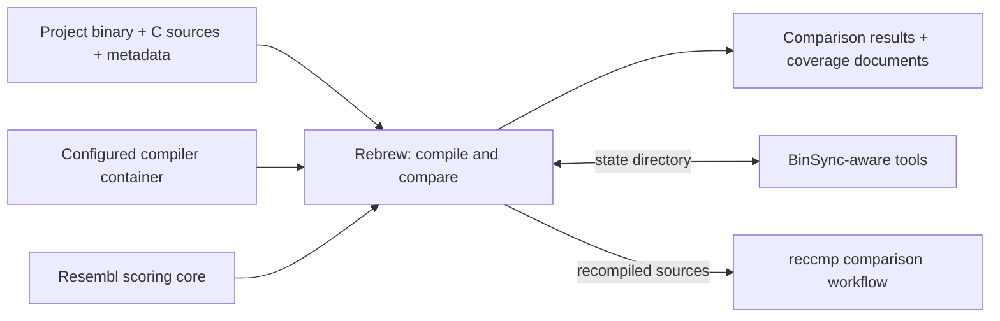
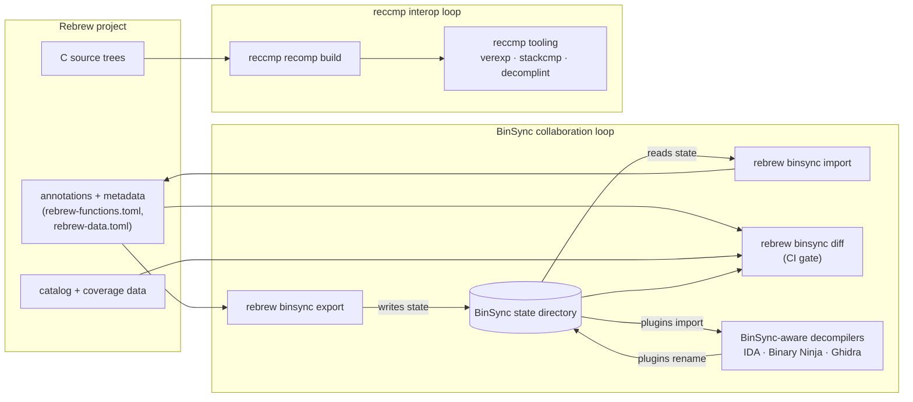

# Rebrew Ecosystem

Rebrew and [Resembl](https://github.com/maci0/resembl) are open-source
projects. This guide describes their public integration boundaries and
interoperability with third-party tools.

For Rebrew's own modules and data flow, see
[ARCHITECTURE.md](ARCHITECTURE.md).

## Component map

## Components

### rebrew: the core workbench (this repo)

Rebrew compiles C source with a configured compiler, compares the result
against a target binary, and records comparison-earned status in managed
metadata. It provides a CLI and Python library for this workflow.

Public outputs include:

- C sources and managed `rebrew-functions.toml` / `rebrew-data.toml` metadata;
- coverage documents described in [COVERAGE_DOCUMENT.md](COVERAGE_DOCUMENT.md);
- comparison results, matching history and generated signatures;
- BinSync state-directory exports for collaboration.

Compiler execution uses configured container images. See
[TOOLCHAIN.md](TOOLCHAIN.md) for setup and image requirements; availability of
a build source or image is separate from Rebrew's source license.

### resembl: assembly similarity search

Standalone CLI/library for finding structurally similar assembly snippets
in a database: normalization lexer (registers → `REG`, immediates → `IMM`),
weighted shingling, MinHash + banded LSH index, and a hybrid
Jaccard + Levenshtein (rapidfuzz) score, plus CFG similarity in `compare`.
Backends: SQLite (default), PostgreSQL, MySQL, DuckDB.

Integration with rebrew is at the package level: the `similarity` dependency
group selects the `resembl` checkout, and rebrew reuses
`resembl/scoring.py` (importable without resembl's DB stack) for the
`verify_results.similarity` column; the structural score verify reports for
every verified function with compiled bytes, matched and unmatched alike (the
neighbouring `diff_lines` is unmatched-only). resembl itself has no rebrew
dependency and keeps its own database.

Boundary with rebrew's own matchers: `resembl` owns the *persisted corpus and
approximate search* case (a snippet library built across projects, near
neighbours, a query that is a fragment of a larger function). rebrew's
`instruction_clones` (`rebrew similarity function --submatch` / `--cluster`) owns the *in-process,
exact, one target* case (where two functions correspond, which functions are
identical after normalization) and keeps no index. Cross-project duplicate
detection belongs on `resembl`; see
[ARCHITECTURE.md](ARCHITECTURE.md#which-similarity-tool) for the full list of
similarity surfaces.

## External interoperability

### reccmp

[reccmp](https://github.com/isledecomp/reccmp) is the binary recompilation
comparison framework from the LEGO Island decomp community: the de-facto
standard toolset for Windows binary-matching decomp projects. It is
an independent project. Rebrew uses dedicated
canonical metadata (functions format 3; data format 2) and optional ADDRESS-only source anchors. It does not read
reccmp marker blocks; a reccmp checkout needs its own compatible identities.

| Boundary | How rebrew interoperates |
|---|---|
| Source identities | Rebrew stores qualified `MODULE.0xVA` rows in managed metadata. Optional ADDRESS comments bind C declarations; inline state and older block formats are rejected. No compatibility parser or migration command is shipped |
| Tool equivalents | rebrew reimplements reccmp's toolset natively: `rebrew build check-exports` = `verexp`, `rebrew diagnose stack` = `stackcmp` (adapted; frames derived from disassembly on both sides instead of a recomp PDB, so it works for MSVC 6.0 whose PDBs `llvm-pdbutil` cannot read), `rebrew lint` = `decomplint`-inspired, `rebrew verify --skip-libraries` = reccmp `--nolib` |
| Match semantics | Verify's *effective match* parity: a delta that is pure register allocation counts as 100%, matching reccmp's effective-match rule (`rebrew diagnose near` reports it as `EFFECTIVE`) |
| Adapted modules | Beyond the tool equivalents, four adaptations from reccmp's source (MIT) remain: pinned-sequence diffing, the jump-swap instruction-equivalence check (in `near_analysis`), and vtordisp/float-const detection; see [RECCMP_ADAPTATIONS.md](RECCMP_ADAPTATIONS.md) |
| Recomp build | rebrew sources build into a reccmp-style recomp binary: `rebrew build round-trip` splices matched functions back into the PE and reports the naked-fenced sources so the reccmp build can compile them with `-DREBREW_ALLOW_NAKED=1` |

### BinSync

[BinSync](https://github.com/binsync/binsync) is the decompilation
community's collaboration framework: a shared state format plus plugins for
IDA Pro, Binary Ninja, and Ghidra that synchronize names, prototypes, types,
locals, and comments between analysts and tools. rebrew bridges to it at the
**state directory** level, serializing artifacts with
[declib](https://github.com/binsync/declib) (BinSync's artifact layer, the
`binsync` extra):

- `rebrew binsync init <state-dir>` creates the git envelope upstream
  requires: the `binsync/__root__` root commit (`.gitignore` +
  `binary_hash`) and a `binsync/<user>` branch.
- `rebrew binsync export <outdir>` writes a BinSync state directory: declib
  `Function` artifacts (one per function, reversed + catalog-only with
  canonical sizes; header, stack vars, and comments included),
  `global_vars.toml`, `structs/`, `enums.toml`, `typedefs.toml`, and
  `metadata.toml`. STATUS is comparison-earned and CFLAGS are local compiler inputs; neither is exported.
- `rebrew binsync import <state-dir>` is the inverse: it reads a state
  directory produced by any BinSync-aware decompiler and applies names,
  prototypes, globals, stack vars, comments, and type definitions back into
  rebrew, with the same conflict resolution as `rebrew sync push`
  (`--accept-binsync` / `--accept-local`, `--module`, `--dry-run`,
  `--create-missing`).
- `rebrew binsync overlay <state-dir>` maps a related target's BinSync data
  onto structurally matched functions of this target (the same code at
  different VAs): names, prototypes, notes, globals by content, and shifted
  stack vars/comments.
- `rebrew binsync diff <state-dir>` is a read-only divergence report (exit
  1 on any divergence, JSON output) for previewing imports and guarding
  sync drift in CI.

BinSync is the *team/tool* boundary, complementary to the Ghidra-only ReVa
MCP bridge (`rebrew sync push`): anything BinSync-aware can consume rebrew's
exports and feed renames back, while the Ghidra bridge stays interactive.
Full details: [BINSYNC_INTEGRATION.md](BINSYNC_INTEGRATION.md).

### Interop flows

Both interop loops in one view: the BinSync collaboration cycle
(export → decompilers → import back, with `rebrew binsync diff` guarding drift)
and the reccmp format interop (sources into the recomp build).

The full external-tools table (decomp.me, LIEF, Capstone, angr, ReVa, and
the adjacent tools) lives in the README's "Ecosystem & Related Tools"
section.

## Public boundary contracts

| Boundary | Contract |
|---|---|
| Compiler execution | Configured container image and compiler inputs; see [TOOLCHAIN.md](TOOLCHAIN.md) |
| Coverage | Rebrew's [coverage document format](COVERAGE_DOCUMENT.md) |
| Similarity | Resembl's scoring core, independent of its database stack |
| Collaboration | BinSync state-directory artifacts |
| Comparison | Recompiled sources and comparison outputs; Reccmp identities remain separate |

## Further reading

- [ARCHITECTURE.md](ARCHITECTURE.md): Rebrew's internal module map and compile loop
- [architecture.drawio](architecture.drawio): public integration and Rebrew data-flow diagrams
- [TOOLCHAIN.md](TOOLCHAIN.md): compiler configuration and image requirements
- [COVERAGE_DOCUMENT.md](COVERAGE_DOCUMENT.md): coverage document format
- [BINSYNC_INTEGRATION.md](BINSYNC_INTEGRATION.md): BinSync state-directory bridge
- [Resembl](https://github.com/maci0/resembl): assembly similarity search
