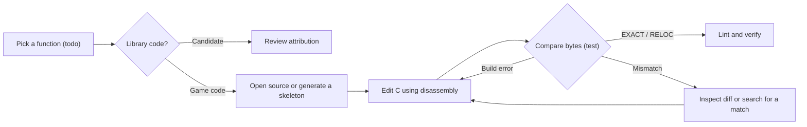

# Decompilation Workflow Guide

Use this guide after [setting up your first project](GETTING_STARTED.md).
For MSVC 6 instruction patterns and SEH helpers, see
[MSVC 6 matching patterns](CODEGEN_PATTERNS.md).

## Iteration Loop



### 1. Pick a function

```bash
rebrew todo
rebrew todo --category start-function    # uncovered functions, ranked by affected extent
rebrew todo --stats              # coverage summary
```

`rebrew todo` ranks work for the selected target. Setup comes first. Within
each priority tier, work is ordered by affected bytes and score. Each item
includes a `command`. See [queue ordering](CLI.md#rebrew-todo).

### 2. Open the source or generate a skeleton

If the function already has a source file, open it. For a function without
source, generate a skeleton:

```bash
rebrew skeleton 0x<VA>
rebrew skeleton 0x<VA> --decomp --decompiler ghidra
rebrew skeleton 0x<VA> --xrefs
```

The command writes C and a metadata binding, then prints the source path
and a test command. See [skeleton options](CLI.md#rebrew-skeleton) for backend details.

To add a function to an existing multi-function file:

```bash
rebrew skeleton 0x<VA> --append existing_file.c
```

### 3. Get the decompilation

With Ghidra + ReVa MCP:

```text
get-decompilation programPath="/target.dll" functionNameOrAddress="0x<VA>"
```

Without Ghidra, use the built-in disassembler.

```bash
rebrew binary asm show 0x<VA> --size <SIZE>
```

For possible library functions, preview attribution before rewriting them.
See [library attribution](GETTING_STARTED.md#5-check-library-attribution).

### 4. Implement the function

Implement the function in the dialect your compiler supports. For MSVC 6, use
C89 and refer to the [compiler-specific patterns](CODEGEN_PATTERNS.md).

### 5. Test the match

```bash
rebrew test src/target_name/my_func.c
```

`test` records the comparison in function metadata. On `EXACT` or `RELOC`,
move to the next function. For a mismatch, inspect the diff. If compilation
or symbol extraction fails, check the compiler output or the source binding.
See [match types](MATCH_TYPES.md) for verdict rules.

`--dry-run` (single-function) compiles and prints the would-be STATUS change
without writing: useful to preview a promotion or a `--force-status` demotion
before applying it. `test --all --dry-run` lists batch candidates without
compiling.

### 6. Inspect byte mismatches

```bash
rebrew diff src/target_name/my_func.c

# Show structural differences and invalid relocation rows
rebrew diff --mismatches-only src/target_name/my_func.c

# VA form works too: resolves to the source file and selects the stored function identity
# whose VA matches (multi-function files: NOT the first function).
rebrew diff 0x10009310
```

**Diff markers:**
- `==` identical bytes
- `~~` relocation-only difference (acceptable)
- `**` structural difference (needs fixing)
- `XX` invalid relocation

### 7. If bytes still differ: sweep flags or run the GA

```bash
# Sweep compiler flag combinations for one function
rebrew match flags src/target_name/my_func.c

# Run the GA over C source variants
rebrew match run src/target_name/my_func.c --generations 100 --pop-size 64

# Batch flag sweep on NEAR_MATCHING functions; update CFLAGS after a confirmed byte match
rebrew match batch --fix-cflags --algorithm flags

# Near-miss batch: focus on NEAR_MATCHING functions with ≤5B delta
rebrew match batch --near-miss --threshold 5
```

| Remaining difference | Try |
| --- | --- |
| Identifier qualifiers affect allocation | `rebrew match qualifiers <file>` |
| Independent statements compile in a different order | `rebrew match climb <file>` |
| Diff grows after an unexpected function boundary | `rebrew diagnose gap <file>` |
| Function bytes match but data addresses differ | `rebrew build check-data-placement` |

### 8. Update metadata

Use `rebrew test --no-promote <file>` to compare without writing a verdict.
When you add or move address anchors, preview their registration with
`rebrew source register --dry-run`, then apply. See
[source bindings and metadata](#source-addresses-and-metadata).

For NEAR_MATCHING functions, auto-classify and write the BLOCKER:

```bash
rebrew diff --fix-blocker src/target_name/my_func.c   # auto-classified
rebrew diagnose near --fix-blocker src/target_name/my_func.c
```

Use a blocker to record what an unfinished function needs, such as a
structure layout or a reference library:

```bash
rebrew blocker set src/target_name/my_func.c "needs RE structs; see rebrew types recover"
rebrew blocker set 0x401000 "needs table layout for local dispatch"
rebrew blocker clear src/target_name/my_func.c          # remove it again
```

The CLI writes blockers in the function store. Use the CLI or metadata API for
changes. See [metadata ownership](METADATA.md).

### 9. If still NEAR_MATCHING: prove semantic equivalence

When the remaining diff is purely structural (register allocation, instruction
reordering), use symbolic execution to verify equivalence:

```bash
rebrew prove src/target_name/my_func.c                # prove and update STATUS → PROVEN
rebrew prove src/target_name/my_func.c --json         # JSON output
rebrew prove src/target_name/my_func.c --dry-run      # preview without updating
rebrew prove my_func --timeout 120                    # allow 2 minutes for complex functions
```

A completed equivalence proof can promote STATUS to `PROVEN`. See the
[proof scope and limits](MATCH_TYPES.md#proven).

> [!NOTE]
> Install the [`prove` extra](../README.md#optional-features) in the
> environment running Rebrew. Contributor environments set up with
> `make setup` already include it.

> [!CAUTION]
> The next byte verdict replaces `PROVEN`. An `EXACT` or `RELOC` result
> clears the blocker when the source is readable and has no inline assembly. `status` counts
> `PROVEN` separately, and `todo` lists it as improve-match work.

### 10. Verify STATUS is current

```bash
rebrew verify  # rechecks tracked functions, reusing unchanged verdicts; auto-updates drifted STATUS
```

The writer preserves parked `SKIP`, `STUB` against `SIZE_MISMATCH` or
`MISSING_SIZE`, and earned `EXACT`, `RELOC`, or `PROVEN` against tooling
failures. See the [verdict writer rules](METADATA.md#who-owns-which-fact).

### 11. Lint source bindings and metadata

```bash
rebrew lint              # check for source bindings, metadata, and project conventions
rebrew coverage catalog --summary # view overall RE progress and stats
```

**Data identity:** each global allocation has one qualified `MODULE.0xVA` row
in `rebrew-data.toml`; its source-binding identity is `file` plus `kind` plus
`name`. Assigning conflicting owners or addresses across files fires lint
**E013** (duplicate VA) and **W021** (duplicate name). Keep the row on the
symbol's home (for example `globals.c`) and leave plain `extern` declarations
elsewhere.

---

## JSON Output for Scripting and CI

Use `--json` on commands that declare it. See [output and exit codes](CLI.md#exit-codes)
for stdout and stderr behavior.

```bash
# Test a function and parse results with jq
rebrew test src/target_name/my_func.c --json | jq '.status'

# Get progress stats as JSON
rebrew todo --stats --json | jq '.coverage.pct_matched'

# List prioritized action items as JSON
rebrew todo --json --limit 10 | jq '.items[] | {category, roi_score, name}'

# List tiny-byte-diff quick wins (fix-delta is ≤20B; this filter narrows to ≤5B)
rebrew todo --category fix-delta --json | jq '.items[] | select(.byte_delta != null and .byte_delta <= 5)'

# Structured diff output
rebrew diff --json src/target_name/my_func.c | jq '.summary'

# Disassembly as JSON
rebrew binary asm show 0x10003da0 --size 160 --json | jq '.instructions[] | .mnemonic'
```

## Working with Multiple Binaries

When a game ships multiple executables or DLLs that share code, rebrew handles them
as **separate targets** inside one project.

Define each binary as its own `[targets.<name>]` section in `rebrew-project.toml`.
Each target gets its own binary path, source directory, function list, and optional
compiler overrides. Global `[compiler]` settings are inherited unless overridden.

See [CONFIG.md](CONFIG.md) for the full `rebrew-project.toml` key reference and
architecture presets.

Tools default to `[project] default_target`, which is required: config load raises
`ConfigKeyError` when it is missing, suggesting the first `[targets.*]` key. Use
`--target` to select another:

```bash
rebrew test --target game_alt src/game_alt/my_func.c
rebrew todo --target game_alt
```

### Sharing code between targets

Keep one C definition under the shared source directory and bind each target
to it at its own VA. Targets can use different preprocessor defines and
compiler flags. See the [shared-source example](CONFIG.md#shared-source-across-targets).

## File Naming Conventions

After `intake`, generated stubs use `fcn_<VA>.c`. For `skeleton`, use the
reported path. You can keep several functions in one file or organize files
by subsystem.

## Source Addresses and Metadata

Function and data metadata use `MODULE.0xVA` keys. Source can carry an
`ADDRESS: MODULE 0xVA` comment immediately above the relevant definition or
variable declaration, with one anchor per target for shared code. Keep
verdicts, sizes, flags, and blockers in the metadata store. Run
`rebrew source register FILE --support "reason"` for addressless helpers.
See [annotation syntax and lint diagnostics](ANNOTATIONS.md).

A multi-function file has several stored rows naming that file. `rebrew source
split` slices the selected C definition, preserves file-scope storage, and
retargets every row bound to that definition. `rebrew source merge` copies
selected definitions and file-scope objects into the output and retargets input
rows. Preview either operation with `--dry-run` and verify affected functions.

---

## See also

- [Configuration](CONFIG.md) and [toolchains](TOOLCHAIN.md)
- [Library identification with FLIRT](FLIRT_SIGNATURES.md)
- [Ghidra and BinSync integration](BINSYNC_INTEGRATION.md)
- [CLI reference](CLI.md)
